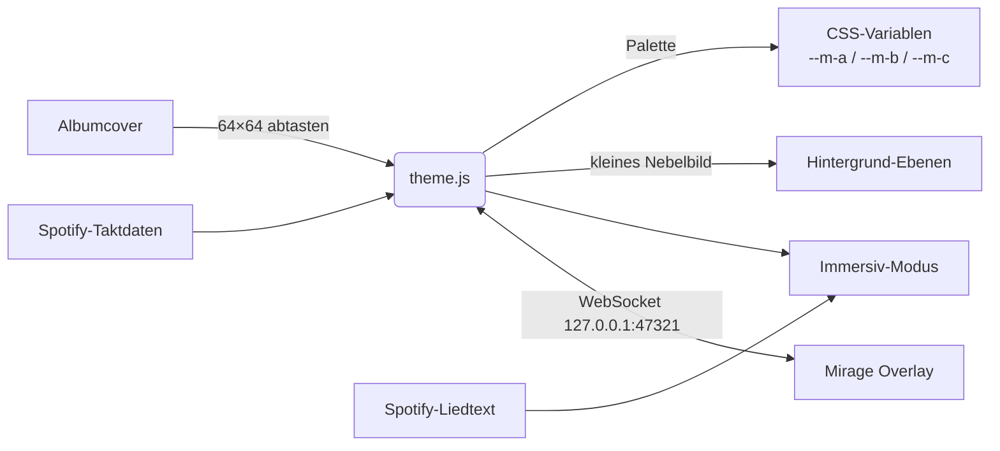

<p align="center">
  
</p>

<p align="center">
  
  
  
  
</p>

<p align="center">
  <a href="README.md">English</a> · <b>Deutsch</b>
  <br><br>
  <a href="#-highlights">Highlights</a> ·
  <a href="#-immersiv-modus">Immersiv-Modus</a> ·
  <a href="#-mirage-overlay">Overlay</a> ·
  <a href="#-farbschemata">Farbschemata</a> ·
  <a href="#-installation">Installation</a> ·
  <a href="#-reparieren-nach-einem-spotify-update">Reparieren nach Updates</a> ·
  <a href="#-einstellungen--tasten">Tasten</a> ·
  <a href="https://github.com/Passimoritz/spicetify-mirage/discussions">Diskussionen</a>
</p>

---

**Mirage** macht aus Spotify mattes Glas, hinter dem die Musik lebt. Jeder Song färbt die Oberfläche in den Farben seines Covers, das Cover treibt als weiches Licht langsam hinter den Flächen, und wenn Spotify Taktdaten liefert, atmet der ganze Hintergrund im Beat.

<p align="center"><a href="https://passimoritz.github.io/spicetify-mirage/"><b>▶ Im Browser ausprobieren</b></a> – ohne Installation: Cover anklicken und zusehen, wie sich die Oberfläche umfärbt.</p>

## 📸 Echte Screenshots

<p align="center">
  
</p>
<table>
  <tr>
    <td width="50%"></td>
    <td width="50%"></td>
  </tr>
  <tr>
    <td align="center"><sub>Albumseite – der Kopf geht weich ins Glas über, kein harter Farbblock</sub></td>
    <td align="center"><sub>Immersiver Visualizer, live in den Coverfarben und im Takt</sub></td>
  </tr>
</table>
<sub>Aufgenommen in einem echten Spotify. Eigene Bibliothek sowie Namen und Bilder von Freunden sind verpixelt.</sub>

## ✦ Highlights

<table>
  <tr>
    <td width="33%" valign="top">
      <h3>🎨 Farben aus dem Cover</h3>
      Akzent, Knöpfe, Fortschritt, Titel und Auswahl nehmen die Palette des Songs an – so gewählt, dass Text auf dunklem Glas lesbar bleibt.
    </td>
    <td width="33%" valign="top">
      <h3>🌫️ Lebendiger Hintergrund</h3>
      Das Cover treibt als langsamer, weicher Nebel hinter der Oberfläche, darüber Aurora-Bänder, schwebender Lichtstaub und Filmkorn.
    </td>
    <td width="33%" valign="top">
      <h3>🥁 Im Takt</h3>
      Mit Spotifys Taktdaten pulsieren Hintergrund, Lichtstaub und Visualizer im Beat. Ohne sie bewegt sich Mirage ruhig und gleichmäßig.
    </td>
  </tr>
  <tr>
    <td valign="top">
      <h3>🃏 3D-Karten</h3>
      Karten neigen sich zum Mauszeiger, ein Lichtkegel und ein leuchtender Rand folgen der Maus.
    </td>
    <td valign="top">
      <h3>✨ Seiten-Animationen</h3>
      Seiten blenden weich ein, Raster fallen kaskadenartig herein, Titelzeilen gleiten nacheinander herein. Der laufende Song leuchtet im Farbstrom.
    </td>
    <td valign="top">
      <h3>💿 Vinyl & Details</h3>
      Das Cover im Player wird zur drehenden Platte, der Play-Knopf bekommt einen kreisenden Lichtring, beim Liken gibt es eine Herz-Explosion.
    </td>
  </tr>
</table>

## ◐ Immersiv-Modus

<kbd>Strg</kbd> + <kbd>Umschalt</kbd> + <kbd>M</kbd> oder der Kreis-Knopf oben. Drei Ansichten, die ineinander übergehen:

<p align="center"></p>

| Ansicht | Was du bekommst |
|---|---|
| **Cover** | Riesiges Cover, das sich mit der Maus neigt, Titel im Farbverlauf, Fortschritt, volle Steuerung |
| **Liedtext** | Spotifys synchronisierter Liedtext, die aktuelle Zeile leuchtet in der Mitte – Klick auf eine Zeile springt dorthin |
| **Visualizer** | Kreisförmiges Spektrum um das runde Cover, Ringe auf jedem Schlag – mit Spotifys Audioanalyse, sonst ruhige Bewegung |

Steuerung: Zufall, Zurück, Wiedergabe/Pause, Weiter, Wiederholen (auch einen Song), Liken, Lautstärke + Stumm, Vollbild.

## ◎ Mirage Overlay

Eine kleine Begleit-App, die Songwechsel **außerhalb von Spotify** anzeigt – über allen Fenstern, auf dem Bildschirm deiner Wahl. Das Theme spricht lokal mit ihr (`127.0.0.1:47321`), nichts verlässt deinen Rechner.

<p align="center"></p>

- **Wann:** bei jedem Songwechsel, dauerhaft als Mini-Player oder aus · auf Wunsch auch bei Wiedergabe/Pause · Ruhezeiten (z. B. 22:00–07:00)
- **Wo:** Hauptbildschirm, der Bildschirm mit der Maus oder jeder Bildschirm direkt auf einer Karte deiner Monitore · 9 Positionen · Feinabstand
- **Wie:** Insel, Karte, Banner oder Minimal · federnd, gleitend oder überblendend · Hintergrund aus dem Cover / dunkel / hell · Leuchten, Rundung, Größe, Deckkraft · Überschrift, Album, Zeit, Fortschrittsbalken
- **Steuerung beim Überfahren:** Zurück · Wiedergabe/Pause · Weiter direkt im Overlay
- Läuft im Infobereich, startet auf Wunsch mit Windows und spricht die Sprache, die Spotify nutzt

## ◑ Farbschemata

<p align="center"></p>

`Mirage` folgt live dem Cover. Die anderen vier sind feste Paletten für einen ruhigeren Look.

## ⬇ Installation

### Spicetify Marketplace

**Marketplace → Themes** öffnen, nach **Mirage** suchen, installieren. Fertig.

> Der Marketplace zeigt nur **öffentliche** Repos mit dem Thema `spicetify-themes`.

### Von Hand (Windows)

```powershell
git clone https://github.com/Passimoritz/spicetify-mirage
cd spicetify-mirage
powershell -ExecutionPolicy Bypass -File install.ps1            # nur Theme
powershell -ExecutionPolicy Bypass -File install.ps1 -Overlay   # Theme + Overlay-App
```

Farbschema wählen mit `-Scheme Obsidian` (oder `Sakura`, `Abyss`, `Ember`).

### Deinstallieren

```bash
spicetify config current_theme marketplace
spicetify apply
```

## 🛠 Reparieren nach einem Spotify-Update

Spotify aktualisiert sich alle paar Wochen still im Hintergrund und überschreibt dabei die Dateien, die Spicetify verändert hat. Das merkst du so:

- Spotify sieht plötzlich wieder aus wie normales Spotify – kein Mirage, kein Marketplace, keine Erweiterungen
- `spicetify apply` bricht ab mit *„backup version mismatch“*, *„Spotify version and backup version are mismatched“* oder *„Cannot find xpui.spa“*
- Spotify zeigt direkt nach dem Start ein schwarzes oder weißes Fenster

Kaputt ist nichts – Spicetify muss die neue Spotify-Version nur noch einmal anpassen.

### Mit einem Klick (Windows)

<a href="https://github.com/Passimoritz/spicetify-mirage/releases/latest/download/fix-spicetify.cmd"><b>⬇ fix-spicetify.cmd herunterladen</b></a> · <sub><a href="tools/fix-spicetify.cmd">vorher den Inhalt ansehen</a></sub>

Nach jedem Spotify-Update einfach doppelklicken. Das Script schließt Spotify, aktualisiert Spicetify, verwirft die veraltete Sicherung, legt eine frische vom neuen Spotify an, wendet Mirage und deine Erweiterungen wieder an und startet Spotify. Einstellungen, Theme und Marketplace-Inhalte bleiben erhalten.

> Windows warnt eventuell, weil die Datei aus dem Internet kommt: **Weitere Informationen → Trotzdem ausführen**. Es ist ein reines Text-Script – du kannst es im Editor öffnen und jede Zeile lesen.

Es ist auf Dauer gebaut: Es nutzt nur Befehle, die jede Spicetify-Version 2.x kennt (`upgrade`, `restore`, `backup`, `apply`, `clear`), findet Spicetify auch, wenn es nicht im `PATH` steht, läuft mit und ohne Adminrechte und sagt dir Bescheid, wenn du die Microsoft-Store-Version von Spotify nutzt (die kann Spicetify nicht verändern – installiere Spotify dann von spotify.com).

### Von Hand (Windows, macOS, Linux)

```bash
spicetify upgrade
spicetify restore backup apply
```

Klappt es immer noch nicht? Alte Sicherung löschen und neu versuchen:

```bash
spicetify clear
spicetify backup apply
```

### Wenn eine ganz neue Spotify-Version noch nicht unterstützt wird

Direkt nach einem großen Spotify-Release braucht Spicetify manchmal ein paar Tage – `apply` schlägt dann auch nach den Schritten oben fehl. Warte auf den nächsten [Spicetify-Release](https://github.com/spicetify/cli/releases) und starte die Reparatur noch einmal: Sie holt das neue Spicetify automatisch. Sieht in Mirage nach einem Update etwas falsch aus, eröffne ein Issue mit dem [Formular für Spotify-Updates](https://github.com/Passimoritz/spicetify-mirage/issues/new/choose) – es fragt genau die Versionen ab, die für eine schnelle Lösung nötig sind.

## ⌨ Einstellungen & Tasten

Profilmenü → **Mirage-Einstellungen**: Farben aus dem Cover, Lichtstaub, Hintergrund im Takt, Seiten-Animationen, Vinyl, 3D-Karten, Herz-Explosion, Overlay-Verbindung, Filmkorn, echtes Glas, ruhiger Modus, Unschärfe und Helligkeit.

| Wo | Taste | Aktion |
|---|---|---|
| überall | <kbd>Strg</kbd>+<kbd>Umschalt</kbd>+<kbd>M</kbd> | Immersiv-Modus öffnen / schließen |
| immersiv | <kbd>1</kbd> <kbd>2</kbd> <kbd>3</kbd> | Cover · Liedtext · Visualizer |
| immersiv | <kbd>Leertaste</kbd> | Wiedergabe / Pause |
| immersiv | <kbd>←</kbd> <kbd>→</kbd> | 5 s spulen |
| immersiv | <kbd>↑</kbd> <kbd>↓</kbd> | Lautstärke |
| immersiv | <kbd>L</kbd> <kbd>S</kbd> <kbd>R</kbd> <kbd>F</kbd> | Liken · Zufall · Wiederholen · Vollbild |
| immersiv | <kbd>N</kbd> <kbd>P</kbd> | Weiter · Zurück |
| immersiv | <kbd>Esc</kbd> | Vollbild verlassen / schließen |

## ⚡ Leistung

Mirage soll lebendig wirken, ohne den Prozessor aufzufressen. Kommende **Leistungsstufen** in den Mirage-Einstellungen bestimmen, wie viel davon du willst:

| Stufe | Was du bekommst |
|---|---|
| **Voll** | Alles an – echtes Glas mit Live-Unschärfe hinter jeder Fläche, Lichtstaub, Beat-Hintergrund, 3D-Karten |
| **Ausgewogen** | Der volle Look mit leichteren Effekten – der beste Kompromiss für die meisten PCs |
| **Leicht** | Ersetzt die Live-Glasunschärfe durch durchscheinende Flächen und dünnt den Hintergrund aus – für Laptops und ältere Grafikkarten |

- **Automatisch herunterschalten:** Laufen die ersten Sekunden nach dem Start unter ~45 fps, wechselt Mirage von selbst auf die nächstleichtere Stufe.
- **Pause im Hintergrund:** Ist Spotify minimiert, ruhen die Effekte – nichts läuft unbemerkt weiter.
- **Ruhemodus folgt dem System:** Ist im Betriebssystem *Bewegung reduzieren* eingeschaltet, startet Mirage im Ruhemodus.

### Mirage vs. ein typisches statisches Theme

| | Mirage | Typisches statisches Theme |
|---|:---:|:---:|
| Farben folgen dem Albumcover | ✓ | ✗ fest |
| Lebendiger Hintergrund | ✓ | ✗ |
| Bewegung im Takt | ✓ | ✗ |
| Immersive Lyrics + Visualizer | ✓ | ✗ |
| Desktop-Overlay | ✓ | ✗ |
| Leistungsstufen | ✓ | ✗ |
| 14 Sprachen | ✓ | ✗ fest |

## 🌍 Sprachen

English, Deutsch, Français, Español, Italiano, Português, Nederlands, Polski, Türkçe, Русский, Українська, 日本語, 한국어 und 中文 – jede andere Sprache fällt auf Englisch zurück. Mirage findet Spotifys Bedienelemente über sprachunabhängige Merkmale und funktioniert deshalb in jeder Spotify-Sprache.

## ⚙ So funktioniert es



- **Leistung zuerst:** Farben wechseln in einem einzigen Schritt, der Hintergrund ist ein verkleinertes Bild, das einmal verwischt und nur noch gedreht wird, und er pausiert, solange der Immersiv-Modus ihn verdeckt. Echtes Glas (Live-Unschärfe hinter jeder Fläche) ist optional.
- **Gegen das echte Spotify gebaut:** Aktuelle Spotify-Versionen haben `.Root__main-view` & Co. in `#main-view` / `#Desktop_LeftSidebar_Id` umbenannt; Mirage spricht beide an. Farbblöcke im Kopf (auch `::after`-Verläufe und `oklch()`-Farben) erkennt Mirage am berechneten Stil statt an Klassennamen, die sich bei jedem Update ändern.
- **Diagnose:** Läuft das Overlay, kann das Theme einen Aufbau-Bericht (Größen, Klassen, Farben – keine Inhalte) nach `%APPDATA%\Mirage Overlay\dom-report.json` schicken. So werden Darstellungsfehler nach Fakten behoben statt geraten.
- **Datenschutz:** kein eigener Server, kein Tracking. Liedtext und Taktdaten kommen von Spotify selbst, Schriften von Google Fonts.
- **Barrierefreiheit:** beachtet „Bewegung reduzieren“, sichtbare Fokusrahmen, lesbarer Kontrast in jeder Palette.

## Lizenz

MIT © Passimoritz
