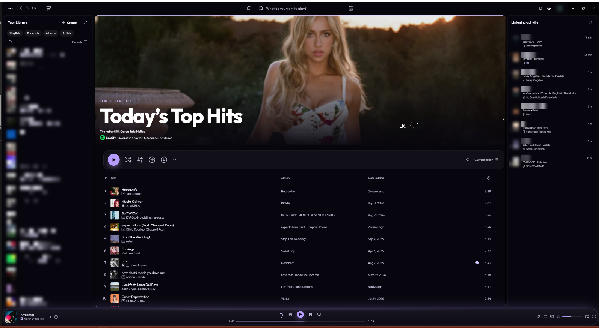
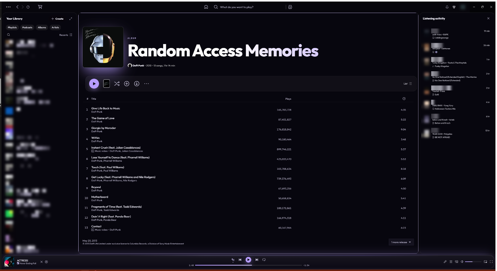
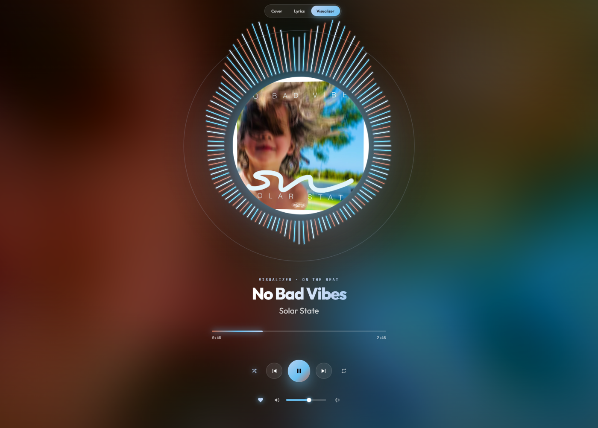
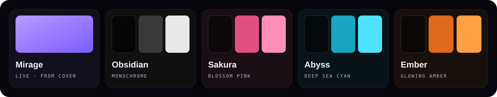
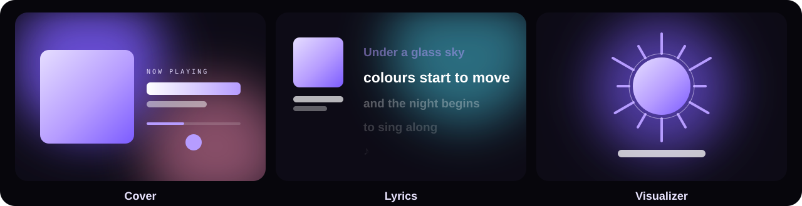
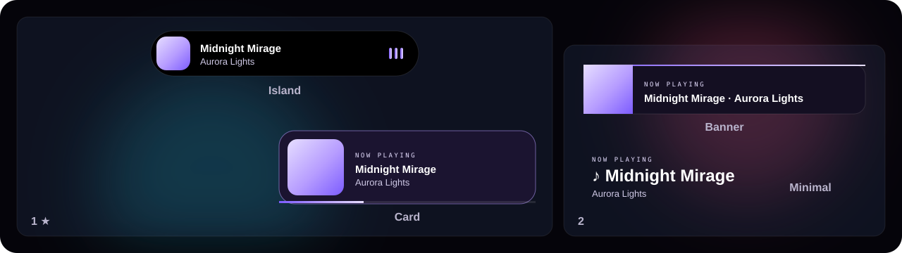
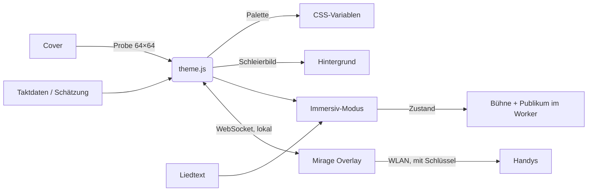

<p align="center">
  
</p>

<p align="center">
  <a href="#-installation"></a>
  
  
  
</p>

<p align="center">
  <a href="README.md">English</a> · <b>Deutsch</b>
  <br><br>
  <a href="#-installation">Installation</a> ·
  <a href="#-was-es-kann">Funktionen</a> ·
  <a href="#-immersiv-modus">Immersiv</a> ·
  <a href="#-party-modus">Party</a> ·
  <a href="#-mirage-overlay">Overlay</a> ·
  <a href="#-reparieren-nach-einem-spotify-update">Reparieren nach Updates</a> ·
  <a href="#-tasten">Tasten</a> ·
  <a href="#-häufige-fragen">FAQ</a>
</p>

---

**Mirage macht aus Spotify mattes Glas, hinter dem die Musik lebt.** Jeder Song färbt die Oberfläche in den Farben seines Covers, das Cover treibt als weiches Licht hinter den Flächen, und der Hintergrund atmet im Takt. Mit <kbd>Strg</kbd>+<kbd>Umschalt</kbd>+<kbd>M</kbd> wird Spotify zur Vollbild-Bühne – Liedtext, Visualizer oder eine Party-Lichtshow, die weiß, wo der Drop kommt.

<p align="center"><a href="https://passimoritz.github.io/spicetify-mirage/"><b>▶ Im Browser ausprobieren</b></a> – ohne Installation: Cover anklicken und zusehen, wie sich die Oberfläche umfärbt.</p>

<p align="center">
  
</p>
<table>
  <tr>
    <td width="50%"></td>
    <td width="50%"></td>
  </tr>
  <tr>
    <td align="center"><sub>Albumseite – der Kopfbereich verschmilzt mit dem Glas</sub></td>
    <td align="center"><sub>Immersiver Visualizer, live in den Farben des Covers</sub></td>
  </tr>
</table>
<sub>Echte Spotify-Installation. Eigene Bibliothek und Namen von Freunden sind verpixelt.</sub>

## ⬇ Installation

**Marketplace (am einfachsten):** **Marketplace → Themes** öffnen, nach **Mirage** suchen, installieren. Fertig.

**Windows per Skript:**

```powershell
git clone https://github.com/Passimoritz/spicetify-mirage
cd spicetify-mirage
powershell -ExecutionPolicy Bypass -File install.ps1            # nur das Theme
powershell -ExecutionPolicy Bypass -File install.ps1 -Overlay   # Theme + Overlay-App
```

Mit `-Scheme Obsidian` (oder `Sakura`, `Abyss`, `Ember`) gibt es ein festes Farbschema.

<details>
<summary><b>macOS / Linux / von Hand</b></summary>

```bash
cp -r Mirage "$(dirname "$(spicetify -c)")/Themes/"
spicetify config current_theme Mirage color_scheme Mirage inject_css 1 replace_colors 1 inject_theme_js 1
spicetify apply
```
</details>

<details>
<summary><b>Deinstallieren</b></summary>

```bash
spicetify config current_theme marketplace
spicetify apply
```
</details>

Eingestellt wird alles unter **Profilmenü → Mirage-Einstellungen**. Jeder Effekt, der hier beschrieben ist, lässt sich dort abschalten.

## ✦ Was es kann

<table>
  <tr>
    <td width="33%" valign="top">
      <h3>🎨 Farben aus dem Cover</h3>
      Akzent, Knöpfe, Fortschrittsbalken und Auswahl übernehmen die Palette des Songs – so abgestimmt, dass Text auf dunklem Glas lesbar bleibt.
    </td>
    <td width="33%" valign="top">
      <h3>🌫️ Lebendiger Hintergrund</h3>
      Das Cover treibt als langsamer Schleier hinter der Oberfläche, darüber Polarlicht-Bänder, Lichtstaub und Filmkorn.
    </td>
    <td width="33%" valign="top">
      <h3>🥁 Im Takt</h3>
      Mit Spotifys Taktdaten pulsieren Hintergrund und Lichtstaub im Beat. Fehlen sie, schätzt Mirage das Tempo selbst.
    </td>
  </tr>
  <tr>
    <td valign="top">
      <h3>🃏 3D-Karten</h3>
      Karten neigen sich zum Mauszeiger, mit Lichtkegel und leuchtender Kante, die der Maus folgen.
    </td>
    <td valign="top">
      <h3>✨ Bewegte Seiten</h3>
      Seiten blenden weich ein, Raster und Titelzeilen gleiten nacheinander herein; die laufende Zeile leuchtet.
    </td>
    <td valign="top">
      <h3>💿 Kleinigkeiten</h3>
      Das Cover im Player dreht sich wie eine Schallplatte, der Play-Knopf bekommt einen Lichtkranz, ein Like löst einen Herzregen aus.
    </td>
  </tr>
</table>

**Farbschemata:** `Mirage` folgt live dem Cover; `Obsidian`, `Sakura`, `Abyss` und `Ember` sind feste Paletten für einen ruhigeren Look, und in den Einstellungen gibt es einen Baukasten für eigene.

<p align="center"></p>

## ◐ Immersiv-Modus

<kbd>Strg</kbd>+<kbd>Umschalt</kbd>+<kbd>M</kbd> oder der Kreis-Knopf oben in der Leiste. Fünf Ansichten gehen ineinander über (Tasten <kbd>1</kbd>–<kbd>5</kbd>):

<p align="center"></p>

| Ansicht | Was du bekommst |
|---|---|
| **Cover** | Riesiges Cover, das sich mit der Maus neigt, Titel im Farbverlauf, alle Bedienelemente |
| **Liedtext** | Synchroner Liedtext, Karaoke Wort für Wort, Klick auf eine Zeile springt dorthin, Übersetzung auf Wunsch |
| **Visualizer** | Kreisförmiges Spektrum um das Cover mit Ringen im Takt |
| **Mix** | Cover, Visualizer-Kranz und Liedtext zugleich – der Puls folgt der echten Kick |
| **Party** | Eine Lichtshow, gebaut für den Song – [siehe unten](#-party-modus) |

**Kein Liedtext bei Spotify?** Mirage sucht bei [LRCLIB](https://lrclib.net), NetEase und lyrics.ovh; *Fassung wählen* nimmt einen anderen Treffer. **Keine Taktdaten?** Mirage holt Tempo und Energie aus Spotifys Audio-Merkmalen oder von Deezer und schätzt den Takt aus dem Timing des Liedtexts – oben steht dann *≈ 128 BPM*.

Vollbild per Knopf, <kbd>F</kbd> oder <kbd>F11</kbd>. Ruht die Maus, blenden die Bedienelemente aus.

## 🎉 Party-Modus

Der Party-Modus liest den ganzen Song, bevor er läuft: Energiekurve, Aufbauten, Drops (auf ihren Schlag gelegt), Breaks, Dur oder Moll und wo Kick, Snare und Hi-Hats sitzen. Nach dieser Karte wird das Licht inszeniert – es reagiert auf das, was kommt, nicht nur auf das, was gerade laut ist.

**Zwanzig Genres, jedes mit eigener Lichtsprache.** Rave bekommt sich kreuzende Strahlen, Techno weiche Scanner-Bänder, House eine Discokugel, Trance Polarlicht-Bänder, Drum & Bass einen Tunnel aus Lichtringen, Hip-Hop Licht vom Boden, Rock harte Spots von oben, Metal glühend rote, Latin warme Schwenks, Pop federnde Farbe, Chill langsam atmendes Licht – dazu Disco, K-Pop, Reggae, Klassik, Punk, Hardstyle, Afro, Jazz und Country. Das Genre kommt aus Apples iTunes-Suche, Spotifys Künstler-Genres und dem Klang selbst.

**Es folgt den Instrumenten.** Die Kick treibt Puls und Bodenlicht, die Snare Spots und Blitze, die Hi-Hats das Funkeln; zwei dünne *Melodie-Laser* folgen der Tonhöhe der Melodie.

**Es inszeniert Momente.**
- **Lichtregie** – Ruhe vor dem Sturm: vor dem Drop hält sich das Licht zurück, auf dem letzten Schlag wird es dunkel, dann schlägt alles auf einmal ein. Der letzte Refrain bekommt am meisten.
- **Zeitlupe** – Funken, Ringe und Publikum erstarren eine halbe Sekunde direkt vor dem Drop.
- **DJ-Übergänge** – beim Songwechsel bleiben die alten Farben bis zum ersten Schlag und gehen dann über vier Schläge in die neuen über.

**Ein Publikum und eine Location.** Silhouetten vor der Bühne bewegen sich passend zum Genre – sie springen und landen auf dem Schlag, nicken, headbangen, klatschen auf 2 und 4, schunkeln –, starten ab und zu eine La-Ola-Welle, nehmen jemanden auf die Schultern und zücken beim Drop die Handykameras. Die Location richtet sich nach dem Genre (Club, Festival, Stadion oder Wohnzimmer) oder wird in den Einstellungen festgelegt.

**Fünf Stärken** von *Sanft* bis *Wahnsinn*. Dazu, jeweils abschaltbar: Hype-Zeilen für Refrains und Mitsing-Rufe, 3D-Tiefe, Kamerafahrten, Liedtext-Funken beim Drop, Jam-Farben für alle in einem Spotify-Jam und sich selbst ausblendende Bedienelemente.

**Noch mehr:**

| | |
|---|---|
| 🎬 **10-Sekunden-Clip** | Nimmt den Visualizer mit Cover und Liedzeile als stummes WebM-Video auf – fertig zum Teilen |
| 📱 **Live-Link** | Handys im selben WLAN scannen einen QR-Code und blitzen als zusätzliche Lichter mit (braucht die Overlay-App) |
| 🖥️ **Zweiter Bildschirm** | Legt den Party-Modus im Vollbild auf einen Fernseher oder anderen Monitor |
| 🌈 **Kantenlicht** | Die Overlay-App lässt die Ränder deines Desktops im Takt leuchten |
| 📊 **Party-Rückblick** | Eine teilbare Karte der Nacht: Songs, Genre-Mischung, Tempo-Spanne, der größte Drop |

## ◎ Mirage Overlay

Eine kleine Begleit-App, die Songwechsel **außerhalb von Spotify** zeigt – über allen Fenstern, auf dem Bildschirm deiner Wahl. Das Theme spricht lokal mit ihr (`127.0.0.1:47321`).

<p align="center"></p>

| Windows | macOS | Linux |
|:-:|:-:|:-:|
| [**⬇ Mirage-Overlay-Setup.exe**](https://github.com/Passimoritz/spicetify-mirage/releases/latest/download/Mirage-Overlay-Setup.exe) | [**⬇ Mirage-Overlay.dmg**](https://github.com/Passimoritz/spicetify-mirage/releases/latest/download/Mirage-Overlay.dmg) | [**⬇ AppImage**](https://github.com/Passimoritz/spicetify-mirage/releases/latest/download/Mirage-Overlay.AppImage) · [**⬇ .deb**](https://github.com/Passimoritz/spicetify-mirage/releases/latest/download/Mirage-Overlay.deb) |
| Doppelklick – startet und wohnt im Infobereich | In *Programme* ziehen | AppImage ausführbar machen, oder `sudo apt install ./Mirage-Overlay.deb` |

Oder in Spotify: **Mirage-Einstellungen → Overlay → Overlay-App herunterladen** (nimmt die passende Datei und zeigt, ob die App verbunden ist).

- **Wann:** bei jedem Songwechsel, dauerhaft als Mini-Player oder aus · bei Play/Pause · Ruhezeiten
- **Wo:** Hauptbildschirm, Bildschirm mit der Maus oder jeder Bildschirm auf einer Karte deiner Displays · 9 Positionen · Feinversatz
- **Wie:** Insel, Karte, Banner oder Minimal · federnd, gleitend oder blendend · Leuchten, Rundung, Größe, Deckkraft · Steuerung beim Drüberfahren
- **Extras:** Lautstärke-Leiste · bleibt still, solange ein Spiel oder Video im Vollbild läuft · eigener Look per `custom.css` · OBS-Browserquelle (`http://127.0.0.1:47322/`) · Kantenlicht und Live-Link für den Party-Modus · aktualisiert sich selbst (Windows, AppImage)

> **Erster Start:** Die Installer sind noch nicht signiert. Windows: *Weitere Informationen → Trotzdem ausführen*. macOS: Rechtsklick → *Öffnen* → *Öffnen*. Beim Einschalten des Live-Links fragt Windows einmal, ob die App im privaten Netzwerk erreichbar sein darf.

## 🛠 Reparieren nach einem Spotify-Update

Spotify aktualisiert sich alle paar Wochen und überschreibt, was Spicetify angepasst hat. Woran man es merkt: Spotify sieht wieder aus wie normales Spotify, `spicetify apply` meldet einen *backup version mismatch* oder *Cannot find xpui.spa*, oder das Fenster bleibt schwarz. Kaputt ist nichts – Spicetify muss nur neu anpassen.

**Ein Klick (Windows):** <a href="https://github.com/Passimoritz/spicetify-mirage/releases/latest/download/fix-spicetify.cmd"><b>⬇ fix-spicetify.cmd</b></a> · <sub><a href="tools/fix-spicetify.cmd">Quelltext lesen</a></sub> – schließt Spotify, aktualisiert Spicetify, legt ein frisches Backup an, wendet Mirage und deine Erweiterungen wieder an und startet Spotify neu. Einstellungen und Marketplace-Inhalte bleiben erhalten. (Windows warnt evtl.: *Weitere Informationen → Trotzdem ausführen* – es ist ein reines Text-Skript.)

**Von Hand (alle Systeme):**

```bash
spicetify upgrade
spicetify restore backup apply
```

Klappt es immer noch nicht? `spicetify clear` und danach `spicetify backup apply`. Direkt nach einer großen Spotify-Version braucht Spicetify manchmal ein paar Tage – auf die nächste [Spicetify-Version](https://github.com/spicetify/cli/releases) warten und die Reparatur erneut starten. Sieht Mirage selbst falsch aus, hilft das [Fehlerformular für Spotify-Updates](https://github.com/Passimoritz/spicetify-mirage/issues/new/choose).

## ⌨ Tasten

| Wo | Taste | Aktion |
|---|---|---|
| überall | <kbd>Strg</kbd>+<kbd>Umschalt</kbd>+<kbd>M</kbd> | Immersiv-Modus öffnen / schließen |
| immersiv | <kbd>1</kbd> … <kbd>5</kbd> | Cover · Liedtext · Visualizer · Mix · Party |
| immersiv | <kbd>Leertaste</kbd> | Play / Pause |
| immersiv | <kbd>←</kbd> <kbd>→</kbd> · <kbd>↑</kbd> <kbd>↓</kbd> | 5 s spulen · Lautstärke |
| immersiv | <kbd>N</kbd> <kbd>P</kbd> | nächster · vorheriger Song |
| immersiv | <kbd>L</kbd> <kbd>S</kbd> <kbd>R</kbd> <kbd>Q</kbd> | Like · Zufall · Wiederholen · Warteschlange |
| immersiv | <kbd>F</kbd> / <kbd>F11</kbd> | Vollbild |
| immersiv | <kbd>?</kbd> · <kbd>Esc</kbd> | alle Tasten · schließen |

## ⚡ Leistung

Mirage soll lebendig aussehen, ohne den Rechner aufzufressen.

- **Voreinstellungen:** *Voll*, *Ausgewogen*, *Leicht* und *Ruhig* in den Einstellungen. Laufen die ersten Sekunden unter ~45 fps, schaltet Mirage selbst eine Stufe herunter.
- **Party passt sich an:** Bühne und Publikum werden in einem Hintergrund-Thread gezeichnet, eine Qualitätsregelung dünnt Details aus, bevor Bilder ausfallen, und ruhige Intros und Breaks laufen mit 30 fps.
- **Energiesparen:** im Akkubetrieb (oder auf Wunsch immer) läuft alles mit 30 fps und leichteren Details.
- **Pausiert im Hintergrund** und startet im ruhigen Modus, wenn dein System weniger Bewegung wünscht.

## 🔒 Datenschutz

Kein eigener Server, kein Tracking, kein Konto. Liedtext, Taktdaten und Audio-Merkmale kommen von Spotify. Nur wenn Spotify nichts hat: Titel, Interpret, Album und Länge gehen für Liedtexte an LRCLIB, NetEase und lyrics.ovh, Titel und Interpret für das Tempo an Deezer und für das Party-Genre an Apples iTunes-Suche – alles abschaltbar. Die Overlay-App lauscht nur auf deinem eigenen Rechner; der Live-Link (standardmäßig aus) öffnet eine Seite im lokalen Netz, geschützt durch einen Zufallsschlüssel in der Adresse, die nur Lichtfarben und den Songtitel bekommt. Schriften kommen von Google Fonts.

## ❓ Häufige Fragen

<details>
<summary><b>Nach einem Spotify-Update ist Mirage weg.</b></summary>

[Reparatur](#-reparieren-nach-einem-spotify-update) starten – das liegt an Spicetify, nicht an Mirage.
</details>

<details>
<summary><b>Der Party-Modus erkennt das falsche Genre.</b></summary>

Den Stil in **Mirage-Einstellungen → Party-Modus** von Hand wählen, oder bei *Auto* bleiben und *Genre online nachschlagen* einschalten.
</details>

<details>
<summary><b>Die Handy-Seite öffnet sich nicht.</b></summary>

Handy und PC müssen im selben WLAN sein (kein Gästenetz), die Overlay-App muss laufen, und Windows muss sie im privaten Netzwerk durchgelassen haben. Live-Link in den Einstellungen aus- und wieder einschalten gibt einen frischen QR-Code.
</details>

<details>
<summary><b>Das ist mir zu viel / mein Laptop wird warm.</b></summary>

Voreinstellung *Leicht* oder *Ruhig* wählen, Energiesparen auf *Immer* stellen oder die Party-Stärke senken. Jeder Effekt hat seinen eigenen Schalter.
</details>

## ⚙ Unter der Haube



- Farben wechseln in einem einzigen Stil-Update; der Hintergrundschleier ist ein vorab verkleinertes Bild, einmal weichgezeichnet und nur noch gedreht.
- Gebaut gegen das echte Spotify-DOM und erkannt am berechneten Stil statt an Klassennamen, die sich mit jeder Version ändern.
- Läuft die Overlay-App, kann das Theme einen Aufbaubericht (Größen, Klassen, Farben – keine Inhalte) nach `%APPDATA%\Mirage Overlay\dom-report.json` schreiben, für Fehlermeldungen.
- 14 Sprachen: English, Deutsch, Français, Español, Italiano, Português, Nederlands, Polski, Türkçe, Русский, Українська, 日本語, 한국어, 中文.

Mithelfen? Siehe [CONTRIBUTING.md](CONTRIBUTING.md) und den [Changelog](CHANGELOG.md). Fragen und Ideen gehören in die [Diskussionen](https://github.com/Passimoritz/spicetify-mirage/discussions).

## Lizenz

MIT © Passimoritz
