<p align="center">
  
</p>

<p align="center">
  <a href="README.md">English</a> · <b>Deutsch</b>
</p>

<p align="center">
  <a href="#-in-2-minuten-installiert"></a>
  <a href="https://github.com/Passimoritz/spicetify-mirage/releases/latest"></a>
  
  
</p>

<h3 align="center">Mirage färbt Spotify in den Farben deiner Musik<br>und macht deinen Bildschirm zur Bühne mit Karaoke, Lichtshow und Partyspielen.</h3>

<p align="center">
  <a href="#-in-2-minuten-installiert"></a>
  <a href="#-was-mirage-kann"></a>
  <a href="#-party-mit-freunden"></a>
</p>

<p align="center">
  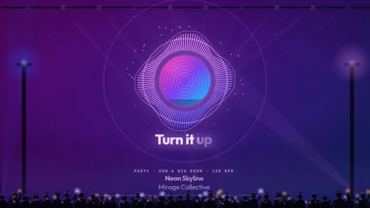
</p>

<p align="center"><a href="https://passimoritz.github.io/spicetify-mirage/"><b>▶ Farben im Browser ausprobieren</b></a> – ohne Installation.</p>

---

## 📦 In 2 Minuten installiert

**Bevor du startest:** Du brauchst die normale Spotify-App für den Computer von [spotify.com/download](https://www.spotify.com/de/download/). Öffne sie einmal und melde dich an.
Unter Windows funktioniert die Version aus dem Microsoft Store nicht, unter Linux nicht die Snap-Version.

Mirage nutzt **Spicetify** (ein kostenloses Werkzeug, mit dem Spotify Themes laden kann). Hast du es noch nicht, richtet der Installer es für dich ein.

### Windows

1. Drück die **Windows-Taste**, tippe **PowerShell** und öffne es (das normale, nicht „als Administrator“).
2. Kopiere diese Zeile, füge sie ins blaue Fenster ein (Rechtsklick fügt ein) und drück **Enter**:

   ```powershell
   iwr -useb https://raw.githubusercontent.com/Passimoritz/spicetify-mirage/main/install.ps1 | iex
   ```

3. Warte etwa eine Minute. Spotify schließt sich und startet von selbst neu.
4. Steht da in Grün **„Mirage is installed.“**, bist du fertig.

### Mac und Linux

1. Öffne das **Terminal** (Mac: <kbd>Cmd</kbd>+<kbd>Leertaste</kbd>, *Terminal* tippen, Enter).
2. Kopiere diese Zeile, füge sie ein und drück **Enter**:

   ```bash
   curl -fsSL https://raw.githubusercontent.com/Passimoritz/spicetify-mirage/main/install.sh | bash
   ```

3. Warte etwa eine Minute. Spotify startet neu.
4. Steht da in Grün **„Mirage is installed.“**, bist du fertig.

> **Gut zu wissen:** Der Installer macht nur vier Dinge: Er installiert Spicetify, falls es fehlt, kopiert die Mirage-Dateien, stellt Spotify auf Mirage um und startet Spotify neu. Du kannst ihn jederzeit nochmal ausführen, zum Beispiel für ein Update. Seine Meldungen sind auf Englisch.

**Du nutzt schon den Spicetify Marketplace?** Öffne **Marketplace → Themes**, such nach **Mirage** und klick auf *Install*.

### Deine ersten Schritte

- Drück <kbd>Strg</kbd>+<kbd>Umschalt</kbd>+<kbd>M</kbd> (oder den Kreis-Knopf oben), um die Vollbild-Bühne zu öffnen.
- Alle Einstellungen findest du im **Profilmenü** (dein Bild oben rechts) **→ Mirage-Einstellungen**.

<details>
<summary><b>Bei der Installation ging etwas schief</b></summary>

- **„You are using the Microsoft Store version of Spotify“** – deinstalliere sie, hol dir Spotify von [spotify.com](https://www.spotify.com/de/download/windows/), öffne es einmal und füge die Zeile nochmal ein.
- **„Spotify is installed as a Snap“** (Linux) – genauso: Snap entfernen, Spotify von spotify.com oder Flathub installieren.
- **„spicetify apply failed“** – das passiert meist direkt nach einem Spotify-Update. Siehe [Hilfe nach einem Spotify-Update](#-hilfe-nach-einem-spotify-update).
- **„not on the PATH yet“** – Fenster schließen, ein neues öffnen und die Zeile nochmal einfügen.
- **Linux: keine Schreibrechte für Spotifys Ordner** – der Installer zeigt dir den genauen Befehl, der das behebt.
- Der Installer für Mac und Linux ist neu. Klappt er bei dir nicht, folge der [Anleitung von Spicetify](https://spicetify.app/docs/getting-started) und installiere Mirage dann über den Marketplace.
</details>

<details>
<summary><b>Mirage wieder entfernen</b></summary>

Ein anderes Theme wählst du unter **Marketplace → Themes**. Um Spotify genau so zurückzusetzen, wie es war, gib das in PowerShell oder im Terminal ein:

```bash
spicetify restore
```
</details>

## ✨ Was Mirage kann

### Spotify in den Farben deiner Musik

<p align="center">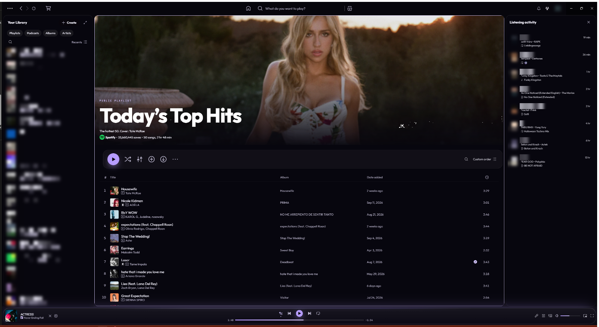</p>

<table>
  <tr>
    <td width="50%">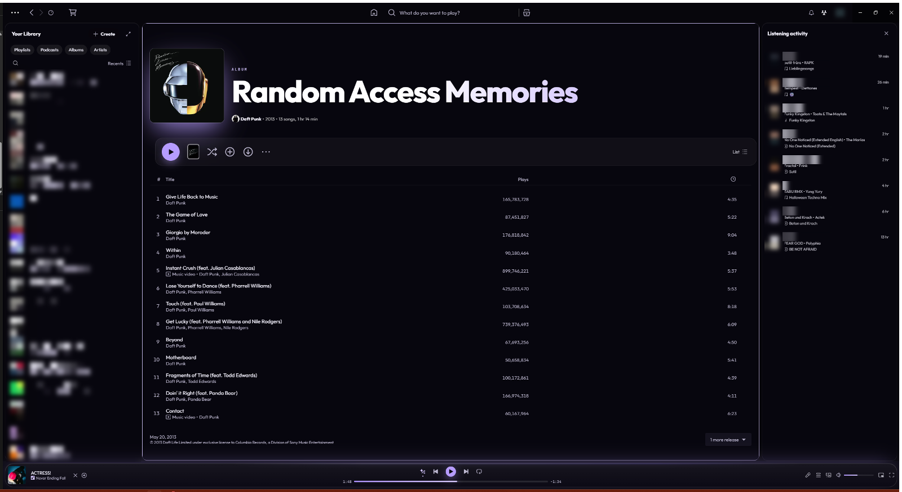</td>
    <td width="50%">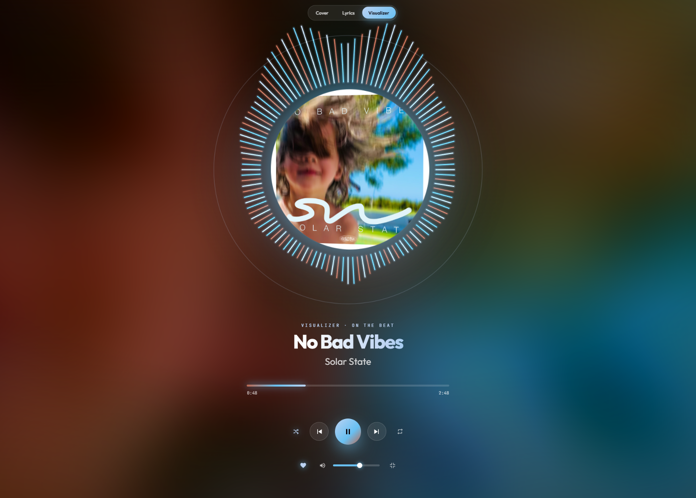</td>
  </tr>
  <tr>
    <td align="center"><sub>Jedes Album bekommt eigene Farben</sub></td>
    <td align="center"><sub>Der Visualizer in den Farben des Covers</sub></td>
  </tr>
</table>

- **Farben aus dem Cover** – jeder Song färbt Knöpfe, Balken und Markierungen neu, immer gut lesbar.
- **Ein lebendiger Hintergrund** – das Cover schwebt hinter dem Glas und atmet im Takt.
- **Sechs Farbschemata** – *Mirage* folgt dem Cover; *Obsidian*, *Sakura*, *Abyss* und *Ember* sind ruhige dunkle, *Pearl* ist hell. Oder du baust dir dein eigenes.

<p align="center">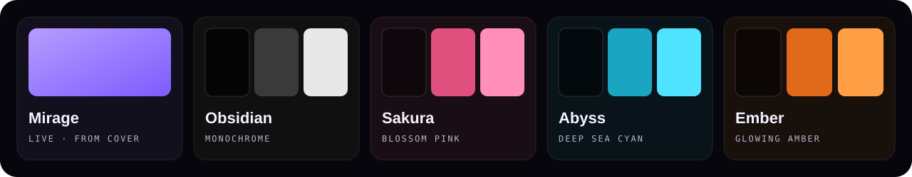</p>

### Eine Vollbild-Bühne

Drück <kbd>Strg</kbd>+<kbd>Umschalt</kbd>+<kbd>M</kbd>. Mit <kbd>1</kbd> bis <kbd>5</kbd> wechselst du zwischen fünf Ansichten.

<table>
  <tr>
    <td width="33%">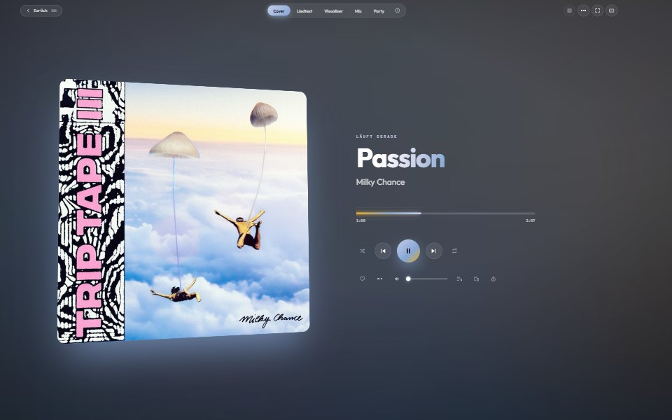</td>
    <td width="33%">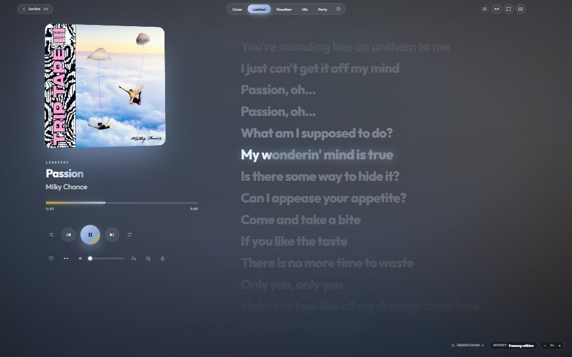</td>
    <td width="33%">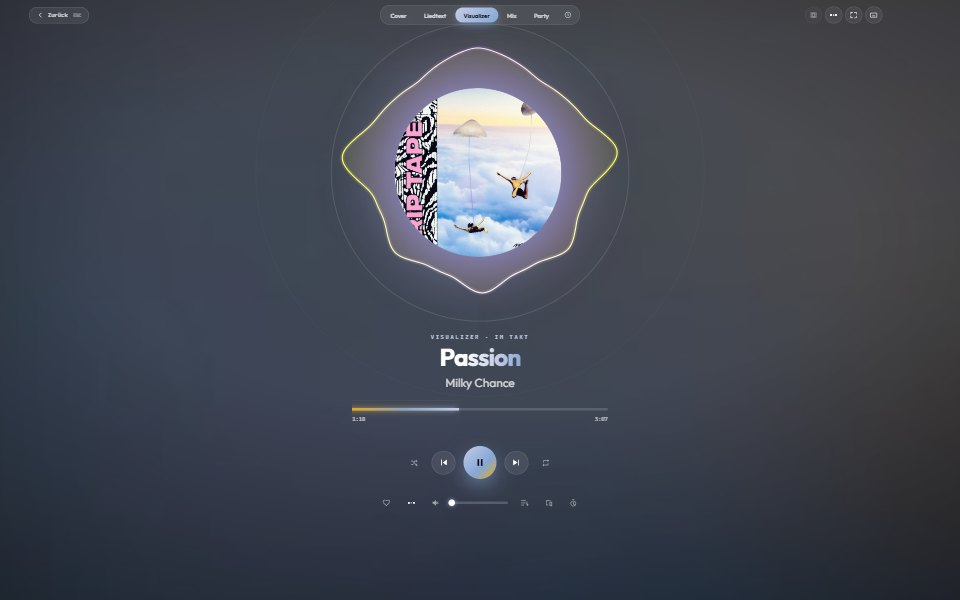</td>
  </tr>
  <tr>
    <td align="center"><b>1 · Cover</b></td>
    <td align="center"><b>2 · Liedtext</b></td>
    <td align="center"><b>3 · Visualizer</b></td>
  </tr>
  <tr>
    <td>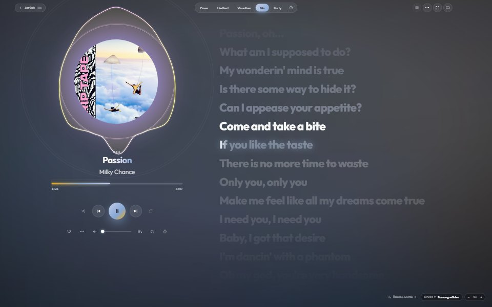</td>
    <td>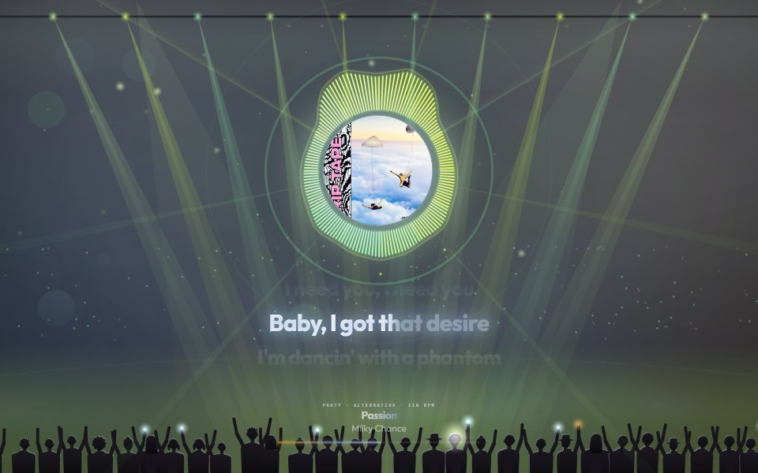</td>
    <td>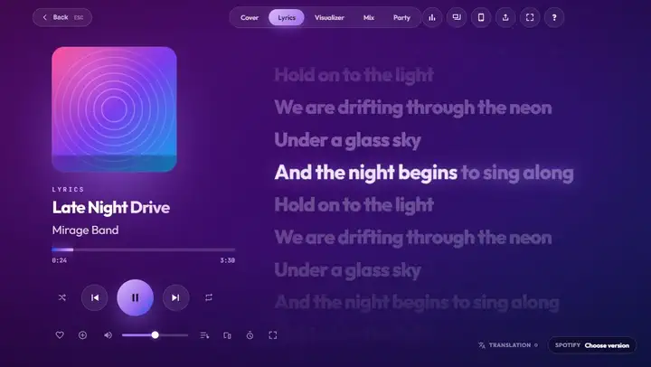</td>
  </tr>
  <tr>
    <td align="center"><b>4 · Mix</b></td>
    <td align="center"><b>5 · Party</b></td>
    <td align="center"><b>Karaoke</b> – füllt sich beim Singen</td>
  </tr>
</table>

- **Liedtext für fast jeden Song** – hat Spotify keinen, sucht Mirage gleichzeitig in mehreren freien Liedtext-Sammlungen und legt ihn von selbst passend auf den Gesang.
- **Karaoke Wort für Wort** – die Buchstaben füllen sich genau dann, wenn sie gesungen werden.
- **Übersetzung und lateinische Buchstaben** unter dem Liedtext, wenn du magst (zum Beispiel unter Koreanisch, Japanisch, Chinesisch, Russisch, Griechisch oder Hindi).
- **Falscher Liedtext?** Ein Klick auf *Nicht der richtige Liedtext* probiert den nächstbesten.
- **Elf Visualizer-Stile**, von einfachen Balken bis zu Galaxie oder 3D-Tunnel.

### Eine Lichtshow, die den Song kennt

<table>
  <tr>
    <td width="50%">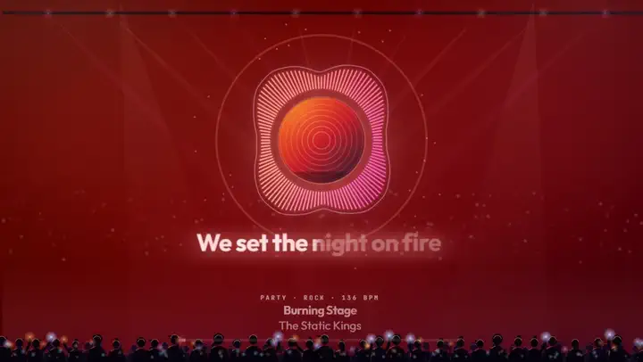</td>
    <td width="50%">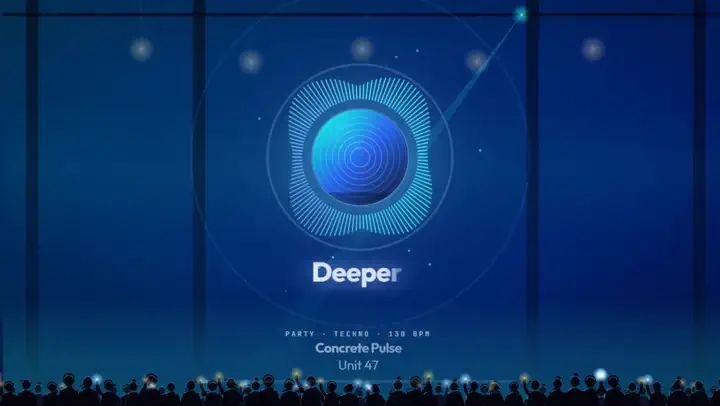</td>
  </tr>
  <tr>
    <td align="center"><sub><b>Rock · Stadion</b> – Flammen beim Drop</sub></td>
    <td align="center"><sub><b>Techno · Lagerhalle</b> – Laser und Lauflichter</sub></td>
  </tr>
  <tr>
    <td>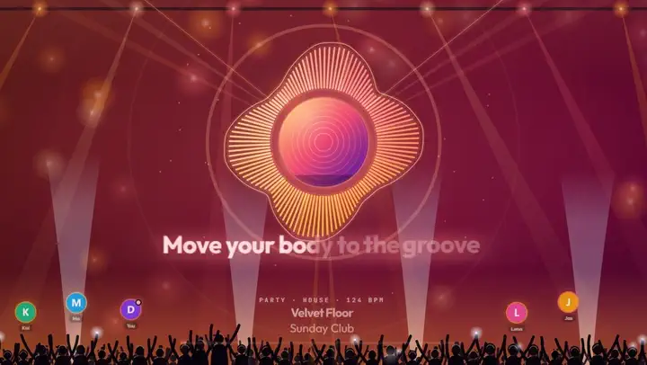</td>
    <td>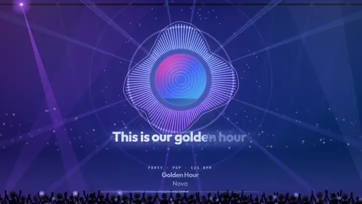</td>
  </tr>
  <tr>
    <td align="center"><sub><b>House · Club</b> – Discokugel und Lichtwellen</sub></td>
    <td align="center"><sub><b>Pop · Stadion</b> – Feuerwerk zum letzten Refrain</sub></td>
  </tr>
</table>
<sub>Aufgenommen mit dem echten Theme und ausgedachten Demo-Songs.</sub>

Der Party-Modus hört sich den ganzen Song an, **bevor** er läuft. Er weiß, wo der Refrain beginnt und wo der Drop kommt, und plant das Licht für jeden Teil.

- **Folgt der Stimmung** – ein euphorischer Drop, eine zarte Pause und eine traurige Bridge bekommen jeweils eigene Farben und ein eigenes Tempo. Die Szenen wechseln während des Songs, immer im Takt.
- **318 Musikstile** – Techno bekommt Laser-Scanner, House eine Discokugel, Rock harte Spots, Balladen ein Lichtermeer aus Handys. Mirage erkennt den Stil selbst, oder du wählst ihn.
- **17 Orte** – Club, Lagerhalle, Festival, Stadion, Strand, Wohnzimmer, Dachterrasse, Kathedrale, Jazz-Bar, Waldbühne, Konzertsaal, Gewölbekeller, Weltall, Neon-Straße, Pub, Skihütte und Wüstennacht.
- **Ein Publikum, das mittanzt** – Sprünge auf dem Schlag, Hände hoch im Refrain, Feuerzeuge bei Balladen.
- **Instrumente bekommen ihren Moment** – nennen die Song-Credits Trompete, Saxofon, Gitarre, Klavier, Streicher, Chor und ein paar mehr, bekommt das Instrument einen eigenen Effekt. Außerdem hört Mirage die 30-s-Hörprobe des Songs (nur gerechnet, nie abgespielt): Kick, 808, Hi-Hats, Gitarren, Klavier, Streicher, Flächen und Soundeffekte wie Riser, Einschläge, Stopps oder Sirenen bekommen eigenes Licht – nur wenn Mirage sicher ist.
- **Fünf Stärken** von *Sanft* bis *Wahnsinn*. Das Bild zoomt nie und keine Kamera fährt.

<p align="center">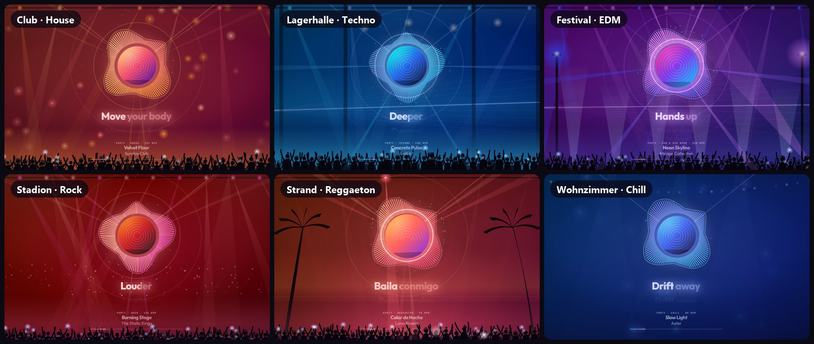</p>
<p align="center">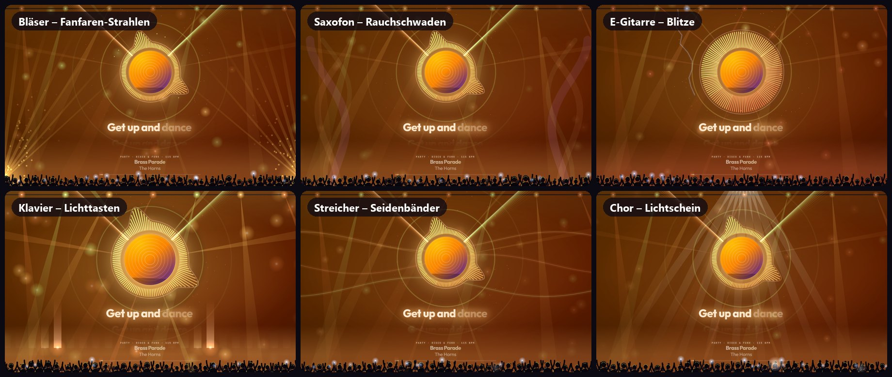</p>

<details>
<summary><b>Alle 318 Stile in 17 Familien</b></summary>

| Familie | Stile |
|---|---|
| Elektronisch (51) | Rave · EDM & Big Room · Electro House · Progressive House · Future & Slap House · House · Deep House · Tropical House · Tech House · Bass House · Acid House · Chicago & Classic House · French House · Nu-Disco · UK Garage · Jersey Club · Techno · Minimal & Microhouse · Detroit Techno · Dub Techno · Melodic Techno · Hard Techno · EBM & Industrial Dance · Trance · Progressive Trance · Uplifting & Vocal Trance · Psytrance · Drum & Bass · Liquid Drum & Bass · Neurofunk · Jungle · Breakbeat · Footwork & Juke · Electro & Miami Bass · Dubstep · Festival Trap · Future Bass · Moombahton · Hardstyle · Gabber & Hardcore · Happy Hardcore · Eurodance · Eurobeat · Hands Up · Italo Disco · Synthwave · Darksynth · Vaporwave · Hyperpop · Chiptune & 8-Bit · Electro Swing |
| Hip-Hop & R&B (28) | Hip-Hop · Boom Bap · Gangsta- & Hardcore-Rap · West Coast & G-Funk · Southern Hip-Hop & Crunk · Alternativer & Underground-Hip-Hop · Trap · Pop-Rap & Melodic Rap · Cloud Rap · Drill · Phonk · UK-Rap · Grime · Deutschrap · Französischer Rap · Italienischer Rap · Spanischer Rap · Russischer Rap · Türkischer Rap · Arabischer & Maghreb-Rap · Brasilianischer Hip-Hop & Trap · R&B · Alternative R&B · New Jack Swing · Soul & Funk · Neo-Soul · Northern & Classic Soul · Funk |
| Rock (28) | Rock · Classic Rock · Rock ’n’ Roll & Rockabilly · Hard Rock · Glam Rock · Blues Rock · Southern Rock · Psychedelic Rock · Stoner & Desert Rock · Progressive & Art Rock · Krautrock · Surf Rock · Garage Rock · Alternative · Grunge · Indie · Britpop & UK-Indie · Shoegaze & Dream Pop · Post-Punk & Darkwave · Post-Rock · Folk Rock · Soft Rock & Yacht Rock · Deutschrock · Punk · Pop-Punk · Hardcore Punk · Post-Hardcore & Screamo · Emo |
| Metal (17) | Metal · Heavy Metal & NWOBHM · Thrash Metal · Glam & Hair Metal · Power Metal · Symphonic & Gothic Metal · Progressive Metal & Djent · Doom & Sludge · Death Metal · Black Metal · Grindcore & Powerviolence · Groove & Alternative Metal · Metalcore · Deathcore · Nu Metal & Rap Metal · Industrial Metal & NDH · Folk & Viking Metal |
| Pop (11) | Pop · Dance-Pop · Electropop · Synth-Pop & New Wave · Teenie-Pop & Boybands · Pop-Rock & Power-Pop · Indie-Pop & Bedroom-Pop · Art-Pop & Chamber-Pop · Disco & Funk · Ballade · Musical |
| Asien (33) | K-Pop · K-Indie · K-Rock · K-Hip-Hop · K-R&B · Trot · J-Pop & Anime · J-Rock & Visual Kei · J-Hip-Hop · Anime & Anisong · Vocaloid & Utaite · City Pop · Shibuya-kei · Enka & Kayōkyoku · Traditionelle japanische Musik · C-Pop · Mandopop · Cantopop · Chinesischer Hip-Hop · Traditionelle chinesische Musik · T-Pop · Luk Thung & Mor Lam · V-Pop · OPM & P-Pop · Dangdut & Indo-Pop · Gamelan & südostasiatische Tradition · Bollywood · Südindische Filmmusik · Punjabi & Bhangra · Desi-Hip-Hop · Hindustanische Klassik · Karnatische Klassik · Qawwali & Sufi |
| Lateinamerika (29) | Latin · Latin-Pop · Reggaeton · Latin Trap · Dembow · Bachata · Merengue · Salsa & Tropical · Son & Trova (Kuba) · Bolero & Balada · Cumbia · Vallenato · Tango · Mariachi & Ranchera · Regional Mexican · Banda · Norteño & Tejano · Corridos & Sierreño · Rock en Español · Anden-Musik & Folklore · Brasilianisch · Samba · Pagode · Axé & Frevo · Forró & Piseiro · Sertanejo · Funk Carioca & Baile Funk · MPB · Bossa Nova |
| Afrika & Karibik (21) | Afrobeats · Afrobeat & Afro-Funk · Highlife & Hiplife · Amapiano · Gqom · Afro House · Bongo Flava & Ostafrika · Soukous & kongolesische Rumba · Kuduro · Kizomba & Semba · Desert Blues · Reggae · Roots Reggae & Lovers Rock · Dub · Rocksteady · Ska · Dancehall · Soca · Calypso & Steelpan · Zouk · Kompa |
| Naher Osten & Nordafrika (14) | Arabisch · Arabischer Pop · Khaleeji · Tarab & arabische Klassik · Raï · Gnawa & Chaabi · Dabke · Mahraganat & Shaabi · Türkischer Pop · Arabesk & türkische Volksmusik · Anatolischer Rock · Persischer Pop · Persische Klassik · Mizrahi & israelischer Pop |
| Europa (19) | Schlager · Après-Ski & Ballermann · Volksmusik & Alpenländisches · Polka & Blasmusik · Karneval & Levenslied · Deutschpop & NDW · Chanson & Variété · Canzone & Italo-Pop · Europop & Eurovision · Disco Polo · Russischer Pop & Estrada · Griechisch: Laïko & Rebetiko · Fado · Flamenco · Balkan · Turbo-Folk · Chalga & Manele · Klezmer · Irisch & keltisch · Nordischer Folk |
| Country & Folk (10) | Country & Folk · Klassischer & Outlaw-Country · Country-Pop · Country-Rock & Red Dirt · Americana & Alt-Country · Bluegrass & Old-Time · Cajun & Zydeco · Folk · Indie-Folk & Folk-Pop · Akustik |
| Jazz & Blues (17) | Jazz · New Orleans & Dixieland · Swing & Big Band · Bebop & Hard Bop · Cool & West Coast Jazz · Modal & Spiritual Jazz · Free & Avantgarde-Jazz · Vocal Jazz & Standards · Latin Jazz · Gypsy-Jazz (Manouche) · Jazz-Fusion & Jazz-Funk · Acid Jazz · Nu Jazz & UK-Jazz · Smooth Jazz · Blues · Delta & Acoustic Blues · Electric & Chicago Blues |
| Gospel & Spirituelles (7) | Gospel · Christlicher Pop & CCM · Worship & Lobpreis · Christlicher Rock & Metal · Christlicher Hip-Hop · Bhajan · Kirtan & Mantra · Nasheed & islamische Musik |
| Klassik & Filmmusik (12) | Klassik · Barock & Alte Musik · Wiener Klassik · Romantik · Oper & Operette · Chor & geistliche Musik · Kammermusik · Orchester & Sinfonik · Minimal Music · Neue Musik · Film & Epik · Videospielmusik |
| Ruhig & klassisch (10) | Chill · Lo-Fi · Downtempo & Chillout · Trip-Hop · Easy Listening & Lounge · Ambient · New Age & Heilmusik · Meditation & Yoga · Schlaf & Naturklänge · Neoklassik |
| Experimentell (5) | Experimentell & Avantgarde · IDM & Glitch · Industrial & Power Electronics · Noise & Noise-Rock · Dark Ambient & Drone |
| Kinder, Feiertage & Gesprochenes (6) | Weihnachten · Halloween · Kindermusik · Disney & Familienfilm · Comedy & Spaßlieder · Wortbeitrag & Podcast |
</details>

## 🎉 Party mit Freunden

<p align="center">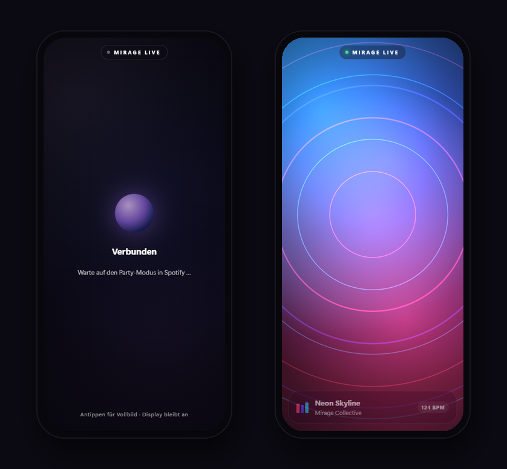</p>

Deine Gäste machen mit dem Handy mit. **Keine App, kein Konto** – WLAN oder mobile Daten reichen.

1. Schalte unter **Mirage-Einstellungen → Party-Modus** den **Live-Link fürs Handy** ein.
2. Öffne den Party-Modus (<kbd>Strg</kbd>+<kbd>Umschalt</kbd>+<kbd>M</kbd>, dann <kbd>5</kbd>) und klick oben auf den **QR-Code**-Knopf.
3. Die Gäste scannen den Code mit der Handykamera, wählen **Namen und Farbe** – fertig.

**Was Gäste am Handy machen können**

- 💡 **Mitleuchten** – das Handy blinkt in den Farben des Songs; als *Lichtwelle* leuchten die Handys nacheinander.
- 🎤 **Mitsingen** – die aktuelle Liedzeile, groß und gut lesbar.
- 🎵 **Songs wünschen** – suchen wie in Spotify oder einen Spotify-Link einfügen; die anderen stimmen ab. Du entscheidest, was läuft, oder Songs kommen ab genug Stimmen von selbst in die Warteschlange.
- 🔥 **Reaktionen schicken** – Emojis steigen leise am Rand des großen Bildschirms auf.
- 📸 **Foto-Wand** (aus, bis du sie einschaltest) – Gäste schicken ein Foto; es erscheint erst, wenn du es freigibst.
- 📱 Die Handy-Seite spricht **14 Sprachen** und lässt sich wie eine App auf den Startbildschirm legen. Android-Handys vibrieren im Takt.

**Zwei extra QR-Codes, nur für dich**

- **Fernbedienung für dein Handy** (in den Party-Einstellungen): Wiedergabe, Lautstärke, Lichtstärke, Ort und Spiele vom Sofa aus.
- **Spielleitung am Handy** (im Spiele-Feld): Spiele starten, überspringen und beenden, Punkte korrigieren. Gäste können das nicht.

### 26 Partyspiele

Klick im Party-Modus auf den **Spiele**-Knopf. Der große Bildschirm zeigt Fragen und Punkte, alle antworten am eigenen Handy.
Spielt allein, gegeneinander oder in **2 bis 4 Teams**, oder als **Turnier** aus 3 bis 6 Spielen mit Siegertreppchen.

| | Ein paar Lieblinge |
|:-:|---|
| 🎶 | **Karaoke** – einer singt, sein Handy gibt Punkte für Timing, Töne und Dabeisein. Die Aufnahme verlässt das Handy nie. |
| 🎱 | **Musik-Bingo** – jedes Handy bekommt eine eigene Karte mit Songtiteln. |
| 🖼️ | **Cover-Rätsel** – ein verpixeltes Albumcover wird langsam scharf. Wer erkennt es zuerst? |
| ⚔️ | **Song-Duell** – der Raum stimmt ab, welcher von zwei Songs bleibt. |
| 📅 | **Älter oder jünger?** – welcher von zwei Songs ist zuerst erschienen? |

<details>
<summary><b>Alle 26 Spiele</b></summary>

- **Musik-Quiz:** Wer singt hier? · Wie heißt der Song? · Intro-Blitz · Liedtext-Lücken · Nächste Zeile · Echt oder Fake? · Beat-Treffer · Älter oder jünger? · Cover-Rätsel · Song-Duell
- **Schnelle Finger:** Musik-Stopp · Schnellster Finger · Tipp-Rennen · Tanz-Battle · Heiße Kartoffel
- **Party:** Wer würde am ehesten …? · Sing weiter · Karaoke · Turnier · Musik-Bingo · Glücksrad
- **Trinkspiele (ab 18, nur wenn ihr Lust habt; Wasser zählt auch):** Ich hab noch nie · Schluck-Quiz · Wort-Alarm · Wer würde … (Schluck-Ausgabe) · Schluck-Rad

Quizze gibt es leicht, normal oder schwer, mit Jahrzehnt-Filter oder einer deiner Playlists, und wer später kommt, kann noch einsteigen und behält seine Punkte.
**Keine Handys?** Zahlentasten antworten, <kbd>Leertaste</kbd> ist der Buzzer, <kbd>Enter</kbd> startet. Nach einem Spiel kannst du die Rangliste als Bild speichern.
</details>

**Mehr für die Party:** ein DJ-Feld, das deine Warteschlange so sortiert, dass die Stimmung fließt, Gäste aus deinem Spotify Jam tanzen im Publikum, Konfetti auf <kbd>C</kbd>, und ein Rückblick auf den Abend, den du als Playlist speichern kannst.

## 💡 Overlay-App

<p align="center">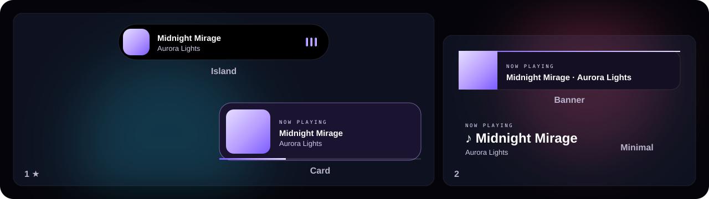</p>

Eine kleine kostenlose Zusatz-App. Sie zeigt den laufenden Song **über allen Fenstern**, auch beim Arbeiten oder Spielen, und verbindet Mirage mit den Lampen in deinem Zimmer.

| Windows | Mac | Linux |
|:-:|:-:|:-:|
| [**⬇ Mirage-Overlay-Setup.exe**](https://github.com/Passimoritz/spicetify-mirage/releases/latest/download/Mirage-Overlay-Setup.exe) | [**⬇ Mirage-Overlay.dmg**](https://github.com/Passimoritz/spicetify-mirage/releases/latest/download/Mirage-Overlay.dmg) | [**⬇ AppImage**](https://github.com/Passimoritz/spicetify-mirage/releases/latest/download/Mirage-Overlay.AppImage) · [**⬇ .deb**](https://github.com/Passimoritz/spicetify-mirage/releases/latest/download/Mirage-Overlay.deb) |
| Doppelklick zum Installieren. Sie sitzt dann neben der Uhr. | In *Programme* ziehen. | AppImage ausführbar machen oder die .deb öffnen. |

- 🪟 **Song-Einblendungen** in acht Stilen, auf dem Bildschirm und an der Stelle, die du magst.
- 💡 **Die Lampen im Zimmer tanzen mit** – Philips Hue (mit einem neuen, noch experimentellen schnellen Modus für *Hue Entertainment*), WLED, Govee, Nanoleaf, LIFX, Yeelight, Home Assistant, OpenRGB und Razer Chroma. Beim ersten Start sucht die App deine Lampen für dich. Du kannst eine Höchst-Helligkeit festlegen und das Timing je Lampe feinjustieren. Die Passwörter deiner Lampen werden verschlüsselt gespeichert.
- 📺 **Party auf dem Fernseher** – schick die Party an Chromecast, Google TV oder einen Smart-TV.
- 🌈 **Kantenlicht** – die Ränder deines Bildschirms leuchten im Takt.
- 🛠️ **Repariert Mirage für dich** – nach einem Spotify-Update bietet das Menü der App (neben der Uhr, am Mac oben in der Menüleiste) *Theme in Spotify reparieren* an, und sie sagt dir, wenn eine neue Mirage-Version bereitsteht.
- 🎛️ **Stream Deck** – [⬇ Mirage.streamDeckPlugin](https://github.com/Passimoritz/spicetify-mirage/releases/latest/download/Mirage.streamDeckPlugin) legt Abspielen, Weiter, Like und Party-Modus auf Tasten. Für Streamer gibt es außerdem eine Quelle für OBS.

> **Windows meldet „Der Computer wurde durch Windows geschützt“?** Die App ist noch nicht signiert ([warum](CODE_SIGNING.md)). Klick auf *Weitere Informationen → Trotzdem ausführen*.
>
> **Der Mac sagt, die App kann nicht geöffnet werden?** Rechtsklick auf die App → *Öffnen* → *Öffnen*.

## ⚙️ Einstellungen kurz erklärt

Öffne dein **Profilmenü → Mirage-Einstellungen**. Jeder Effekt hat einen eigenen Schalter, und jeder Bereich lässt sich einzeln zurücksetzen.

- **Aussehen & Leistung** – ein Klick für *Voll*, *Ausgewogen*, *Leicht* oder *Ruhig*. Kommt dein Computer nicht hinterher, schaltet Mirage selbst eine Stufe runter.
- **Schnellmenü** – auf der Vollbild-Bühne <kbd>O</kbd> drücken (oder den **⋯**-Knopf), um Aussehen und Leistung zu ändern, ohne die Musik zu verlassen.
- **Energiesparen** – im Akkubetrieb zeichnet Mirage weniger und spart Strom.
- **Keine Blitze** – für empfindliche Augen: kein Stroboskop, kein blendendes Licht, keine plötzlichen Blitze, auch nicht auf den Handys der Gäste und bei den Lampen im Raum. Schaltet sich von selbst ein, wenn dein Computer auf „Bewegung reduzieren“ steht.
- **Licht und Liedtext zu früh oder zu spät?** Drück sechsmal <kbd>T</kbd> im Takt. Mirage misst die Verzögerung deiner Lautsprecher (Bluetooth bringt etwas mit).

<details>
<summary><b>Party-Einstellungen ansehen</b></summary>
<p align="center">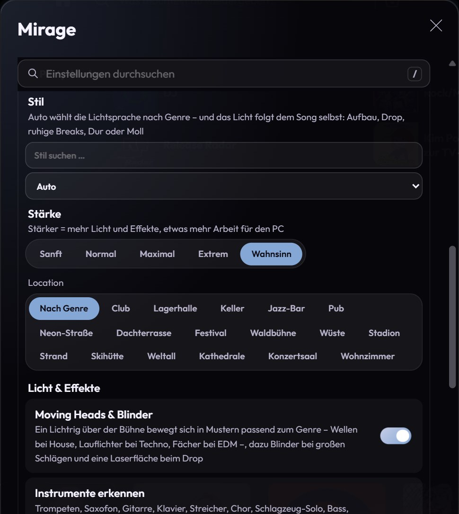</p>
</details>

## 🔧 Hilfe nach einem Spotify-Update

Spotify aktualisiert sich alle paar Wochen selbst. Manchmal ist Mirage danach weg, oder Spotify bleibt schwarz. **Kaputt ist nichts** – Spicetify muss nur neu eingerichtet werden.

1. **Kleine Probleme behebt Mirage oft selbst.** Es lädt kleine Reparaturen für neue Spotify-Versionen (abschaltbar unter *Nach Spotify-Updates selbst reparieren*).
2. **Du hast die Overlay-App?** Klick auf ihr Symbol (neben der Uhr, am Mac in der Menüleiste) → **Theme in Spotify reparieren**.
3. **Windows mit einem Klick:** [**⬇ fix-spicetify.cmd**](https://github.com/Passimoritz/spicetify-mirage/releases/latest/download/fix-spicetify.cmd) herunterladen und doppelklicken ([was drinsteht](tools/fix-spicetify.cmd)). Es schließt Spotify, repariert Spicetify, bringt Mirage zurück und öffnet Spotify wieder. Deine Einstellungen bleiben.
4. **Mac, Linux oder von Hand:** diese zwei Zeilen ins Terminal oder in PowerShell einfügen:

   ```bash
   spicetify upgrade
   spicetify restore backup apply
   ```

Immer noch kaputt? Direkt nach einem großen Spotify-Update braucht Spicetify manchmal ein paar Tage. Sieht Mirage selbst seltsam aus, sag uns Bescheid über das [Fehlerformular für Spotify-Updates](https://github.com/Passimoritz/spicetify-mirage/issues/new/choose).

## 🔒 Datenschutz in einfachen Worten

- **Kein Konto, kein Tracking, keine Werbung.** Mirage hat keinen eigenen Server.
- **Bleibt auf deinem Computer:** deine Einstellungen, gespeicherte Liedtexte und die Passwörter deiner Lampen (verschlüsselt).
- **Nur Song-Angaben verlassen deinen Computer**, nie, wer du bist: Hat Spotify für einen Song keinen Liedtext, kein Tempo oder keinen Stil, schickt Mirage Angaben wie Titel und Künstler an freie Musikdienste (LRCLIB, NetEase, Kugou, lyrics.ovh, Deezer, Apples iTunes-Suche, MusicBrainz). Diese Abfragen kannst du abschalten.
- **Übersetzung** (aus, bis du sie einschaltest) schickt Liedzeilen an Google Übersetzer.
- **Handys auf der Party** (aus, bis du es einschaltest): alles ist Ende-zu-Ende verschlüsselt – niemand außer deinen Gästen kann es lesen, nicht einmal der Vermittlungsdienst, der es weiterreicht. Der Schlüssel steckt nur im QR-Code. Es funktioniert nur, solange der Party-Modus läuft, und verfällt 10 Minuten danach.
- **Karaoke:** der Gesang wird auf dem Handy des Sängers bewertet. Die Aufnahme verlässt es nie.
- **Foto-Wand:** aus, bis du sie einschaltest. Standort und versteckte Foto-Daten werden schon auf dem Handy entfernt, nichts erscheint ohne dein OK, und nichts wird gespeichert – nach der Party sind die Fotos weg.
- **Overlay-App:** spricht mit Mirage nur auf deinem eigenen Computer, steuert Lampen nur in deinem eigenen Heimnetz und fragt bei GitHub nach Updates (abschaltbar). Mehr in der [Datenschutzerklärung](CODE_SIGNING.md#privacy-policy) (Englisch).

## ❓ Fragen und Antworten

<details>
<summary><b>Kostet Mirage etwas?</b></summary>

Nein, Mirage ist komplett kostenlos und quelloffen.
</details>

<details>
<summary><b>Nach einem Spotify-Update ist Mirage weg.</b></summary>

Das ist normal. Folge der [Hilfe nach einem Spotify-Update](#-hilfe-nach-einem-spotify-update).
</details>

<details>
<summary><b>Der Party-Modus erkennt den falschen Musikstil.</b></summary>

Wähl ihn selbst unter **Mirage-Einstellungen → Party-Modus → Stil**. Die Liste hat ein Suchfeld.
</details>

<details>
<summary><b>Mein Laptop wird warm oder der Lüfter ist laut.</b></summary>

Drück auf der Vollbild-Bühne <kbd>O</kbd> und wähl *Leicht* oder *Ruhig*, oder schalte Energiesparen ein.
</details>

<details>
<summary><b>Die Handy-Seite zeigt „keine Verbindung“.</b></summary>

Das Handy braucht Internet. Ein VPN oder Werbeblocker auf dem Handy kann die Verbindung blockieren. Die Seite wartet, bis der Party-Modus in Spotify läuft.
</details>

<details>
<summary><b>Geht das auch mit dem iPhone?</b></summary>

Ja. iPhones lassen Websites nicht vibrieren, deshalb gibt es dort auf Wunsch ein leises Klicken im Takt.
</details>

## ⌨️ Tastenkürzel

| Taste | Was sie tut |
|---|---|
| <kbd>Strg</kbd>+<kbd>Umschalt</kbd>+<kbd>M</kbd> | Vollbild-Bühne öffnen oder schließen |
| <kbd>1</kbd> … <kbd>5</kbd> | Cover · Liedtext · Visualizer · Mix · Party |
| <kbd>Leertaste</kbd> | Abspielen / Pause |
| <kbd>O</kbd> | Schnellmenü für Aussehen und Leistung |
| <kbd>?</kbd> | alle Tastenkürzel zeigen |

<details>
<summary><b>Alle Tastenkürzel auf der Vollbild-Bühne</b></summary>

| Taste | Was sie tut |
|---|---|
| <kbd>N</kbd> · <kbd>P</kbd> | nächster · vorheriger Song |
| <kbd>←</kbd> <kbd>→</kbd> | 5 Sekunden springen |
| <kbd>↑</kbd> <kbd>↓</kbd> | Lautstärke |
| <kbd>L</kbd> · <kbd>S</kbd> · <kbd>R</kbd> · <kbd>Q</kbd> | Like · Zufall · Wiederholen · Warteschlange |
| <kbd>F</kbd> oder <kbd>F11</kbd> | Vollbild |
| <kbd>C</kbd> | Konfetti |
| <kbd>T</kbd> (6×, im Takt) | Licht und Liedtext an deine Lautsprecher anpassen |
| <kbd>E</kbd>, dann <kbd>Enter</kbd> | Liedtext-Timing korrigieren: Enter drücken, wenn die markierte Zeile beginnt |
| <kbd>Esc</kbd> | schließen |
</details>

## ❤️ Danke & Lizenz

Mirage baut auf [Spicetify](https://spicetify.app) auf. Liedtexte kommen von Spotify, [LRCLIB](https://lrclib.net), NetEase, Kugou, lyrics.ovh und der [AMLL](https://github.com/amll-dev/amll-ttml-db)-Sammlung; Song-Angaben von Deezer, Apples iTunes-Suche und [MusicBrainz](https://musicbrainz.org). Danke!

Ideen und Fragen sind in den [Discussions](https://github.com/Passimoritz/spicetify-mirage/discussions) willkommen. Du willst mitbauen? Siehe [CONTRIBUTING.md](CONTRIBUTING.md) (Englisch) und das [Changelog](CHANGELOG.md).

MIT-Lizenz © Passimoritz – frei nutzen, teilen und verändern.
