<p align="center">
  
</p>

<p align="center">
  <a href="#-installation"></a>
  <a href="https://github.com/Passimoritz/spicetify-mirage/releases/latest"></a>
  
  
</p>

<p align="center">
  <a href="README.md">English</a> · <b>Deutsch</b>
  <br><br>
  <a href="#-installation">Installation</a> ·
  <a href="#-das-theme">Theme</a> ·
  <a href="#-immersiv-modus">Immersiv</a> ·
  <a href="#-party-modus">Party</a> ·
  <a href="#-live-link-fürs-handy">Handys</a> ·
  <a href="#-mirage-overlay">Overlay</a> ·
  <a href="#-einstellungen--leistung">Einstellungen</a> ·
  <a href="#-häufige-fragen">FAQ</a>
</p>

---

<h3 align="center">Spotify als mattes Glas, hinter dem die Musik lebt.<br>Und einen Tastendruck entfernt: eine Vollbild-Bühne mit Karaoke, Visualizer und einer Party-Lichtshow, die weiß, wo der Drop kommt.</h3>

<p align="center">
  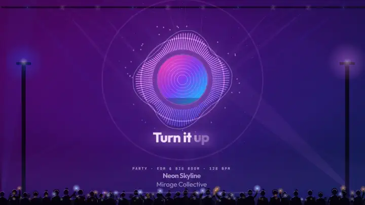
</p>

<p align="center"><a href="https://passimoritz.github.io/spicetify-mirage/"><b>▶ Farben im Browser ausprobieren</b></a> – ohne Installation.</p>

## ✦ Auf einen Blick

<table>
  <tr>
    <td width="33%" valign="top"><h3>🎨 Farben aus dem Cover</h3>Jeder Song färbt Spotify in der Palette seines Covers – lesbar auf dunklem Glas, mit dem Cover als Schleier hinter den Flächen.</td>
    <td width="33%" valign="top"><h3>🎤 Karaoke & Visualizer</h3>Vollbild-Liedtext, der sich Silbe für Silbe füllt, ein Visualizer im Takt und ein Mix aus beidem.</td>
    <td width="33%" valign="top"><h3>🎉 Eine Party, die den Song kennt</h3>48 Stile, zwölf Locations, Publikum, Lichtrig, Bühneneffekte und Momente für den Drop – aus dem Song gelesen, bevor er läuft.</td>
  </tr>
  <tr>
    <td valign="top"><h3>🎺 Instrumente</h3>Bestätigen die Credits Trompete, Saxofon, Gitarre, Klavier, Streicher oder Chor, bekommt das Instrument einen eigenen Effekt.</td>
    <td valign="top"><h3>📱 Handys machen mit</h3>Gäste scannen einen QR-Code: Ihre Handys blitzen im Takt, zeigen den Liedtext und nehmen Songwünsche aus Spotify an – Ende-zu-Ende verschlüsselt.</td>
    <td valign="top"><h3>◎ Außerhalb von Spotify</h3>Die Overlay-App kündigt Songs über allen Fenstern an, mit Kantenlicht und OBS-Quelle.</td>
  </tr>
</table>

## ⬇ Installation

**Marketplace (am einfachsten):** **Marketplace → Themes** öffnen, nach **Mirage** suchen, installieren. Fertig.

<details>
<summary><b>Windows per Skript</b></summary>

```powershell
git clone https://github.com/Passimoritz/spicetify-mirage
cd spicetify-mirage
powershell -ExecutionPolicy Bypass -File install.ps1            # nur das Theme
powershell -ExecutionPolicy Bypass -File install.ps1 -Overlay   # Theme + Overlay-App
```

Mit `-Scheme Obsidian` (oder `Sakura`, `Abyss`, `Ember`) gibt es ein festes Farbschema.
</details>

<details>
<summary><b>macOS / Linux / von Hand</b></summary>

```bash
cp -r Mirage "$(dirname "$(spicetify -c)")/Themes/"
spicetify config current_theme Mirage color_scheme Mirage inject_css 1 replace_colors 1 inject_theme_js 1
spicetify apply
```
</details>

<details>
<summary><b>Deinstallieren</b></summary>

```bash
spicetify config current_theme marketplace
spicetify apply
```
</details>

Eingestellt wird alles unter **Profilmenü → Mirage-Einstellungen**, und jeder Effekt unten hat dort seinen eigenen Schalter.

## 🎨 Das Theme

<p align="center"></p>
<table>
  <tr>
    <td width="50%"></td>
    <td width="50%"></td>
  </tr>
  <tr>
    <td align="center"><sub>Albumseite – der Kopfbereich verschmilzt mit dem Glas</sub></td>
    <td align="center"><sub>Visualizer, live in den Farben des Covers</sub></td>
  </tr>
</table>
<sub>Echte Spotify-Installation; eigene Bibliothek und Namen von Freunden sind verpixelt.</sub>

- **Farben aus dem Cover** – Akzent, Knöpfe, Fortschrittsbalken und Auswahl übernehmen die Palette des Songs, auf Kontrast abgestimmt.
- **Lebendiger Hintergrund** – das Cover treibt als langsamer Schleier mit Polarlicht-Bändern, Lichtstaub und Filmkorn und atmet im Takt.
- **Bewegung** – Seiten blenden weich ein, Raster gleiten nacheinander herein, Karten neigen sich zum Mauszeiger, das Player-Cover dreht sich wie eine Schallplatte, ein Like löst einen Herzregen aus.
- **Farbschemata** – `Mirage` folgt live dem Cover; `Obsidian`, `Sakura`, `Abyss` und `Ember` sind ruhige feste Paletten, und es gibt einen Baukasten für eigene.

<p align="center"></p>

## ◐ Immersiv-Modus

<kbd>Strg</kbd>+<kbd>Umschalt</kbd>+<kbd>M</kbd> (oder der Kreis-Knopf oben in der Leiste) macht Spotify zur Vollbild-Bühne mit fünf Ansichten, die ineinander übergehen – umschalten mit <kbd>1</kbd>–<kbd>5</kbd>.

<table>
  <tr>
    <td width="33%">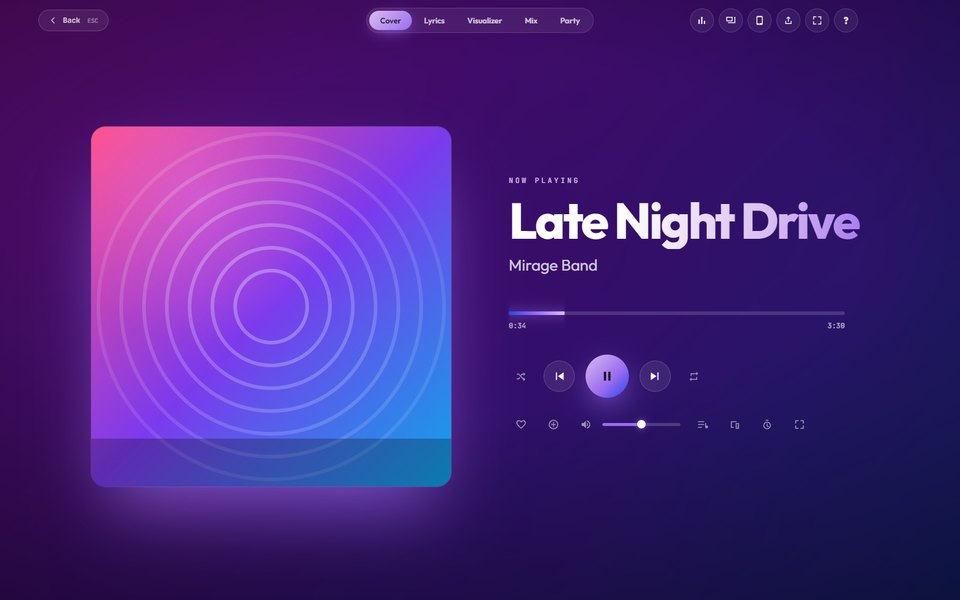</td>
    <td width="33%">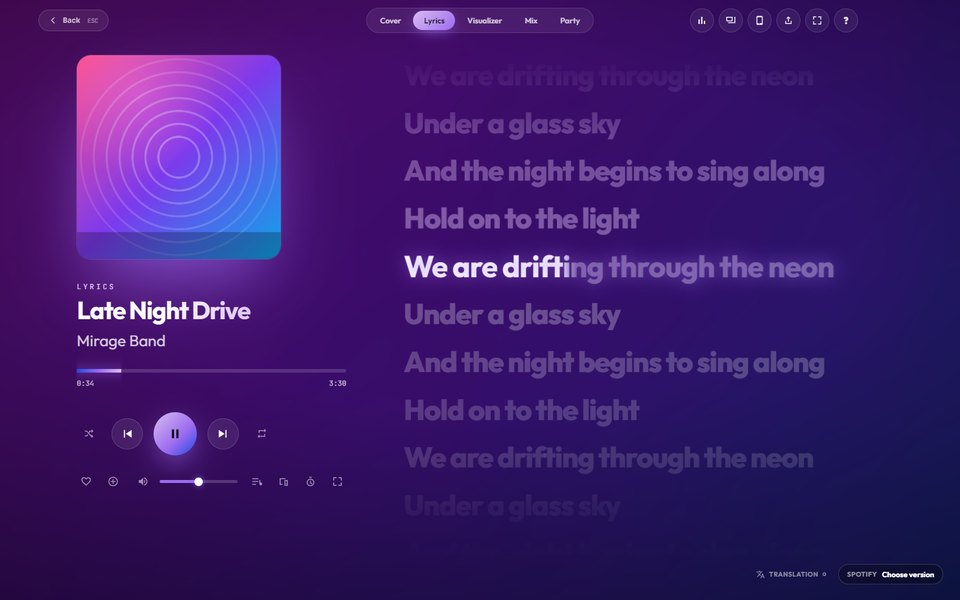</td>
    <td width="33%">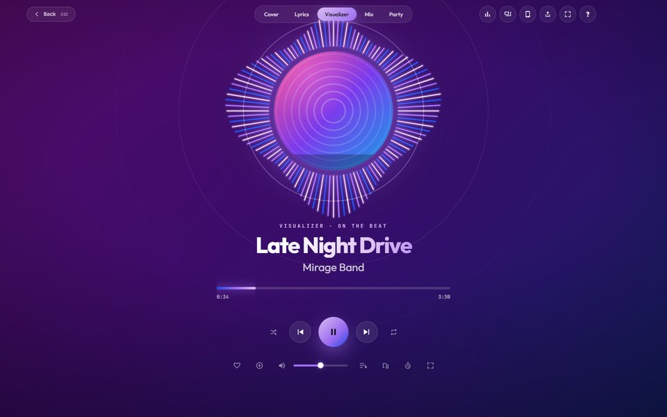</td>
  </tr>
  <tr>
    <td align="center"><b>Cover</b><br><sub>neigt sich mit der Maus, alle Bedienelemente</sub></td>
    <td align="center"><b>Liedtext</b><br><sub>synchrones Karaoke, Klick auf eine Zeile springt</sub></td>
    <td align="center"><b>Visualizer</b><br><sub>Balken, Welle, Punkte, Partikel, Linie oder 3D-Tunnel</sub></td>
  </tr>
  <tr>
    <td>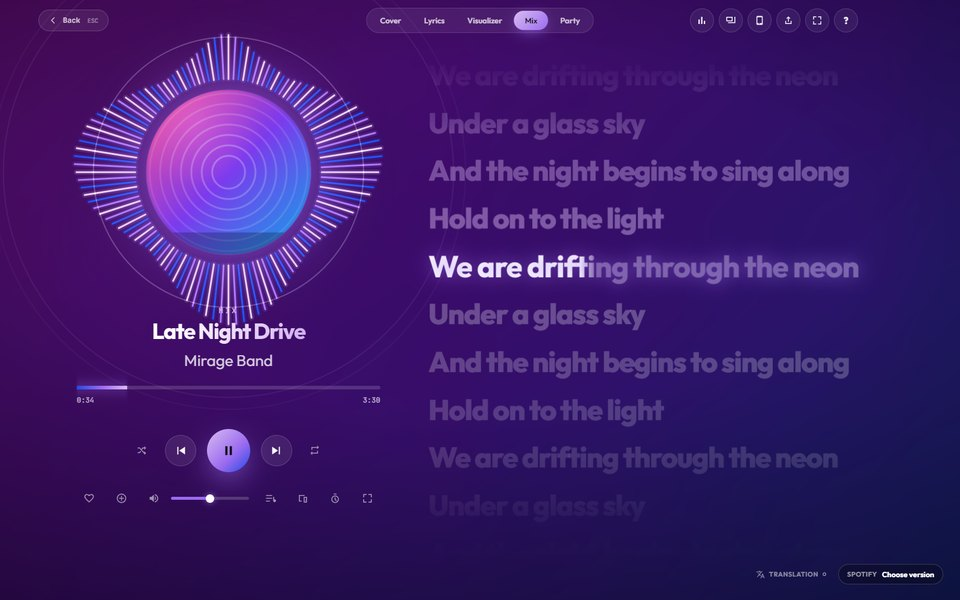</td>
    <td>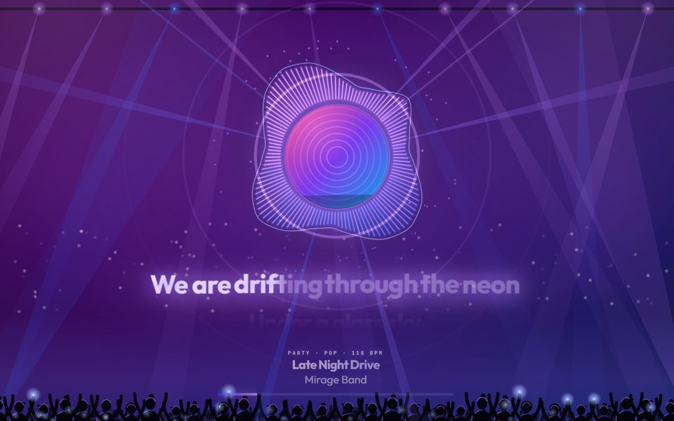</td>
    <td>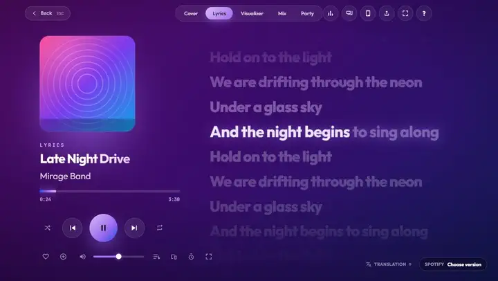</td>
  </tr>
  <tr>
    <td align="center"><b>Mix</b><br><sub>Visualizer-Kranz und Liedtext zugleich</sub></td>
    <td align="center"><b>Party</b><br><sub>die Lichtshow – siehe unten</sub></td>
    <td align="center"><b>Karaoke</b><br><sub>Buchstaben füllen sich Silbe für Silbe</sub></td>
  </tr>
</table>

- **Karaoke auf die Silbe** – Wortzeiten von Spotify oder NetEase gelten genau so; sonst zerlegt Mirage jedes Wort in Silben und legt jede auf einen gesungenen Einsatz der Analyse. Liedtexte aus anderen Quellen werden automatisch auf den Song ausgerichtet.
- **Liedtext, wenn Spotify keinen hat** – Mirage sucht bei [LRCLIB](https://lrclib.net), NetEase und lyrics.ovh; *Fassung wählen* nimmt einen anderen Treffer, und auf Wunsch steht eine Übersetzung unter jeder Zeile.
- **Ein Takt auch ohne Spotifys Analyse** – Tempo und Energie kommen aus Spotifys Audio-Merkmalen oder von Deezer, der Takt aus dem Timing des Liedtexts (oben steht dann *≈ 128 BPM*).
- **Synchron zu dem, was du hörst** – eine ruhige Song-Uhr glättet Spotifys Position; sechsmal <kbd>T</kbd> im Takt misst Licht, Publikum und Liedtext auf deine Lautsprecher ein.
- **Lautschrift** unter koreanischem, japanischem und chinesischem Liedtext, **Duett-Farben** für Zeilen mit Sängernamen und kleiner gesetzter Hintergrundgesang in Klammern.
- **Timing selbst korrigieren** – <kbd>E</kbd> drücken, dann Enter, sobald die markierte Zeile beginnt; gespeichert je Song.
- **Vollbild** per Knopf, <kbd>F</kbd> oder <kbd>F11</kbd>; ruht die Maus, blenden die Bedienelemente aus.

## 🎉 Party-Modus

<table>
  <tr>
    <td width="50%">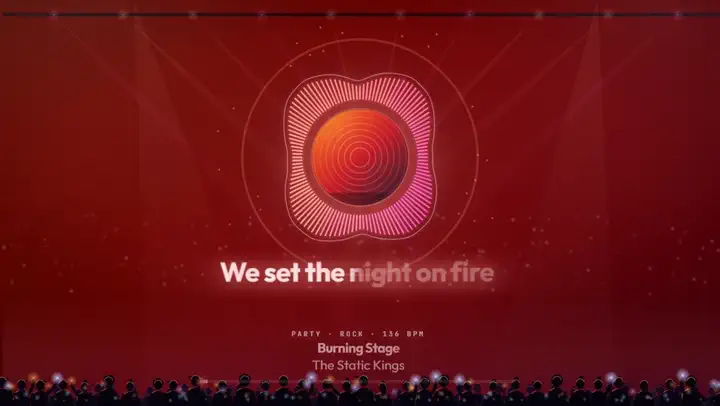</td>
    <td width="50%">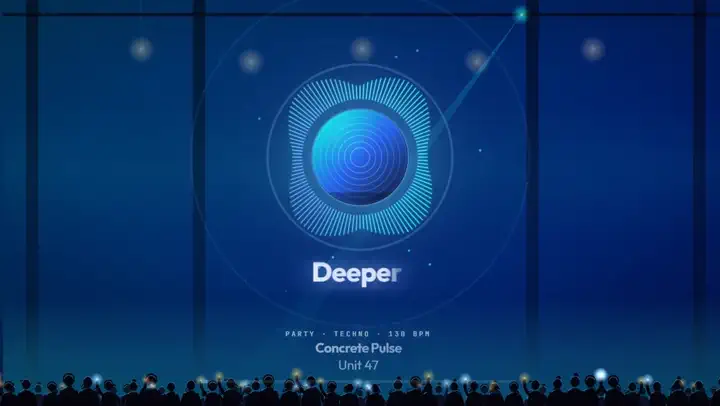</td>
  </tr>
  <tr>
    <td align="center"><sub><b>Rock · Stadion</b> – Spots von oben, Pyro beim Drop, das Publikum headbangt</sub></td>
    <td align="center"><sub><b>Techno · Lagerhalle</b> – Lauflichter, Laserfläche, Stroboskop beim harten Drop</sub></td>
  </tr>
  <tr>
    <td>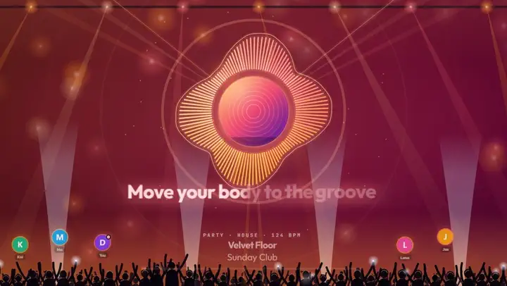</td>
    <td>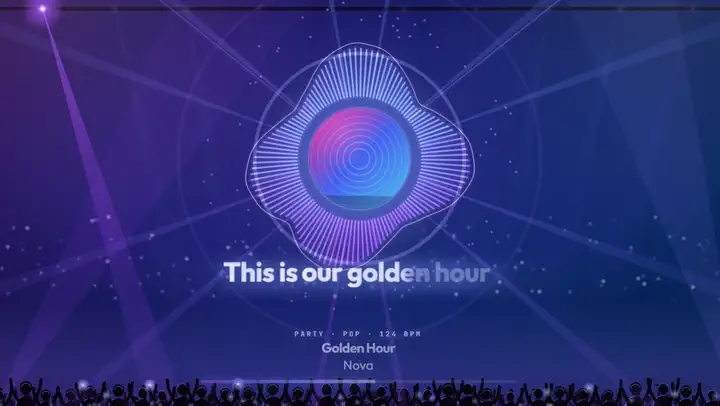</td>
  </tr>
  <tr>
    <td align="center"><sub><b>House · Club</b> – Discokugel, Lichtwellen, Jam-Gäste im Publikum</sub></td>
    <td align="center"><sub><b>Pop · Stadion</b> – der letzte Refrain bekommt alles</sub></td>
  </tr>
</table>
<sub>Clips und Standbilder sind mit dem echten Theme aufgenommen, mit ausgedachten Demo-Songs und Jam-Gästen.</sub>

Der Party-Modus liest den ganzen Song, bevor er läuft – Energiekurve, Aufbauten, Drops auf ihrem Schlag, Breaks, Dur oder Moll und wo Kick, Snare und Hi-Hats sitzen – und inszeniert das Licht nach dieser Karte. Er reagiert auf das, was *kommt*, nicht nur auf das, was gerade laut ist.

### 48 Stile

Der Stil kommt aus Apples iTunes-Genre, Spotifys Künstler-Genres und dem Klang selbst – oder du wählst ihn in den Einstellungen. Jeder Stil hat eigene Lichtsprache, Publikumsbewegungen, Location und Effekte: Rave bekommt sich kreuzende Strahlen, Techno weiche Scanner-Bänder, House eine Discokugel, Trance Polarlicht-Bänder, Drum & Bass einen Tunnel aus Lichtringen, Hip-Hop Licht vom Boden, Rock harte Spots von oben, Chill langsam atmendes Licht.

<details>
<summary><b>Alle 48 Stile</b></summary>

| Familie | Stile |
|---|---|
| Elektronisch | Rave · EDM & Big Room · House · Deep House · Tech House · Techno · Trance · Psytrance · Drum & Bass · Dubstep · UK Garage · Hardstyle · Eurodance · Synthwave · Hyperpop |
| Hip-Hop & R&B | Hip-Hop · Trap · Drill · Phonk · R&B · Soul & Funk · Afro · Reggae |
| Rock | Rock · Alternative · Indie · Punk · Metal · Blues |
| Pop | Pop · K-Pop · Disco · Schlager · Ballade · Gospel · Country |
| Latin & Welt | Latin · Reggaeton · Salsa & Tropical · Brasilianisch · Flamenco · Bollywood · Arabisch |
| Ruhig & klassisch | Chill · Ambient · Jazz · Klassik · Film & Epik |
</details>

### Zwölf Locations

<p align="center">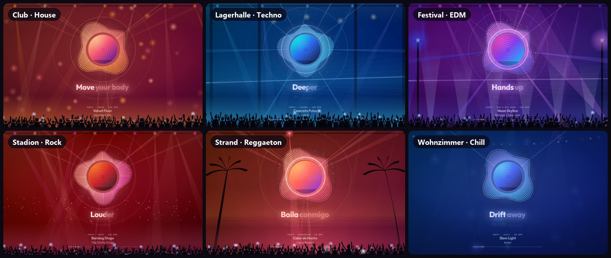</p>

Club, Lagerhalle, Festival, Stadion, Strand und Wohnzimmer – dazu Dachterrasse, Kathedrale, Jazz-Bar, Waldbühne, Konzertsaal (das Publikum sitzt) und Gewölbekeller. Die Location richtet sich nach dem Stil oder wird in den Einstellungen festgelegt. Das Publikum hängt am Takt: Sprünge landen auf dem Schlag, Köpfe nicken oder bangen, Hände klatschen auf 2 und 4, ab und zu rollt eine La-Ola-Welle durch, und beim Drop blitzen die Handykameras.

### Licht, Effekte und Momente

- **Lichtrig** – Moving Heads an einer Traverse bewegen sich in Mustern passend zum Genre: Wellen bei House, Lauflichter bei Techno, Fächer bei EDM, alle aufs Cover bei Hip-Hop und Rock. Blinder zünden bei großen Schlägen, beim Drop spannt sich eine Laserfläche über die Menge; ruhige Songs bekommen stattdessen weiches Bokeh.
- **Folgt den Instrumenten** – die Kick treibt Puls und Bodenlicht, die Snare die Spots, die Hi-Hats das Funkeln; zwei dünne *Melodie-Laser* folgen der Tonhöhe der Melodie.
- **Bühneneffekte, wo sie hingehören** – CO2-Fontänen bei elektronischer Musik, Pyro bei Rock, Metal und Punk, Feuerwerk, Konfetti-Kanonen und Luftschlangen im letzten Refrain, Stroboskop bei harten Drops (ab *Extrem*, nie mehr als ein Blitz pro Schlag).
- **Lichtermeer** – bei Balladen, Gospel und Soul heben im Refrain immer mehr Leute Handys und Feuerzeuge und schwenken sie gemeinsam.
- **Kameraschnitte** – harte Schnitte auf dem Taktanfang zwischen Totale, Nah und Publikum; der Drop schneidet zurück auf die Totale.
- **Lichtregie** – vor dem Drop hält sich das Licht zurück, auf dem letzten Schlag wird es dunkel, dann schlägt alles auf einmal ein. Eine Zeitlupe friert die halbe Sekunde davor ein, und DJ-Übergänge blenden beim Songwechsel die Farben über vier Schläge.
- **Fünf Stärken** von *Sanft* bis *Wahnsinn*, dazu Hype-Zeilen für Refrains, 3D-Tiefe, Kamerafahrten und Liedtext, der beim Drop in Licht zerplatzt.

### 🎺 Instrumente

<p align="center">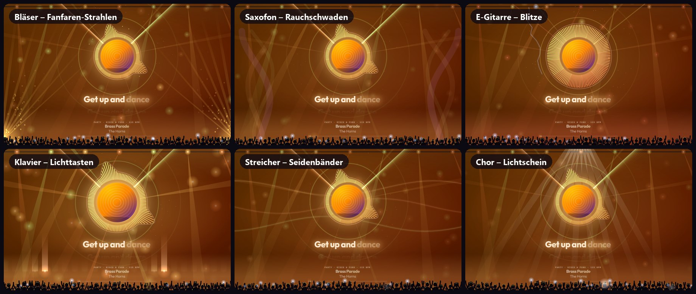</p>

Bestätigen die **Credits** des Songs (Spotify, sonst MusicBrainz) ein Instrument, bekommt es seinen eigenen Moment, wo es im Klang hervortritt: goldene Fanfaren-Strahlen, aufsteigender Rauch, Blitze von der Traverse, Lichttasten, die den Tönen folgen, fließende Seidenbänder, ein Lichtschein von oben. Ohne Credit kein Effekt – geraten wird nichts, und höchstens zwei Instrumente zeigen sich gleichzeitig.

### Jam & Extras

- **Spotify Jam** – alle im Jam stehen als kleines, farbiges Gesicht im Publikum und wippen zur Kick; wer den laufenden Song hinzugefügt hat, leuchtet als DJ.
- **Zweiter Bildschirm** – der Party-Modus im Vollbild auf einem Fernseher oder anderen Monitor.
- **Kantenlicht** – die Overlay-App lässt die Ränder deines Desktops im Takt leuchten.
- **Licht im Raum** – die Overlay-App lässt Philips Hue, WLED-LED-Streifen, OpenRGB und Razer Chroma mitspielen.
- **Party-Rückblick** – eine teilbare Karte der Nacht: Songs, Genre-Mischung, Tempo-Spanne, der größte Drop.

## 📱 Live-Link fürs Handy

<p align="center">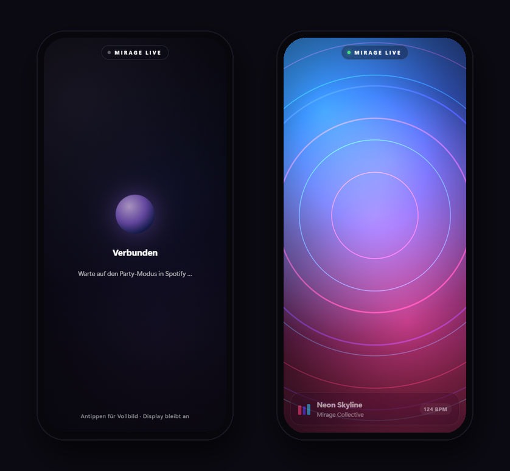</p>

**Live-Link** in den Party-Einstellungen einschalten, im Party-Modus den Handy-Knopf drücken und die Gäste den QR-Code scannen lassen. Ihre Handys werden zu zusätzlichen Lichtern: die Farben des Songs, ein Ring auf jedem Schlag, ein Blitz beim Drop – im Vollbild, der Bildschirm bleibt an.

- **Liedtext zum Mitsingen** – die aktuelle Zeile groß in der Mitte, die nächste darunter.
- **Songwünsche aus Spotify** – Gäste suchen auf dem Handy im echten Spotify-Katalog, wählen einen Song und stimmen über die Wünsche der anderen ab. Du siehst die meistgewünschten im Party-Modus und nimmst sie mit einem Klick in die Warteschlange; von selbst kommt nichts hinein.
- **Vibration beim Drop** (Android).

- **Jedes Netz, keine App** – WLAN oder mobile Daten; die Seite kommt von GitHub Pages.
- **Nur für alle mit dem QR-Code** – Kanal und Schlüssel sind 128-Bit-Zufallswerte, die nur im QR-Link hinter dem `#` stehen, und dieser Teil geht nie an einen Server. Die Nachrichten sind Ende-zu-Ende verschlüsselt und authentifiziert (AES-GCM): Der Relay sieht nur Zufallsbytes, und niemand kann mitlesen oder etwas einschleusen.
- **Nur solange du feierst** – das Theme sendet nur im Party-Modus; danach zeigt die Seite *Party beendet*, und 10 Minuten später verfällt der Code. Die nächste Party bekommt einen neuen.

## ⚙ Einstellungen & Leistung

<details>
<summary><b>Party-Einstellungen ansehen</b></summary>
<p align="center">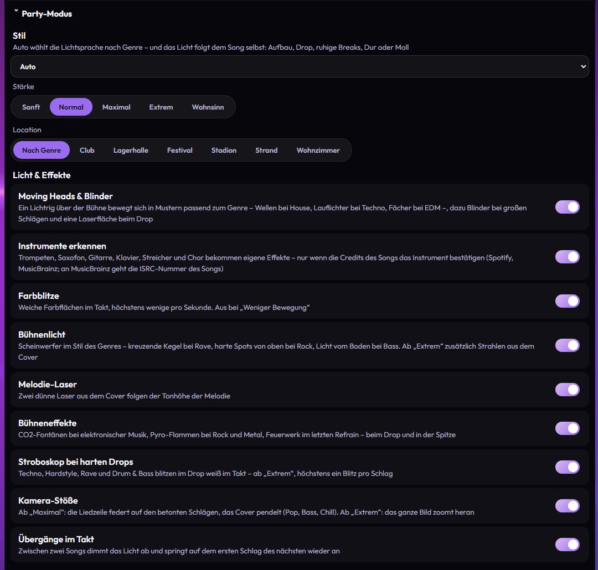</p>
</details>

- **Voreinstellungen** – *Voll*, *Ausgewogen*, *Leicht* und *Ruhig*. *Ausgewogen* zeichnet den Immersiv-Modus mit höchstens 60 fps (auf 120/144-Hz-Bildschirmen die halbe Arbeit), *Leicht* mit 30 fps und rund 40 % weniger Pixeln. Laufen die ersten Sekunden unter ~45 fps, schaltet Mirage selbst eine Stufe herunter.
- **Party passt sich an** – Bühne und Publikum werden in einem Hintergrund-Thread gezeichnet, der sich nie aufstaut, eine Qualitätsregelung blendet hintere Reihen aus, bevor Bilder ausfallen, und ruhige Intros und Breaks laufen mit 30 fps.
- **Energiesparen** – im Akkubetrieb (oder immer) läuft alles mit 30 fps und leichteren Details. Effekte pausieren, solange Spotify verdeckt ist, und Mirage startet ruhig, wenn dein System weniger Bewegung wünscht.

## ◎ Mirage Overlay

<p align="center"></p>

Eine kleine Begleit-App, die Songs **außerhalb von Spotify** ankündigt – über allen Fenstern, auf dem Bildschirm deiner Wahl. Das Theme spricht nur auf deinem eigenen Rechner mit ihr (`127.0.0.1`).

| Windows | macOS | Linux |
|:-:|:-:|:-:|
| [**⬇ Mirage-Overlay-Setup.exe**](https://github.com/Passimoritz/spicetify-mirage/releases/latest/download/Mirage-Overlay-Setup.exe) | [**⬇ Mirage-Overlay.dmg**](https://github.com/Passimoritz/spicetify-mirage/releases/latest/download/Mirage-Overlay.dmg) | [**⬇ AppImage**](https://github.com/Passimoritz/spicetify-mirage/releases/latest/download/Mirage-Overlay.AppImage) · [**⬇ .deb**](https://github.com/Passimoritz/spicetify-mirage/releases/latest/download/Mirage-Overlay.deb) |
| Doppelklick – wohnt im Infobereich | In *Programme* ziehen | Ausführbar machen, oder `sudo apt install ./Mirage-Overlay.deb` |

Oder in Spotify: **Mirage-Einstellungen → Overlay → Overlay-App herunterladen** (nimmt die passende Datei und zeigt, ob die App verbunden ist).

- **Wann** – bei jedem Songwechsel, dauerhaft als Mini-Player oder aus · bei Play/Pause · Ruhezeiten
- **Wo** – Hauptbildschirm, Bildschirm mit der Maus oder jeder Bildschirm · 9 Positionen · Feinversatz
- **Wie** – Insel, Karte, Banner oder Minimal · federnd, gleitend oder blendend · Leuchten, Rundung, Größe, Deckkraft · Steuerung beim Drüberfahren
- **Extras** – Lautstärke-Leiste · bleibt still bei Spielen und Videos im Vollbild · eigener Look per `custom.css` · OBS-Browserquelle (`http://127.0.0.1:47322/`, Party-Licht unter `/party`) · Kantenlicht für den Party-Modus · zuletzt gespielt · aktualisiert sich selbst
- **Licht im Raum** – im Party-Modus spielen Philips Hue, WLED, OpenRGB und Razer Chroma mit; eingerichtet in den Overlay-Einstellungen, alles bleibt in deinem Netz
- **Stream Deck** – [**⬇ Mirage.streamDeckPlugin**](https://github.com/Passimoritz/spicetify-mirage/releases/latest/download/Mirage.streamDeckPlugin): Play/Pause, springen, liken, Immersiv- und Party-Modus auf Tasten

> **Code-Signatur:** Der Windows-Installer wird gerade für die kostenlose Signatur durch die SignPath Foundation eingerichtet – siehe [Code signing policy](CODE_SIGNING.md). Solange er unsigniert ist, kann Windows' *Smart App Control* ihn blockieren, und SmartScreen fragt einmal nach: *Weitere Informationen → Trotzdem ausführen*. macOS: Rechtsklick → *Öffnen* → *Öffnen*.

## ⌨ Tasten

| Wo | Taste | Aktion |
|---|---|---|
| überall | <kbd>Strg</kbd>+<kbd>Umschalt</kbd>+<kbd>M</kbd> | Immersiv-Modus öffnen / schließen |
| immersiv | <kbd>1</kbd> … <kbd>5</kbd> | Cover · Liedtext · Visualizer · Mix · Party |
| immersiv | <kbd>Leertaste</kbd> · <kbd>N</kbd> <kbd>P</kbd> | Play / Pause · nächster · vorheriger Song |
| immersiv | <kbd>←</kbd> <kbd>→</kbd> · <kbd>↑</kbd> <kbd>↓</kbd> | 5 s spulen · Lautstärke |
| immersiv | <kbd>L</kbd> <kbd>S</kbd> <kbd>R</kbd> <kbd>Q</kbd> | Like · Zufall · Wiederholen · Warteschlange |
| immersiv | <kbd>F</kbd> / <kbd>F11</kbd> | Vollbild |
| immersiv | <kbd>T</kbd> (6×, im Takt) | Licht, Publikum und Liedtext auf das Gehörte einmessen |
| Liedtext | <kbd>E</kbd> · <kbd>Enter</kbd> | Timing korrigieren: die markierte Zeile beginnt jetzt |
| immersiv | <kbd>?</kbd> · <kbd>Esc</kbd> | alle Tasten · schließen |

## 🛠 Reparieren nach einem Spotify-Update

Spotify aktualisiert sich alle paar Wochen und überschreibt, was Spicetify angepasst hat. Dann sieht Spotify wieder normal aus, `spicetify apply` meldet einen *backup version mismatch* oder *Cannot find xpui.spa*, oder das Fenster bleibt schwarz. Kaputt ist nichts – Spicetify muss nur neu anpassen.

**Ein Klick (Windows):** <a href="https://github.com/Passimoritz/spicetify-mirage/releases/latest/download/fix-spicetify.cmd"><b>⬇ fix-spicetify.cmd</b></a> · <sub><a href="tools/fix-spicetify.cmd">Quelltext lesen</a></sub> – schließt Spotify, aktualisiert Spicetify, legt ein frisches Backup an, wendet Mirage und deine Erweiterungen wieder an und startet Spotify neu. Einstellungen und Marketplace-Inhalte bleiben erhalten.

**Von Hand (alle Systeme):**

```bash
spicetify upgrade
spicetify restore backup apply
```

Klappt es immer noch nicht? `spicetify clear`, danach `spicetify backup apply`. Direkt nach einer großen Spotify-Version braucht Spicetify manchmal ein paar Tage – auf die nächste [Spicetify-Version](https://github.com/spicetify/cli/releases) warten. Sieht Mirage selbst falsch aus, hilft das [Fehlerformular für Spotify-Updates](https://github.com/Passimoritz/spicetify-mirage/issues/new/choose).

## 🔒 Datenschutz

- **Kein eigener Server, kein Tracking, kein Konto.** Liedtext, Taktdaten, Audio-Merkmale und Credits kommen von Spotify.
- **Nur wenn Spotify nichts hat** – und alles abschaltbar: Titel, Interpret, Album und Länge gehen für Liedtexte an LRCLIB, NetEase und lyrics.ovh; Titel und Interpret für das Tempo an Deezer und für das Party-Genre an Apples iTunes-Suche; die ISRC-Nummer des Songs für Instrument-Credits an MusicBrainz.
- **Live-Link** (standardmäßig aus) – Lichtfarben, Tempo und Songtitel, Ende-zu-Ende verschlüsselt über einen öffentlichen Relay (HiveMQ). Der Schlüssel verlässt nie den QR-Code. Die Songsuche der Gäste läuft über dein Spotify.
- **Overlay-App** – lauscht nur auf deinem eigenen Rechner und fragt bei GitHub nach Updates (abschaltbar). Das Licht im Raum steuert sie in deinem eigenen Netz; *Bridge suchen* fragt den Suchdienst von Philips (`discovery.meethue.com`) nach der Adresse deiner Bridge. Details in der [Code signing policy](CODE_SIGNING.md#privacy-policy).
- **Lautschrift** (standardmäßig aus) – für Chinesisch lädt einmal das Pinyin-Wörterbuch von jsdelivr.
- Schriften kommen von Google Fonts.

## ❓ Häufige Fragen

<details>
<summary><b>Nach einem Spotify-Update ist Mirage weg.</b></summary>

[Reparatur](#-reparieren-nach-einem-spotify-update) starten – das liegt an Spicetify, nicht an Mirage.
</details>

<details>
<summary><b>Der Party-Modus wählt den falschen Stil.</b></summary>

Den Stil unter **Mirage-Einstellungen → Party-Modus → Stil** von Hand wählen, oder bei *Auto* bleiben und *Genre online nachschlagen* einschalten.
</details>

<details>
<summary><b>Licht und Liedtext sind etwas zu früh oder zu spät.</b></summary>

Im Immersiv-Modus sechsmal <kbd>T</kbd> im Takt drücken – Mirage misst die Verzögerung deiner Lautsprecher (Bluetooth bringt etwas mit) – oder den Sync-Versatz in den Einstellungen setzen.
</details>

<details>
<summary><b>Die Handy-Seite bleibt bei „Keine Verbindung“.</b></summary>

Das Handy braucht Internet (WLAN oder mobile Daten). Eine Firewall, ein VPN oder ein Werbeblocker auf dem Handy blockiert vielleicht den Relay `broker.hivemq.com`. Bis in Spotify der Party-Modus läuft, zeigt die Seite „warte auf den Party-Modus“.
</details>

<details>
<summary><b>Das ist mir zu viel / mein Laptop wird warm.</b></summary>

Voreinstellung *Leicht* oder *Ruhig* wählen, Energiesparen auf *Immer* stellen oder die Party-Stärke senken – jeder Effekt hat seinen eigenen Schalter.
</details>

## 🧩 Unter der Haube

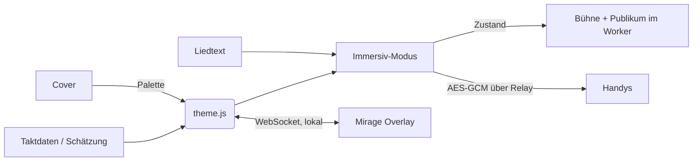

- Farben wechseln in einem einzigen Stil-Update; der Hintergrundschleier ist ein vorab verkleinertes Bild, einmal weichgezeichnet und nur noch gedreht.
- Gebaut gegen das echte Spotify-DOM und erkannt am berechneten Stil statt an Klassennamen, die sich mit jeder Version ändern.
- Läuft die Overlay-App, kann das Theme einen Aufbaubericht (Größen, Klassen, Farben – keine Inhalte) nach `%APPDATA%\Mirage Overlay\dom-report.json` schreiben, für Fehlermeldungen.
- 14 Sprachen: English, Deutsch, Français, Español, Italiano, Português, Nederlands, Polski, Türkçe, Русский, Українська, 日本語, 한국어, 中文.

Mithelfen? Siehe [CONTRIBUTING.md](CONTRIBUTING.md) und den [Changelog](CHANGELOG.md). Fragen und Ideen gehören in die [Diskussionen](https://github.com/Passimoritz/spicetify-mirage/discussions).

## Lizenz

MIT © Passimoritz
