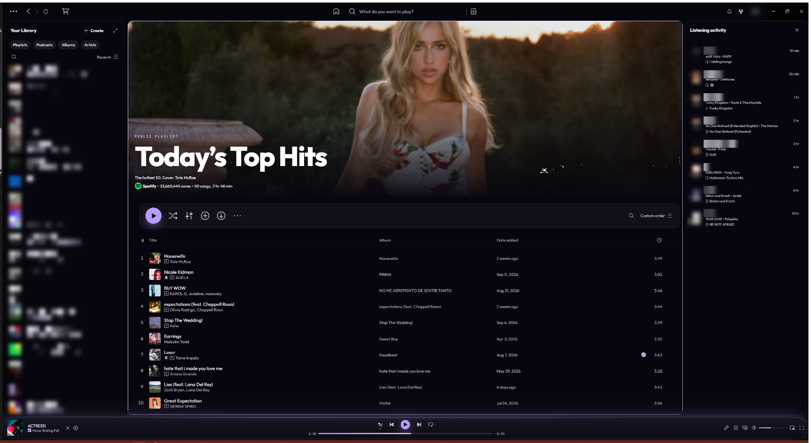
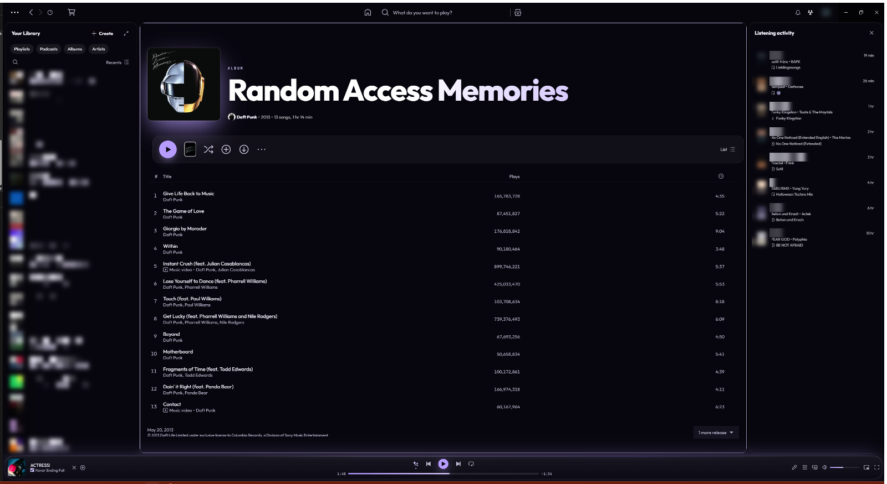
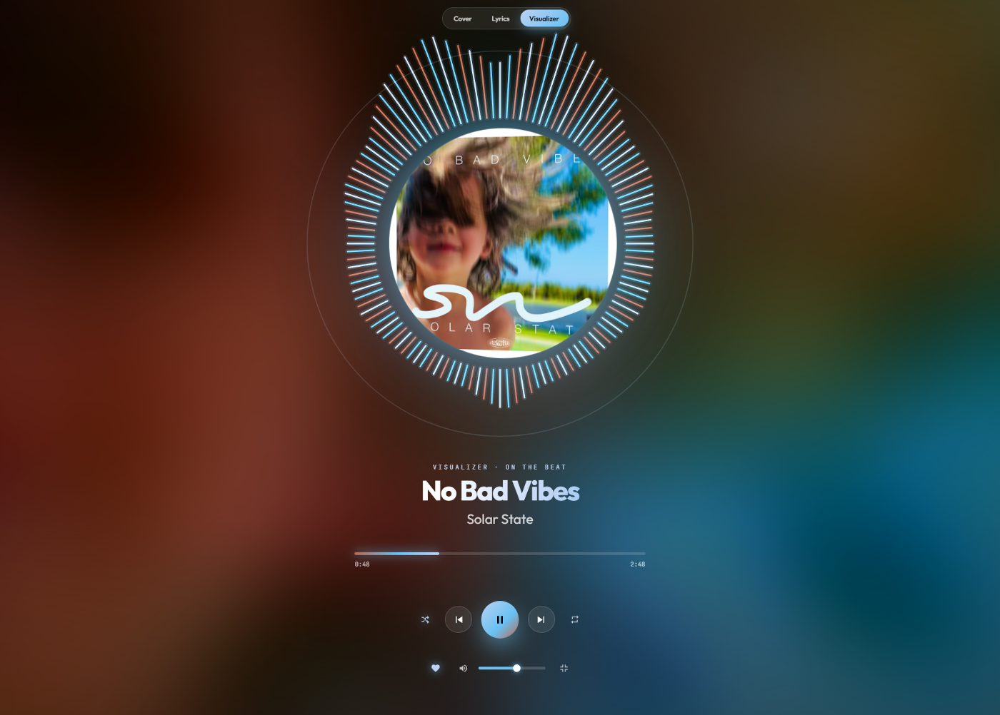
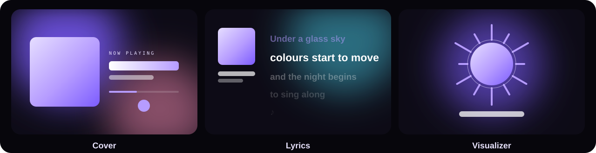
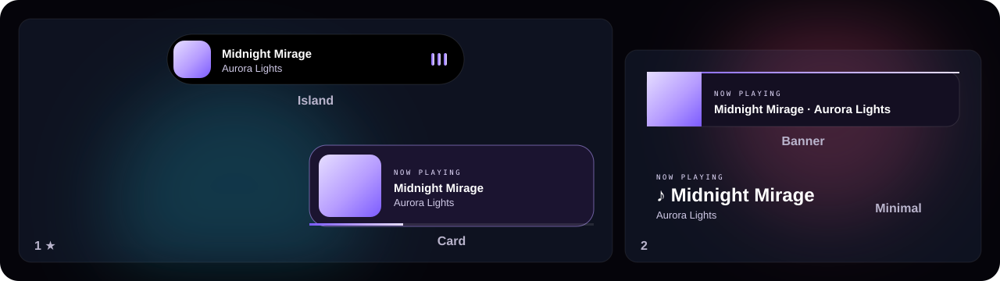
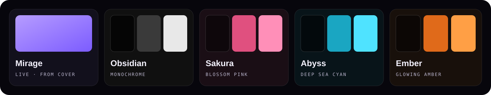
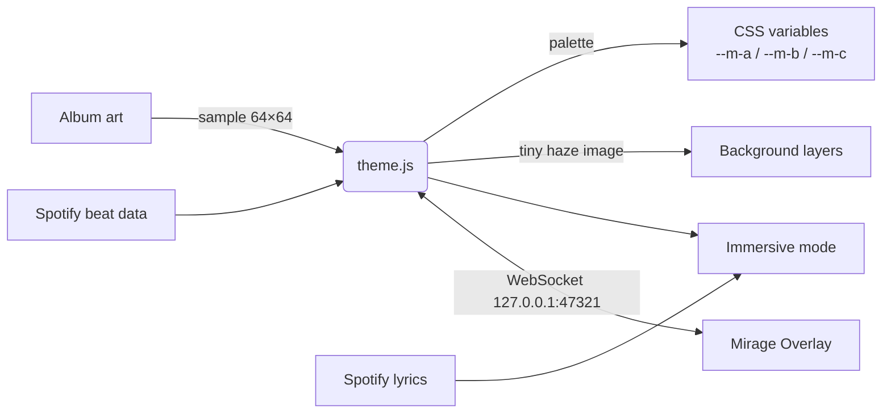

<p align="center">
  
</p>

<p align="center">
  <a href="#-install"></a>
  
  
  
</p>

<p align="center">
  <b>English</b> · <a href="README.de.md">Deutsch</a>
  <br><br>
  <a href="#-highlights">Highlights</a> ·
  <a href="#-immersive-mode">Immersive mode</a> ·
  <a href="#-mirage-overlay">Overlay</a> ·
  <a href="#-colour-schemes">Schemes</a> ·
  <a href="#-install">Install</a> ·
  <a href="#-fix-after-a-spotify-update">Fix after updates</a> ·
  <a href="#-settings--shortcuts">Shortcuts</a> ·
  <a href="https://github.com/Passimoritz/spicetify-mirage/discussions">Discussions</a>
</p>

---

**Mirage** turns Spotify into frosted glass with the music living behind it. Every song repaints the interface in the colours of its album art, the cover drifts slowly behind the panels as soft light, and – when Spotify provides beat data – the whole background breathes on the beat.

<p align="center"><a href="https://passimoritz.github.io/spicetify-mirage/"><b>▶ Try it in your browser</b></a> – no install, click a cover and watch the interface recolour.</p>

## 📸 Real screenshots

<p align="center">
  
</p>
<table>
  <tr>
    <td width="50%"></td>
    <td width="50%"></td>
  </tr>
  <tr>
    <td align="center"><sub>Album page – the header melts into the glass, no hard colour block</sub></td>
    <td align="center"><sub>Immersive visualizer, coloured live from the cover and pulsing on the beat</sub></td>
  </tr>
</table>
<sub>Taken from a real Spotify install. Personal library and friends' names/pictures are pixelated.</sub>

## ✦ Highlights

<table>
  <tr>
    <td width="33%" valign="top">
      <h3>🎨 Colours from the cover</h3>
      Accent, buttons, progress bar, titles and selection take on the song's palette – picked so text stays readable on dark glass.
    </td>
    <td width="33%" valign="top">
      <h3>🌫️ Living background</h3>
      The album art drifts behind the UI as a slow, blurred haze, with aurora bands, floating light dust and film grain on top.
    </td>
    <td width="33%" valign="top">
      <h3>🥁 On the beat</h3>
      With Spotify's beat data the background, light dust and visualizer pulse in time. Without it, Mirage falls back to a calm ambient motion.
    </td>
  </tr>
  <tr>
    <td valign="top">
      <h3>🃏 3D cards</h3>
      Cards tilt towards the pointer, with a light cone and a glowing edge that follow the mouse.
    </td>
    <td valign="top">
      <h3>✨ Page animations</h3>
      Pages blur in, grids cascade, track rows glide in one after another. The playing row glows in a flowing colour stream.
    </td>
    <td valign="top">
      <h3>💿 Vinyl & details</h3>
      The cover in the player turns into a spinning record, the play button gets a rotating halo, liking a song sets off a heart burst.
    </td>
  </tr>
</table>

## ◐ Immersive mode

Press <kbd>Ctrl</kbd> + <kbd>Shift</kbd> + <kbd>M</kbd> or the circle button in the top bar. Three views morph into each other:

<p align="center"></p>

| View | What you get |
|---|---|
| **Cover** | Huge cover that tilts with the mouse, title in a colour gradient, progress, full controls |
| **Lyrics** | Spotify's synced lyrics, the current line lit up and centred – click any line to jump there |
| **Visualizer** | Radial spectrum around the round cover, beat rings – driven by Spotify's audio analysis when available, otherwise ambient |

Controls: shuffle, previous, play/pause, next, repeat (incl. repeat one), like, volume + mute, full screen.

## ◎ Mirage Overlay

A small companion app that shows song changes **outside of Spotify** – above every window, on the screen you choose. The theme talks to it locally (`127.0.0.1:47321`), nothing leaves your computer.

<p align="center"></p>

- **When:** on every song change, permanently as a mini player, or off · optionally on play/pause · quiet hours (e.g. 22:00–07:00)
- **Where:** main screen, the screen with the mouse, or any screen picked on a map of your displays · 9 anchor positions · fine offset
- **How:** Island, Card, Banner or Minimal · springy, slide or fade · background from cover / dark / light · glow, roundness, size, opacity · heading, album, time, progress bar
- **Controls on hover:** previous · play/pause · next, right inside the overlay
- Lives in the tray, starts with Windows if you like, follows the language Spotify uses

## ◑ Colour schemes

<p align="center"></p>

`Mirage` follows the cover live. The other four are fixed palettes for a calmer look.

## ⬇ Install

### Spicetify Marketplace

Open **Marketplace → Themes**, search for **Mirage**, install. Done.

> The Marketplace only lists **public** repositories with the topic `spicetify-themes`.

### Manually (Windows)

```powershell
git clone https://github.com/Passimoritz/spicetify-mirage
cd spicetify-mirage
powershell -ExecutionPolicy Bypass -File install.ps1            # theme only
powershell -ExecutionPolicy Bypass -File install.ps1 -Overlay   # theme + overlay app
```

Pick a scheme with `-Scheme Obsidian` (or `Sakura`, `Abyss`, `Ember`).

<details>
<summary>macOS / Linux / by hand</summary>

```bash
cp -r Mirage "$(dirname "$(spicetify -c)")/Themes/"
spicetify config current_theme Mirage color_scheme Mirage inject_css 1 replace_colors 1 inject_theme_js 1
spicetify apply
```

The overlay app is Electron-based: `cd overlay && npm install && npm start`.
</details>

### Uninstall

```bash
spicetify config current_theme marketplace
spicetify apply
```

## 🛠 Fix after a Spotify update

Spotify updates itself quietly every few weeks and overwrites the files Spicetify patched. You notice it like this:

- Spotify suddenly looks like normal Spotify again – no Mirage, no Marketplace, no extensions
- `spicetify apply` stops with *"backup version mismatch"*, *"Spotify version and backup version are mismatched"* or *"Cannot find xpui.spa"*
- Spotify shows a black or white window right after starting

Nothing is broken – Spicetify just has to re-patch the new Spotify version.

### One click (Windows)

<a href="https://github.com/Passimoritz/spicetify-mirage/releases/latest/download/fix-spicetify.cmd"><b>⬇ Download fix-spicetify.cmd</b></a> · <sub><a href="tools/fix-spicetify.cmd">view the source first</a></sub>

Double-click it after every Spotify update. It closes Spotify, updates Spicetify, throws away the outdated backup, makes a fresh one from the new Spotify, applies Mirage and your extensions again and starts Spotify. Your settings, theme and Marketplace items are kept.

> Windows may warn because the file comes from the internet: **More info → Run anyway**. It is a plain text script – you can open it in Notepad and read every line.

It is built to keep working: it only uses commands every Spicetify 2.x knows (`upgrade`, `restore`, `backup`, `apply`, `clear`), finds Spicetify even when it is missing from `PATH`, works with and without admin rights and tells you if you use the Microsoft Store version of Spotify (Spicetify cannot patch that one – install Spotify from spotify.com instead).

### By hand (Windows, macOS, Linux)

```bash
spicetify upgrade
spicetify restore backup apply
```

Still not working? Clear the old backup and try again:

```bash
spicetify clear
spicetify backup apply
```

### When a brand-new Spotify version is not supported yet

Right after a big Spotify release, Spicetify sometimes needs a few days to catch up – `apply` then fails even after the steps above. Wait for the next [Spicetify release](https://github.com/spicetify/cli/releases) and run the fix again: it pulls the new Spicetify automatically. If something in Mirage looks off after an update, open an issue with the [bug form for Spotify updates](https://github.com/Passimoritz/spicetify-mirage/issues/new/choose) – it asks for exactly the versions needed to fix it quickly.

## ⌨ Settings & shortcuts

Profile menu → **Mirage settings**: colours from the cover, light dust, beat background, page animations, vinyl, 3D cards, heart burst, overlay link, film grain, real glass, calm mode, blur and brightness.

| Where | Key | Action |
|---|---|---|
| anywhere | <kbd>Ctrl</kbd>+<kbd>Shift</kbd>+<kbd>M</kbd> | open / close immersive mode |
| immersive | <kbd>1</kbd> <kbd>2</kbd> <kbd>3</kbd> | cover · lyrics · visualizer |
| immersive | <kbd>Space</kbd> | play / pause |
| immersive | <kbd>←</kbd> <kbd>→</kbd> | seek 5 s |
| immersive | <kbd>↑</kbd> <kbd>↓</kbd> | volume |
| immersive | <kbd>L</kbd> <kbd>S</kbd> <kbd>R</kbd> <kbd>F</kbd> | like · shuffle · repeat · full screen |
| immersive | <kbd>N</kbd> <kbd>P</kbd> | next · previous |
| immersive | <kbd>Esc</kbd> | leave full screen / close |

## ⚡ Performance

Mirage is built to look alive without eating your CPU. Upcoming **performance presets** in Mirage settings let you pick how much of it you want:

| Preset | What you get |
|---|---|
| **Full** | Everything on – real glass with live blur behind every panel, light dust, beat background, 3D cards |
| **Balanced** | The full look with lighter effects – the sweet spot for most PCs |
| **Light** | Swaps live glass blur for translucent panels and thins out the background – for laptops and older GPUs |

- **Automatic step-down:** if the first seconds after start run below ~45 fps, Mirage drops to the next lighter preset by itself.
- **Pauses when hidden:** effects stop while Spotify is minimised, so nothing runs in the background.
- **Calm mode follows your system:** with *reduce motion* turned on in your OS, Mirage starts in calm mode.

### Mirage vs. a typical static theme

| | Mirage | Typical static theme |
|---|:---:|:---:|
| Colours follow the album cover | ✓ | ✗ fixed |
| Living background | ✓ | ✗ |
| Beat-synced motion | ✓ | ✗ |
| Immersive lyrics + visualizer | ✓ | ✗ |
| Desktop overlay | ✓ | ✗ |
| Performance presets | ✓ | ✗ |
| 14 languages | ✓ | ✗ fixed |

## 🌍 Languages

English, Deutsch, Français, Español, Italiano, Português, Nederlands, Polski, Türkçe, Русский, Українська, 日本語, 한국어 and 中文 – any other language falls back to English. Mirage finds Spotify's controls by language-independent markers, so it works no matter which language Spotify is set to.

## ⚙ How it works



- **Performance first:** colours change in a single style update, the background haze is a pre-shrunk image blurred once and only rotated, and the background pauses while immersive mode covers it. Real glass (live blur behind every panel) is optional.
- **Built against the real Spotify DOM:** current Spotify builds renamed `.Root__main-view` & co. to `#main-view` / `#Desktop_LeftSidebar_Id`; Mirage targets both. Header colour blocks (incl. `::after` gradients and `oklch()` colours) are detected by their computed style, not by class names that change every release.
- **Diagnostics:** with the overlay running, the theme can send a layout report (element sizes, classes, colours – no content) to `%APPDATA%\Mirage Overlay\dom-report.json`, so styling bugs can be fixed from facts instead of guesses.
- **Privacy:** no own server, no tracking. Lyrics and beat data come from Spotify itself; fonts load from Google Fonts.
- **Accessibility:** respects *reduce motion*, visible focus rings, readable contrast on every palette.

## License

MIT © Passimoritz
