<p align="center">
  
</p>

<p align="center">
  <b>English</b> · <a href="README.de.md">Deutsch</a>
</p>

<p align="center">
  <a href="#-install-in-2-minutes"></a>
  <a href="https://github.com/Passimoritz/spicetify-mirage/releases/latest"></a>
  
  
</p>

<h3 align="center">Mirage paints Spotify in the colours of your music<br>and turns your screen into a stage with karaoke, a light show and party games.</h3>

<p align="center">
  <a href="#-install-in-2-minutes"></a>
  <a href="#-what-mirage-can-do"></a>
  <a href="#-party-with-friends"></a>
</p>

<p align="center">
  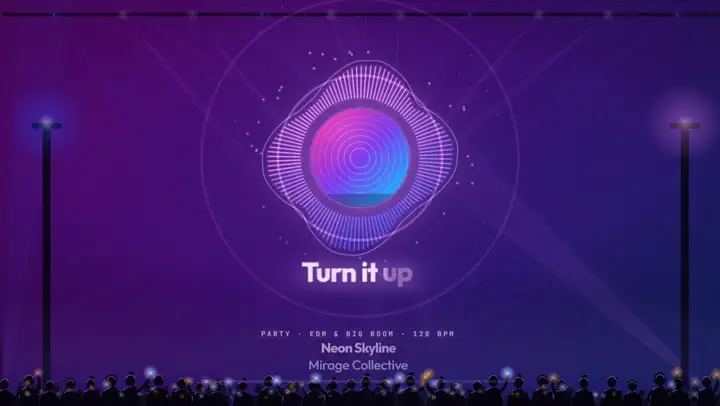
</p>

<p align="center"><a href="https://passimoritz.github.io/spicetify-mirage/"><b>▶ Try the colours in your browser</b></a> – nothing to install.</p>

---

## 📦 Install in 2 minutes

**Before you start:** you need the normal Spotify app for your computer from [spotify.com/download](https://www.spotify.com/download/). Open it once and log in.
On Windows, the Microsoft Store version does not work. On Linux, the Snap version does not work.

Mirage uses **Spicetify** (a free tool that lets Spotify load themes). The installer sets it up for you if you don't have it yet.

### Windows

1. Press the **Windows key**, type **PowerShell** and open it (the normal one, not "as administrator").
2. Copy this line, paste it into the blue window (right-click pastes) and press **Enter**:

   ```powershell
   iwr -useb https://raw.githubusercontent.com/Passimoritz/spicetify-mirage/main/install.ps1 | iex
   ```

3. Wait about a minute. Spotify closes and opens again by itself.
4. When you see **"Mirage is installed."** in green, you're done.

### Mac and Linux

1. Open the **Terminal** (Mac: press <kbd>Cmd</kbd>+<kbd>Space</kbd>, type *Terminal*, press Enter).
2. Copy this line, paste it and press **Enter**:

   ```bash
   curl -fsSL https://raw.githubusercontent.com/Passimoritz/spicetify-mirage/main/install.sh | bash
   ```

3. Wait about a minute. Spotify restarts.
4. When you see **"Mirage is installed."** in green, you're done.

> **Tip:** the installer only does four things: it installs Spicetify if it's missing, copies the Mirage files, switches Spotify to Mirage and restarts Spotify. You can run it again at any time, for example to update Mirage.

**Already use the Spicetify Marketplace?** Open **Marketplace → Themes**, search for **Mirage** and click *Install*.

### Your first steps

- Press <kbd>Ctrl</kbd>+<kbd>Shift</kbd>+<kbd>M</kbd> (or the circle button at the top) to open the full-screen stage.
- All settings are in your **profile menu** (your picture, top right) **→ Mirage settings**.

<details>
<summary><b>Something went wrong during installation</b></summary>

- **"You are using the Microsoft Store version of Spotify"** – uninstall it, get Spotify from [spotify.com](https://www.spotify.com/download/windows/), open it once, then run the line again.
- **"Spotify is installed as a Snap"** (Linux) – same idea: remove the Snap and install Spotify from spotify.com or Flathub.
- **"spicetify apply failed"** – this usually happens right after a Spotify update. See [Help after a Spotify update](#-help-something-looks-wrong-after-a-spotify-update).
- **"not on the PATH yet"** – close the window, open a new one and paste the line again.
- **Linux: no permission for Spotify's folder** – the installer shows you the exact command to fix this.
- The Mac and Linux installer is new. If it doesn't work for you, follow the [Spicetify guide](https://spicetify.app/docs/getting-started) and then install Mirage from the Marketplace.
</details>

<details>
<summary><b>Remove Mirage</b></summary>

To pick another theme, use **Marketplace → Themes**. To put Spotify back exactly as it was, run this in PowerShell or the Terminal:

```bash
spicetify restore
```
</details>

## ✨ What Mirage can do

### Spotify in the colours of your music

<p align="center">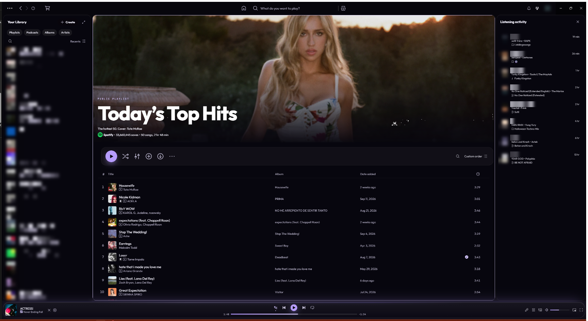</p>

<table>
  <tr>
    <td width="50%">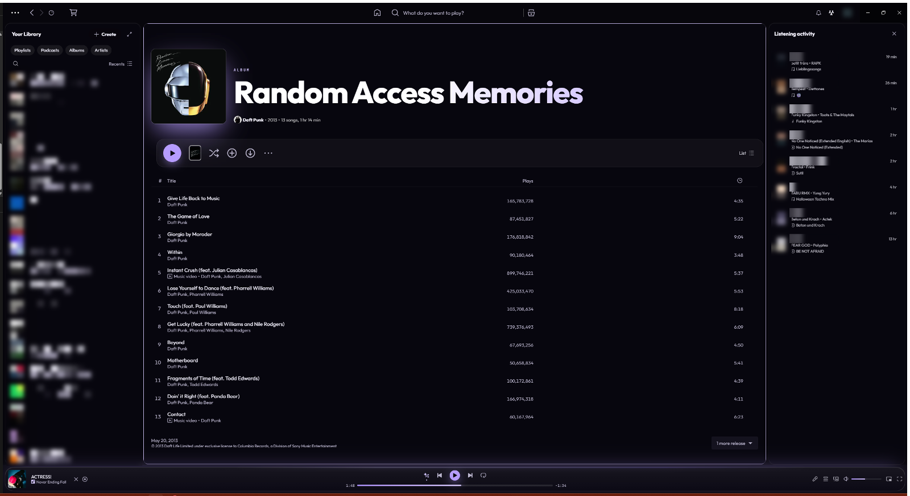</td>
    <td width="50%">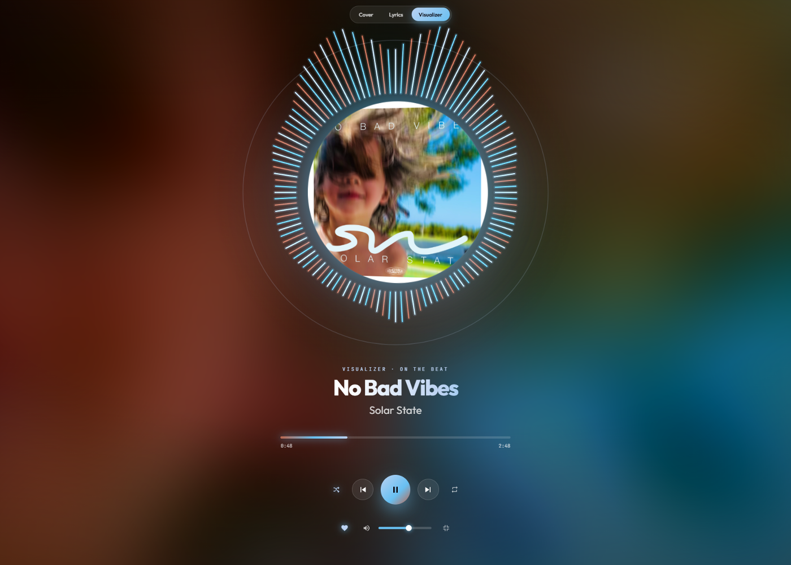</td>
  </tr>
  <tr>
    <td align="center"><sub>Every album gets its own colours</sub></td>
    <td align="center"><sub>The visualizer in the colours of the cover</sub></td>
  </tr>
</table>

- **Colours from the cover** – each song repaints buttons, bars and highlights, always easy to read.
- **A living background** – the cover drifts behind the glass and breathes with the beat.
- **Six colour schemes** – *Mirage* follows the cover; *Obsidian*, *Sakura*, *Abyss* and *Ember* are calm dark ones, *Pearl* is light. Or build your own.

<p align="center">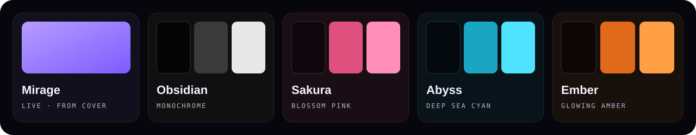</p>

### A full-screen stage

Press <kbd>Ctrl</kbd>+<kbd>Shift</kbd>+<kbd>M</kbd>. Switch between five views with <kbd>1</kbd> to <kbd>5</kbd>.

<table>
  <tr>
    <td width="33%">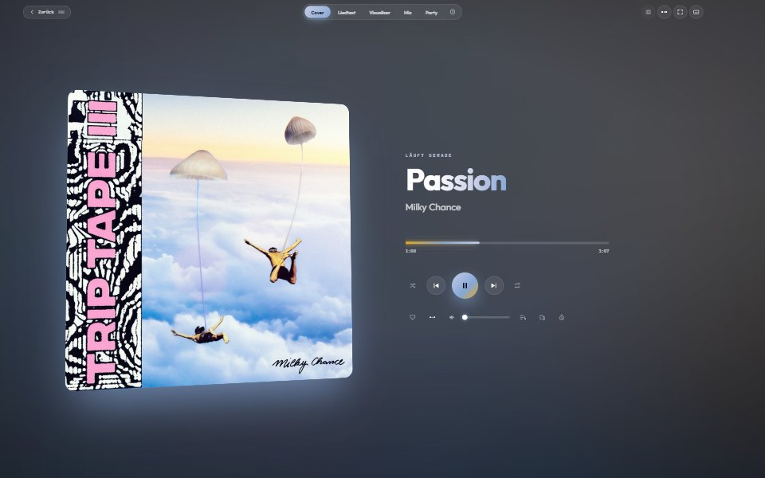</td>
    <td width="33%">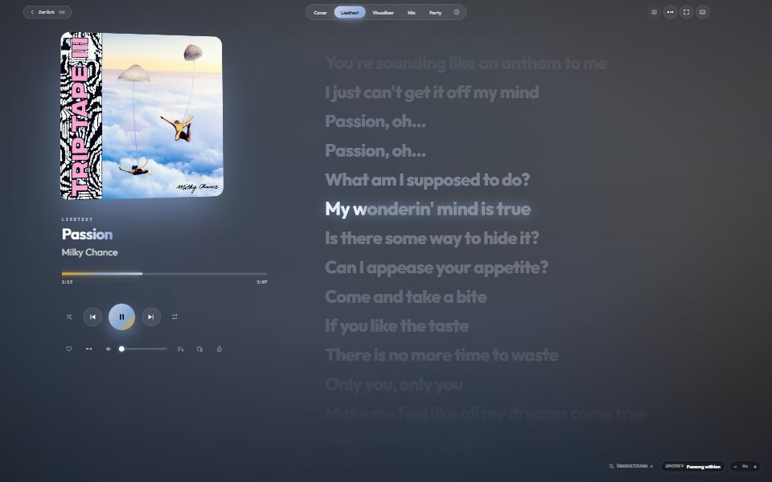</td>
    <td width="33%">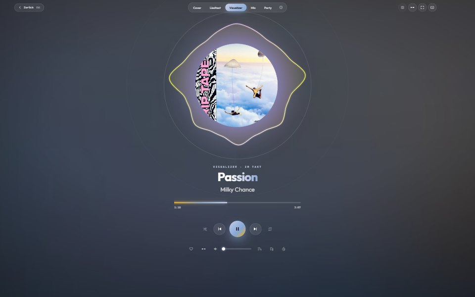</td>
  </tr>
  <tr>
    <td align="center"><b>1 · Cover</b></td>
    <td align="center"><b>2 · Lyrics</b></td>
    <td align="center"><b>3 · Visualizer</b></td>
  </tr>
  <tr>
    <td>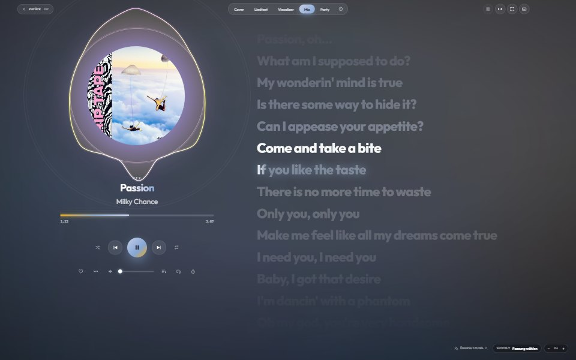</td>
    <td>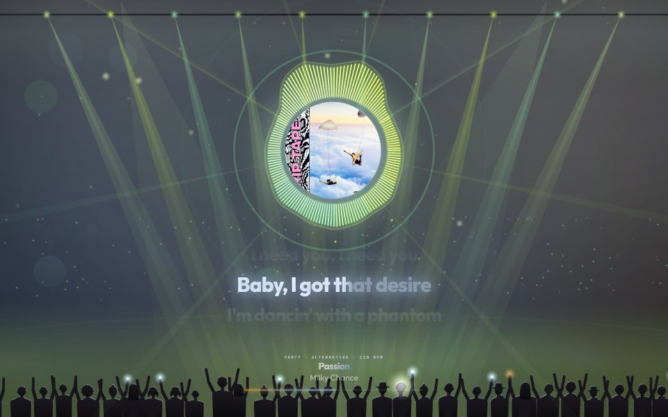</td>
    <td>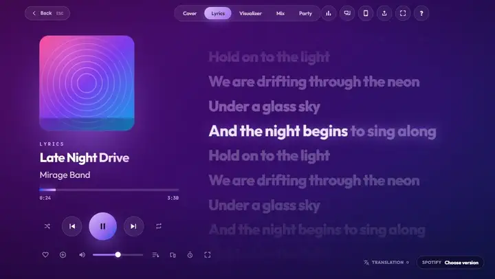</td>
  </tr>
  <tr>
    <td align="center"><b>4 · Mix</b></td>
    <td align="center"><b>5 · Party</b></td>
    <td align="center"><b>Karaoke</b> – fills as it's sung</td>
  </tr>
</table>

- **Lyrics for almost every song** – if Spotify has none, Mirage looks in several free lyrics collections at once and lines them up with the singing by itself.
- **Karaoke word by word** – the letters fill exactly as they are sung.
- **Translation and Latin letters** under the lyrics, if you want them (for example under Korean, Japanese, Chinese, Russian, Greek or Hindi).
- **Wrong lyrics?** One click on *Not the right lyrics* tries the next best match.
- **Eleven visualizer styles**, from simple bars to a galaxy or a 3D tunnel.

### A light show that knows the song

<table>
  <tr>
    <td width="50%">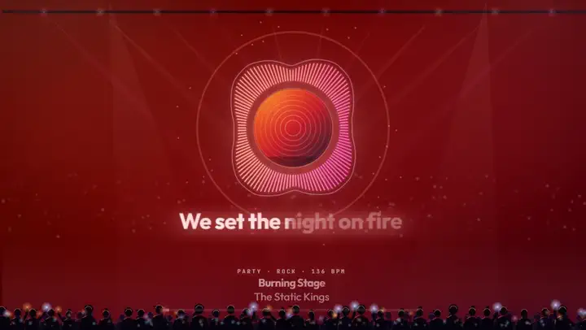</td>
    <td width="50%">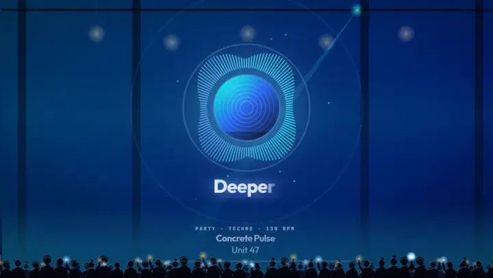</td>
  </tr>
  <tr>
    <td align="center"><sub><b>Rock · stadium</b> – flames on the drop</sub></td>
    <td align="center"><sub><b>Techno · warehouse</b> – lasers and running lights</sub></td>
  </tr>
  <tr>
    <td>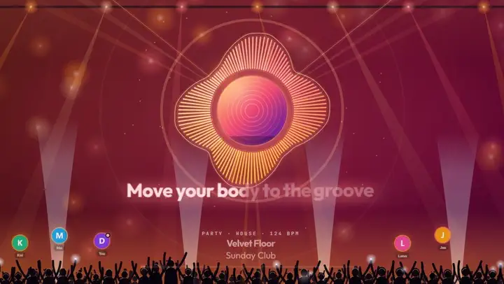</td>
    <td>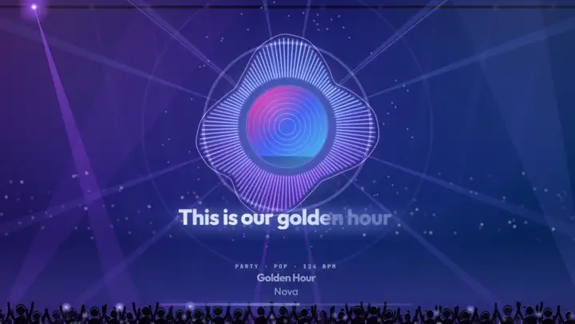</td>
  </tr>
  <tr>
    <td align="center"><sub><b>House · club</b> – disco ball and waves of light</sub></td>
    <td align="center"><sub><b>Pop · stadium</b> – fireworks for the last chorus</sub></td>
  </tr>
</table>
<sub>Recorded from the real theme with made-up demo songs.</sub>

Party mode listens to the whole song **before** it plays. It knows where the chorus starts and where the drop hits, and it plans the light for each part.

- **Follows the mood** – a happy drop, a tender break and a sad bridge each get their own colours and pace. The scenes change during the song, always on the beat.
- **318 music styles** – techno gets laser scanners, house a disco ball, rock hard spots, ballads a sea of phone lights. Mirage picks the style by itself, or you choose it.
- **17 places** – club, warehouse, festival, stadium, beach, living room, rooftop, cathedral, jazz bar, forest stage, concert hall, cellar, outer space, neon street, pub, ski hut and desert night.
- **A crowd that dances along** – jumps on the beat, hands up in the chorus, lighters in ballads.
- **Instruments get a moment** – when the song credits name a trumpet, sax, guitar, piano, strings, choir and a few more, that instrument gets its own effect. Mirage also listens to the song's 30-second preview (analysed, never played): kick, 808, hi-hats, guitars, piano, strings, pads and sound effects like risers, impacts, stops or sirens get their own light – only when Mirage is sure.
- **Five strengths** from *Soft* to *Insane*. The picture never zooms or moves the camera.

<p align="center">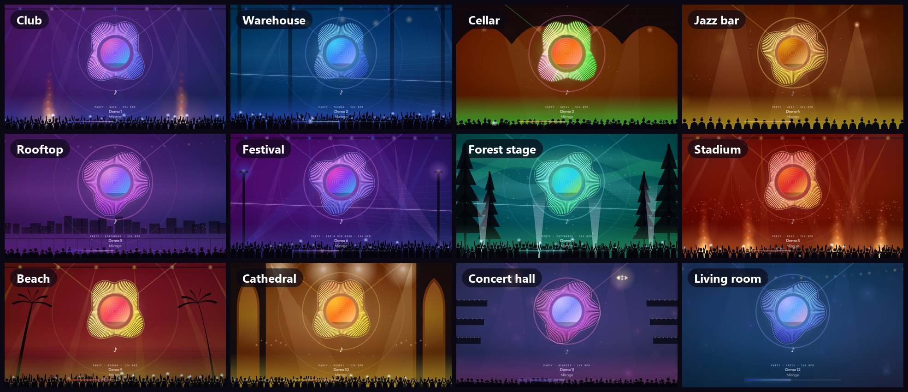</p>
<p align="center">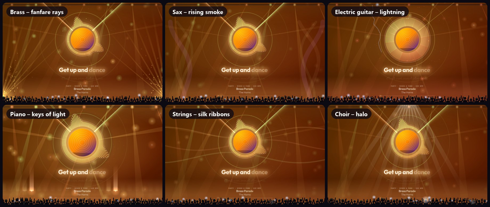</p>

<details>
<summary><b>All 318 styles in 17 families</b></summary>

| Family | Styles |
|---|---|
| Electronic (51) | Rave · EDM & Big Room · Electro house · Progressive house · Future & slap house · House · Deep House · Tropical house · Tech House · Bass house · Acid house · Chicago & classic house · French house · Nu-disco · UK Garage · Jersey club · Techno · Minimal & microhouse · Detroit techno · Dub techno · Melodic techno · Hard techno · EBM & industrial dance · Trance · Progressive trance · Uplifting & vocal trance · Psytrance · Drum & Bass · Liquid drum & bass · Neurofunk · Jungle · Breakbeat · Footwork & juke · Electro & Miami bass · Dubstep · Festival trap · Future bass · Moombahton · Hardstyle · Gabber & hardcore · Happy hardcore · Eurodance · Eurobeat · Hands up · Italo disco · Synthwave · Darksynth · Vaporwave · Hyperpop · Chiptune & 8-bit · Electro swing |
| Hip-Hop & R&B (28) | Hip-Hop · Boom bap · Gangsta & hardcore rap · West Coast & G-funk · Southern hip-hop & crunk · Alternative & underground hip-hop · Trap · Pop rap & melodic rap · Cloud rap · Drill · Phonk · UK rap · Grime · German rap · French rap · Italian rap · Spanish rap · Russian rap · Turkish rap · Arabic & Maghreb rap · Brazilian hip-hop & trap · R&B · Alternative R&B · New jack swing · Soul & Funk · Neo-soul · Northern & classic soul · Funk |
| Rock (28) | Rock · Classic rock · Rock 'n' roll & rockabilly · Hard rock · Glam rock · Blues rock · Southern rock · Psychedelic rock · Stoner & desert rock · Progressive & art rock · Krautrock · Surf rock · Garage rock · Alternative · Grunge · Indie · Britpop & UK indie · Shoegaze & dream pop · Post-punk & darkwave · Post-rock · Folk rock · Soft rock & yacht rock · German rock · Punk · Pop punk · Hardcore punk · Post-hardcore & screamo · Emo |
| Metal (17) | Metal · Heavy metal & NWOBHM · Thrash metal · Glam & hair metal · Power metal · Symphonic & gothic metal · Progressive metal & djent · Doom & sludge · Death metal · Black metal · Grindcore & powerviolence · Groove & alternative metal · Metalcore · Deathcore · Nu metal & rap metal · Industrial metal & NDH · Folk & viking metal |
| Pop (11) | Pop · Dance pop · Electropop · Synth-pop & new wave · Teen pop & boy bands · Pop rock & power pop · Indie pop & bedroom pop · Art pop & chamber pop · Disco & Funk · Ballad · Musical |
| Asia (33) | K-Pop · K-indie · K-rock · K-hip-hop · K-R&B · Trot · J-pop & anime · J-rock & visual kei · J-hip-hop · Anime & anisong · Vocaloid & utaite · City pop · Shibuya-kei · Enka & kayōkyoku · Japanese traditional · C-pop · Mandopop · Cantopop · Chinese hip-hop · Chinese traditional · T-pop · Luk thung & mor lam · V-pop · OPM & P-pop · Dangdut & Indo pop · Gamelan & Southeast Asian traditional · Bollywood · South Indian film · Punjabi & bhangra · Desi hip-hop · Hindustani classical · Carnatic classical · Qawwali & Sufi |
| Latin America (29) | Latin · Latin pop · Reggaeton · Latin trap · Dembow · Bachata · Merengue · Salsa & Tropical · Son & trova (Cuba) · Bolero & balada · Cumbia · Vallenato · Tango · Mariachi & ranchera · Regional Mexican · Banda · Norteño & Tejano · Corridos & sierreño · Rock en español · Andean & folklore · Brazilian · Samba · Pagode · Axé & frevo · Forró & piseiro · Sertanejo · Funk carioca & baile funk · MPB · Bossa nova |
| Africa & Caribbean (21) | Afrobeats · Afrobeat & Afro-funk · Highlife & hiplife · Amapiano · Gqom · Afro house · Bongo flava & East African · Soukous & Congolese rumba · Kuduro · Kizomba & semba · Desert blues · Reggae · Roots reggae & lovers rock · Dub · Rocksteady · Ska · Dancehall · Soca · Calypso & steelpan · Zouk · Kompa |
| Middle East & North Africa (14) | Arabic · Arabic pop · Khaleeji · Tarab & Arabic classical · Raï · Gnawa & chaabi · Dabke · Mahraganat & shaabi · Turkish pop · Arabesk & Turkish folk · Anatolian rock · Persian pop · Persian classical · Mizrahi & Israeli pop |
| Europe (19) | Schlager · Après-ski & Ballermann · Volksmusik & alpine · Polka & brass · Carnival & levenslied · German pop & NDW · Chanson & variété · Canzone & Italian pop · Europop & Eurovision · Disco polo · Russian pop & estrada · Greek laïko & rebetiko · Fado · Flamenco · Balkan · Turbo-folk · chalga & manele · Klezmer · Celtic & Irish · Nordic folk |
| Country & folk (10) | Country & Folk · Classic & outlaw country · Country pop · Country rock & red dirt · Americana & alt-country · Bluegrass & old-time · Cajun & zydeco · Folk · Indie folk & folk pop · Acoustic |
| Jazz & blues (17) | Jazz · New Orleans & Dixieland · Swing & big band · Bebop & hard bop · Cool & West Coast jazz · Modal & spiritual jazz · Free & avant-garde jazz · Vocal jazz & standards · Latin jazz · Gypsy jazz (manouche) · Jazz fusion & jazz-funk · Acid jazz · Nu jazz & UK jazz · Smooth jazz · Blues · Delta & acoustic blues · Electric & Chicago blues |
| Gospel & spiritual (7) | Gospel · Christian pop & CCM · Worship & praise · Christian rock & metal · Christian hip-hop · Bhajan · kirtan & mantra · Nasheed & Islamic |
| Classical & soundtrack (12) | Classical · Baroque & early music · Classical era · Romantic era · Opera & operetta · Choral & sacred · Chamber music · Orchestral & symphonic · Minimalism · Contemporary classical · Film & Epic · Video game music |
| Calm & classical (10) | Chill · Lo-fi · Downtempo & chillout · Trip-hop · Easy listening & lounge · Ambient · New age & healing · Meditation & yoga · Sleep & nature sounds · Neoclassical |
| Experimental (5) | Experimental & avant-garde · IDM & glitch · Industrial & power electronics · Noise & noise rock · Dark ambient & drone |
| Kids, holidays & spoken (6) | Christmas · Halloween · Kids' music · Disney & family film · Comedy & novelty · Spoken word & podcast |
</details>

## 🎉 Party with friends

<p align="center">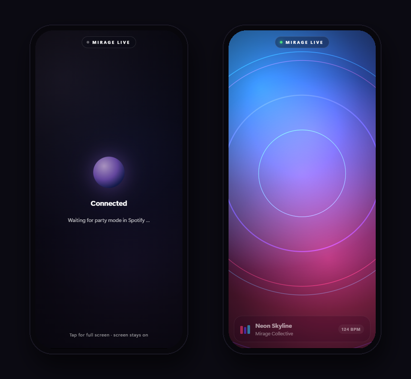</p>

Your guests join with their phone. **No app, no account** – Wi-Fi or mobile data both work.

1. In **Mirage settings → Party mode**, switch on **Live link for phones**.
2. Open party mode (<kbd>Ctrl</kbd>+<kbd>Shift</kbd>+<kbd>M</kbd>, then <kbd>5</kbd>) and click the **QR code** button at the top.
3. Guests scan the code with their phone camera, pick a **name and a colour**, and they're in.

**What guests can do on their phone**

- 💡 **Light up along** – the phone flashes in the song's colours; as a *light wave*, phones can take turns.
- 🎤 **Sing along** – the current lyric line, big and clear.
- 🎵 **Wish for songs** – search like in Spotify or paste a Spotify link; others vote. You decide what gets played, or let songs join the queue automatically after enough votes.
- 🔥 **Send reactions** – emoji float up quietly at the edge of the big screen.
- 📸 **Photo wall** (off unless you turn it on) – guests send a photo; it only appears after you approve it.
- 📱 The phone page speaks **14 languages** and can be added to the home screen like an app. Android phones can vibrate on the beat.

**Two extra QR codes, just for you**

- **Remote control for your phone** (in the party settings): playback, volume, light strength, place and games from your sofa.
- **Game host on your phone** (in the games panel): start, skip and end games and correct points. Guests can't do this.

### 26 party games

Click the **games** button in party mode. The big screen shows the questions and scores, everyone answers on their own phone.
Play alone, against each other or in **2 to 4 teams**, or as a **tournament** of 3 to 6 games with a podium at the end.

| | Some favourites |
|:-:|---|
| 🎶 | **Karaoke** – one guest sings, their phone gives points for timing, notes and singing along. The recording never leaves the phone. |
| 🎱 | **Music bingo** – every phone gets its own card of song titles. |
| 🖼️ | **Cover puzzle** – a blurry album cover slowly gets sharp. Who knows it first? |
| ⚔️ | **Song duel** – the room votes which of two songs stays. |
| 📅 | **Older or newer?** – which of two songs came out first? |

<details>
<summary><b>All 26 games</b></summary>

- **Music quiz:** Who's singing? · Name that song · Intro flash · Lyric gaps · Next line · Real or fake? · Beat hit · Older or newer? · Cover puzzle · Song duel
- **Fast fingers:** Music stop · Fastest finger · Tap race · Dance battle · Hot potato
- **Party:** Who would most likely …? · Keep singing · Karaoke · Tournament · Music bingo · Wheel of fortune
- **Drinking games (18+, only if you want; water counts too):** Never have I ever · Sip quiz · Word alarm · Who would … (sip edition) · Sip wheel

Quizzes come in easy, normal or hard, can use a decade filter or one of your playlists, and late guests can still join and keep their points.
**No phones?** Number keys answer, <kbd>Space</kbd> is the buzzer, <kbd>Enter</kbd> starts. After a game you can save the ranking as an image.
</details>

**More for the party:** a DJ panel that sorts your queue so the mood flows, Spotify Jam guests dancing in the crowd, confetti on <kbd>C</kbd>, and a recap of the night that you can save as a playlist.

## 💡 Overlay app

<p align="center">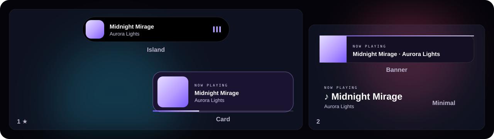</p>

A small free extra app. It shows the current song **above every window**, even while you work or play, and connects Mirage to the lights in your room.

| Windows | Mac | Linux |
|:-:|:-:|:-:|
| [**⬇ Mirage-Overlay-Setup.exe**](https://github.com/Passimoritz/spicetify-mirage/releases/latest/download/Mirage-Overlay-Setup.exe) | [**⬇ Mirage-Overlay.dmg**](https://github.com/Passimoritz/spicetify-mirage/releases/latest/download/Mirage-Overlay.dmg) | [**⬇ AppImage**](https://github.com/Passimoritz/spicetify-mirage/releases/latest/download/Mirage-Overlay.AppImage) · [**⬇ .deb**](https://github.com/Passimoritz/spicetify-mirage/releases/latest/download/Mirage-Overlay.deb) |
| Double-click to install. It sits next to the clock. | Drag it into *Applications*. | Make the AppImage executable, or open the .deb. |

- 🪟 **Song pop-ups** in eight styles, on the screen and spot you like.
- 💡 **Lights in your room dance along** – Philips Hue (with a new, experimental fast mode for *Hue Entertainment*), WLED, Govee, Nanoleaf, LIFX, Yeelight, Home Assistant, OpenRGB and Razer Chroma. On first start the app finds your lights for you. You can set a maximum brightness and fine-tune the timing per light. Passwords for your lights are stored encrypted.
- 📺 **Party on the TV** – send the party screen to a Chromecast, Google TV or smart TV.
- 🌈 **Edge light** – the edges of your screen glow on the beat.
- 🛠️ **Repairs Mirage for you** – after a Spotify update, the app's menu (next to the clock, or in the Mac menu bar) offers *Repair theme in Spotify*, and it tells you when a new Mirage version is ready.
- 🎛️ **Stream Deck** – [⬇ Mirage.streamDeckPlugin](https://github.com/Passimoritz/spicetify-mirage/releases/latest/download/Mirage.streamDeckPlugin) puts play, skip, like and party mode on buttons. Streamers also get a source for OBS.

> **Windows asks "Windows protected your PC"?** The app is not signed yet ([why](CODE_SIGNING.md)). Click *More info → Run anyway*.
>
> **Mac says it can't be opened?** Right-click the app → *Open* → *Open*.

## ⚙️ Settings in short

Open your **profile menu → Mirage settings**. Every effect has its own switch, and each section can be reset on its own.

- **Look & performance** – one click for *Full*, *Balanced*, *Light* or *Calm*. If your computer struggles, Mirage steps down by itself.
- **Quick menu** – in the full-screen stage, press <kbd>O</kbd> (or the **⋯** button) to change look and performance without leaving the music.
- **Energy saving** – on battery, Mirage draws less and saves power.
- **No flashes** – for sensitive eyes: no strobe, no blinding light, no sudden flashes anywhere, also on guest phones and room lights. It turns on by itself when your computer is set to reduce motion.
- **Light and lyrics too early or too late?** Press <kbd>T</kbd> six times on the beat. Mirage measures the delay of your speakers (Bluetooth adds some).

<details>
<summary><b>See the party settings</b></summary>
<p align="center">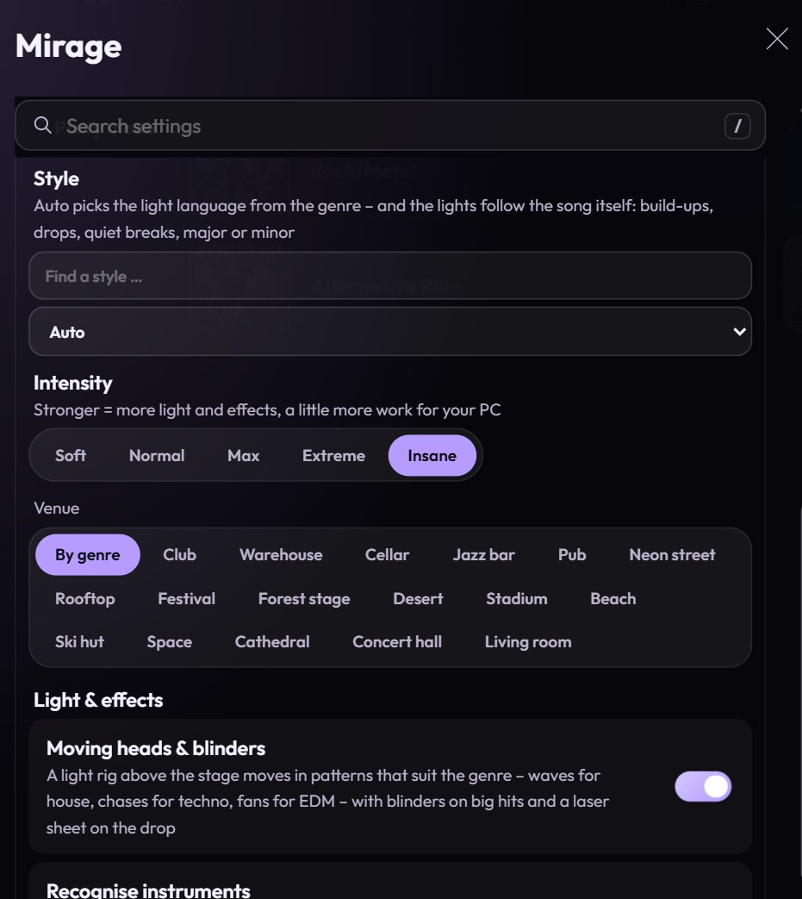</p>
</details>

## 🔧 Help: something looks wrong after a Spotify update

Spotify updates itself every few weeks. Sometimes Mirage is gone afterwards, or Spotify stays black. **Nothing is broken** – Spicetify just has to be set up again.

1. **Mirage often fixes small problems by itself.** It loads small repairs for new Spotify versions (you can switch this off under *Repair itself after Spotify updates*).
2. **Using the overlay app?** Click its icon (next to the clock, or in the Mac menu bar) → **Repair theme in Spotify**.
3. **Windows, one click:** download and double-click [**⬇ fix-spicetify.cmd**](https://github.com/Passimoritz/spicetify-mirage/releases/latest/download/fix-spicetify.cmd) ([see what's inside](tools/fix-spicetify.cmd)). It closes Spotify, repairs Spicetify, puts Mirage back and opens Spotify again. Your settings stay.
4. **Mac, Linux or by hand:** paste these two lines into the Terminal or PowerShell:

   ```bash
   spicetify upgrade
   spicetify restore backup apply
   ```

Still broken? Right after a big Spotify update, Spicetify sometimes needs a few days to catch up. If Mirage itself looks odd, tell us with the [bug form for Spotify updates](https://github.com/Passimoritz/spicetify-mirage/issues/new/choose).

## 🔒 Privacy in plain words

- **No account, no tracking, no ads.** Mirage has no server of its own.
- **Stays on your computer:** your settings, saved lyrics, and the passwords for your lights (encrypted).
- **Only song details leave your computer**, never who you are: when Spotify has no lyrics, tempo or style for a song, Mirage sends song details such as title and artist to free music services (LRCLIB, NetEase, Kugou, lyrics.ovh, Deezer, Apple's iTunes search, MusicBrainz). You can switch these lookups off.
- **Translation** (off unless you turn it on) sends lyric lines to Google Translate.
- **Phones at the party** (off unless you turn it on): everything is end-to-end encrypted – nobody but your guests can read it, not even the relay service that passes it on. The key is only in the QR code. It works only while party mode runs and expires 10 minutes after.
- **Karaoke:** the singing is scored on the singer's phone. The recording never leaves it.
- **Photo wall:** off unless you turn it on. Location and hidden photo data are removed on the phone, nothing shows without your OK, and nothing is saved – the photos are gone when the party ends.
- **Overlay app:** talks to Mirage only on your own computer, controls lights only in your own home network, and asks GitHub for updates (you can switch that off). More in the [privacy policy](CODE_SIGNING.md#privacy-policy).

## ❓ FAQ

<details>
<summary><b>Is Mirage free?</b></summary>

Yes, completely free and open source.
</details>

<details>
<summary><b>Mirage is gone after Spotify updated.</b></summary>

That's normal. Follow [Help after a Spotify update](#-help-something-looks-wrong-after-a-spotify-update).
</details>

<details>
<summary><b>Party mode picks the wrong music style.</b></summary>

Choose it yourself in **Mirage settings → Party mode → Style**. The list has a search field.
</details>

<details>
<summary><b>My laptop gets warm or the fan is loud.</b></summary>

Press <kbd>O</kbd> in the full-screen stage and choose *Light* or *Calm*, or switch on energy saving.
</details>

<details>
<summary><b>The phone page says "no connection".</b></summary>

The phone needs internet. A VPN or ad blocker on the phone can block the connection. The page waits until party mode is running in Spotify.
</details>

<details>
<summary><b>Does the iPhone work?</b></summary>

Yes. iPhones don't let websites vibrate, so they can play a quiet click on the beat instead.
</details>

## ⌨️ Keyboard shortcuts

| Key | What it does |
|---|---|
| <kbd>Ctrl</kbd>+<kbd>Shift</kbd>+<kbd>M</kbd> | open or close the full-screen stage |
| <kbd>1</kbd> … <kbd>5</kbd> | cover · lyrics · visualizer · mix · party |
| <kbd>Space</kbd> | play / pause |
| <kbd>O</kbd> | quick menu for look and performance |
| <kbd>?</kbd> | show all shortcuts |

<details>
<summary><b>All shortcuts in the full-screen stage</b></summary>

| Key | What it does |
|---|---|
| <kbd>N</kbd> · <kbd>P</kbd> | next · previous song |
| <kbd>←</kbd> <kbd>→</kbd> | jump 5 seconds |
| <kbd>↑</kbd> <kbd>↓</kbd> | volume |
| <kbd>L</kbd> · <kbd>S</kbd> · <kbd>R</kbd> · <kbd>Q</kbd> | like · shuffle · repeat · queue |
| <kbd>F</kbd> or <kbd>F11</kbd> | full screen |
| <kbd>C</kbd> | confetti |
| <kbd>T</kbd> (6×, on the beat) | match light and lyrics to your speakers |
| <kbd>E</kbd>, then <kbd>Enter</kbd> | fix the lyric timing: press Enter when the marked line starts |
| <kbd>Esc</kbd> | close |
</details>

## ❤️ Credits & licence

Mirage is built on [Spicetify](https://spicetify.app). Lyrics come from Spotify, [LRCLIB](https://lrclib.net), NetEase, Kugou, lyrics.ovh and the [AMLL](https://github.com/amll-dev/amll-ttml-db) collection; song details from Deezer, Apple's iTunes search and [MusicBrainz](https://musicbrainz.org). Thank you!

Ideas and questions are welcome in [Discussions](https://github.com/Passimoritz/spicetify-mirage/discussions). Want to help build it? See [CONTRIBUTING.md](CONTRIBUTING.md) and the [changelog](CHANGELOG.md).

MIT licence © Passimoritz – free to use, share and change.
