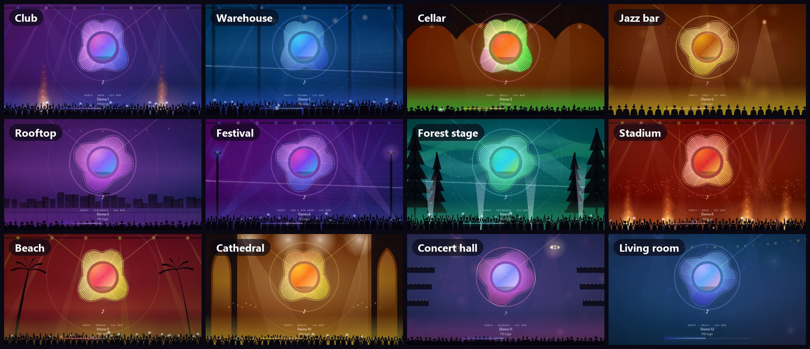
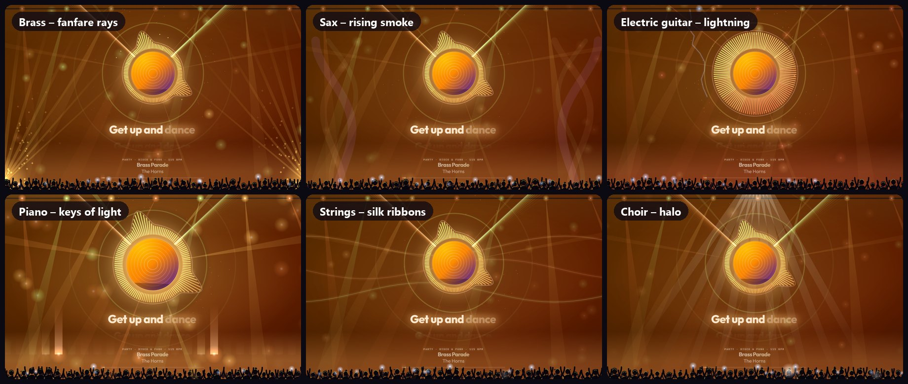
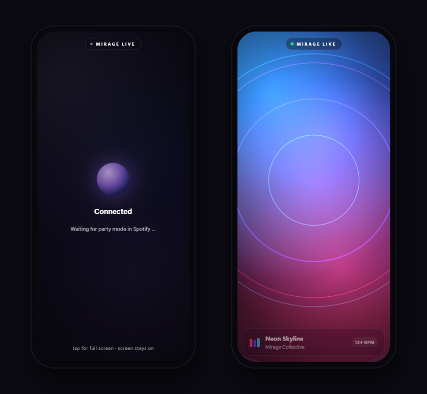
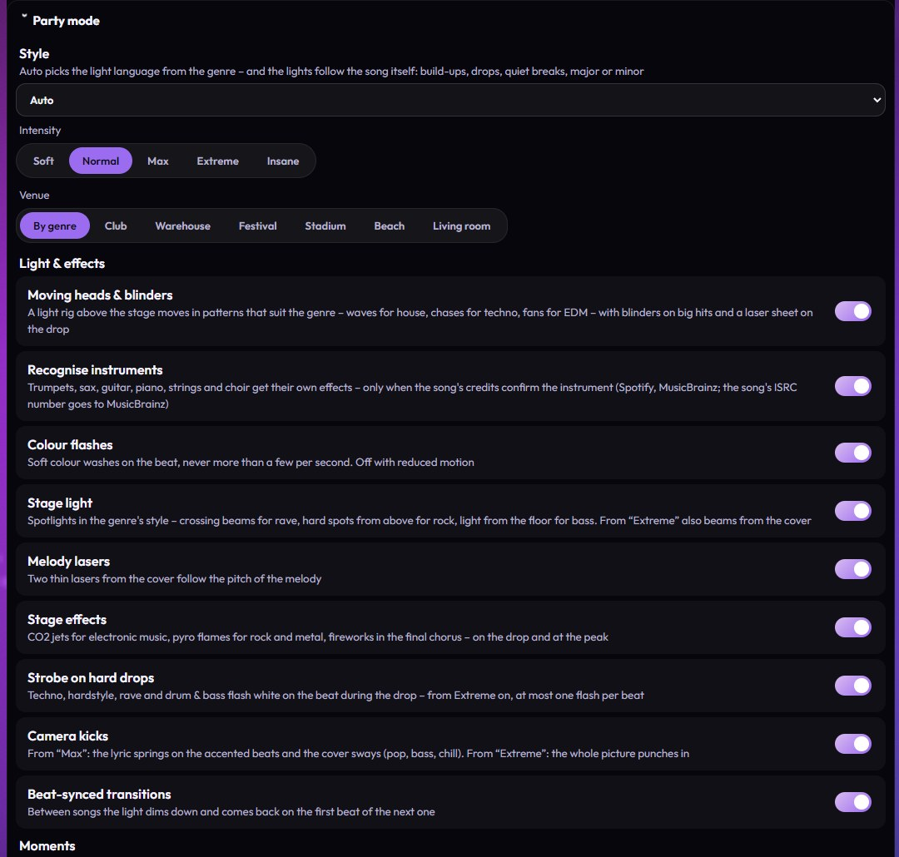
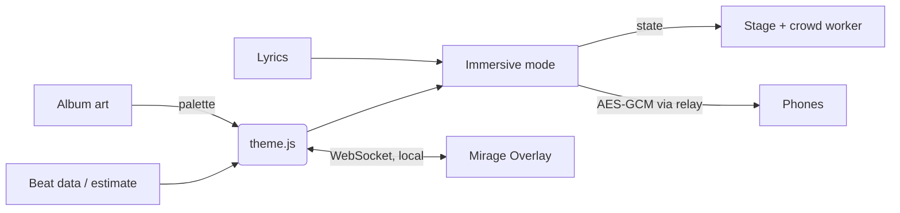

<p align="center">
  
</p>

<p align="center">
  <a href="#-install"></a>
  <a href="https://github.com/Passimoritz/spicetify-mirage/releases/latest"></a>
  
  
</p>

<p align="center">
  <b>English</b> · <a href="README.de.md">Deutsch</a>
  <br><br>
  <a href="#-install">Install</a> ·
  <a href="#-the-theme">Theme</a> ·
  <a href="#-immersive-mode">Immersive</a> ·
  <a href="#-party-mode">Party</a> ·
  <a href="#-live-link-for-phones">Phones</a> ·
  <a href="#-mirage-overlay">Overlay</a> ·
  <a href="#-settings--performance">Settings</a> ·
  <a href="#-faq">FAQ</a>
</p>

---

<h3 align="center">Spotify as frosted glass, with the music living behind it.<br>One shortcut away: a full-screen stage with karaoke, a visualizer and a party light show that knows where the drop is.</h3>

<p align="center">
  
</p>

<p align="center"><a href="https://passimoritz.github.io/spicetify-mirage/"><b>▶ Try the colours in your browser</b></a> – no install needed.</p>

## ✦ At a glance

<table>
  <tr>
    <td width="33%" valign="top"><h3>🎨 Colours from the cover</h3>Every song repaints Spotify in the palette of its album art – readable on dark glass, with the cover drifting behind the panels.</td>
    <td width="33%" valign="top"><h3>🎤 Karaoke & visualizer</h3>Full-screen lyrics that fill syllable by syllable, a visualizer on the beat, and a mix of both.</td>
    <td width="33%" valign="top"><h3>🎉 A party that knows the song</h3>48 styles, six venues, a crowd, a light rig, stage effects and moments for the drop – read from the song before it plays.</td>
  </tr>
  <tr>
    <td valign="top"><h3>🎺 Instruments</h3>When the credits confirm a trumpet, sax, guitar, piano, strings or choir, that instrument gets an effect of its own.</td>
    <td valign="top"><h3>📱 Phones light up</h3>Guests scan a QR code and their phones flash along – on any network, end-to-end encrypted.</td>
    <td valign="top"><h3>◎ Outside Spotify</h3>The overlay app announces songs above every window and adds edge light and an OBS source.</td>
  </tr>
</table>

## ⬇ Install

**Marketplace (easiest):** open **Marketplace → Themes**, search for **Mirage**, install. Done.

<details>
<summary><b>Windows, by script</b></summary>

```powershell
git clone https://github.com/Passimoritz/spicetify-mirage
cd spicetify-mirage
powershell -ExecutionPolicy Bypass -File install.ps1            # theme only
powershell -ExecutionPolicy Bypass -File install.ps1 -Overlay   # theme + overlay app
```

Add `-Scheme Obsidian` (or `Sakura`, `Abyss`, `Ember`) for a fixed colour scheme.
</details>

<details>
<summary><b>macOS / Linux / by hand</b></summary>

```bash
cp -r Mirage "$(dirname "$(spicetify -c)")/Themes/"
spicetify config current_theme Mirage color_scheme Mirage inject_css 1 replace_colors 1 inject_theme_js 1
spicetify apply
```
</details>

<details>
<summary><b>Uninstall</b></summary>

```bash
spicetify config current_theme marketplace
spicetify apply
```
</details>

Everything is set up in **Profile menu → Mirage settings**, and every effect below has its own switch.

## 🎨 The theme

<p align="center"></p>
<table>
  <tr>
    <td width="50%"></td>
    <td width="50%"></td>
  </tr>
  <tr>
    <td align="center"><sub>Album page – the header melts into the glass</sub></td>
    <td align="center"><sub>Visualizer, coloured live from the cover</sub></td>
  </tr>
</table>
<sub>Real Spotify install; personal library and friends' names are pixelated.</sub>

- **Colours from the cover** – accent, buttons, progress bar and selection take on each song's palette, tuned for contrast.
- **Living background** – the cover drifts as slow haze with aurora bands, light dust and film grain, and breathes on the beat.
- **Motion** – pages blur in, grids cascade, cards tilt towards the pointer, the player cover spins like a record, and a like sets off a heart burst.
- **Schemes** – `Mirage` follows the cover live; `Obsidian`, `Sakura`, `Abyss` and `Ember` are calm fixed palettes, and there's a builder for your own.

<p align="center"></p>

## ◐ Immersive mode

<kbd>Ctrl</kbd>+<kbd>Shift</kbd>+<kbd>M</kbd> (or the circle button in the top bar) turns Spotify into a full-screen stage with five views that morph into each other – switch with <kbd>1</kbd>–<kbd>5</kbd>.

<table>
  <tr>
    <td width="33%"></td>
    <td width="33%"></td>
    <td width="33%"></td>
  </tr>
  <tr>
    <td align="center"><b>Cover</b><br><sub>tilts with the mouse, full controls</sub></td>
    <td align="center"><b>Lyrics</b><br><sub>synced karaoke, click a line to jump</sub></td>
    <td align="center"><b>Visualizer</b><br><sub>radial spectrum, rings on the beat</sub></td>
  </tr>
  <tr>
    <td></td>
    <td></td>
    <td></td>
  </tr>
  <tr>
    <td align="center"><b>Mix</b><br><sub>visualizer ring and lyrics together</sub></td>
    <td align="center"><b>Party</b><br><sub>the light show – see below</sub></td>
    <td align="center"><b>Karaoke</b><br><sub>letters fill syllable by syllable</sub></td>
  </tr>
</table>

- **Karaoke on the syllable** – word timings from Spotify or NetEase are used as they are; otherwise every word is split into syllables and placed on a sung onset from the analysis. Lyrics from other sources are aligned to the song automatically.
- **Lyrics when Spotify has none** – Mirage looks on [LRCLIB](https://lrclib.net), NetEase and lyrics.ovh; *Choose version* picks another match, and an optional translation sits under each line.
- **A beat even without Spotify's analysis** – tempo and energy come from Spotify's audio features or Deezer, the beat from the lyric timing (the kicker then shows *≈ 128 BPM*).
- **In sync with what you hear** – a steady song clock smooths Spotify's position; press <kbd>T</kbd> six times on the beat to calibrate light, crowd and lyrics to your speakers.
- **Full screen** with the button, <kbd>F</kbd> or <kbd>F11</kbd>; when the mouse rests, the controls fade out.

## 🎉 Party mode

<table>
  <tr>
    <td width="50%"></td>
    <td width="50%"></td>
  </tr>
  <tr>
    <td align="center"><sub><b>Rock · stadium</b> – spots from above, pyro on the drop, the crowd headbangs</sub></td>
    <td align="center"><sub><b>Techno · warehouse</b> – chase lights, laser sheet, strobe on the hard drop</sub></td>
  </tr>
  <tr>
    <td></td>
    <td></td>
  </tr>
  <tr>
    <td align="center"><sub><b>House · club</b> – disco ball, waves of light, Jam guests in the crowd</sub></td>
    <td align="center"><sub><b>Pop · stadium</b> – the final chorus gets everything</sub></td>
  </tr>
</table>
<sub>Clips and the stills below are recorded from the real theme with made-up demo songs and Jam guests.</sub>

Party mode reads the whole song before it plays – energy curve, build-ups, drops placed on their beat, breaks, major or minor, and where kick, snare and hi-hats hit – and directs the light from that map. It reacts to what's *coming*, not just to what's loud.

### 48 styles

The style comes from Apple's iTunes genre, Spotify's artist genres and the sound itself – or you pick it in the settings. Each style has its own light language, crowd moves, venue and effects: rave gets crossing beams, techno soft scanner bands, house a disco ball, trance aurora ribbons, drum & bass a tunnel of light rings, hip-hop light from the floor, rock hard spots from above, chill slow breathing light.

<details>
<summary><b>All 48 styles</b></summary>

| Family | Styles |
|---|---|
| Electronic | Rave · EDM & Big Room · House · Deep House · Tech House · Techno · Trance · Psytrance · Drum & Bass · Dubstep · UK Garage · Hardstyle · Eurodance · Synthwave · Hyperpop |
| Hip-hop & R&B | Hip-Hop · Trap · Drill · Phonk · R&B · Soul & Funk · Afro · Reggae |
| Rock | Rock · Alternative · Indie · Punk · Metal · Blues |
| Pop | Pop · K-Pop · Disco · Schlager · Ballad · Gospel · Country |
| Latin & world | Latin · Reggaeton · Salsa & Tropical · Brazilian · Flamenco · Bollywood · Arabic |
| Calm & classical | Chill · Ambient · Jazz · Classical · Film & Epic |
</details>

### Six venues

<p align="center"></p>

The venue follows the style or is fixed in the settings. The crowd is locked to the beat: jumps land on it, heads nod or bang, hands clap on 2 and 4, a wave rolls through now and then, and camera flashes go off on the drop.

### Light, effects and moments

- **Light rig** – moving heads on a truss move in genre patterns: waves for house, chases for techno, fans for EDM, everything on the cover for hip-hop and rock. Blinders fire on big hits and a laser sheet spans the crowd on the drop; calm songs get soft bokeh instead.
- **Follows the instruments** – the kick drives the pulse and floor light, the snare the spots, the hi-hats the sparkle; two thin *melody lasers* follow the pitch of the tune.
- **Stage effects where they belong** – CO2 jets for electronic music, pyro for rock, metal and punk, fireworks in the final chorus, a strobe on hard drops (from *Extreme* on, never more than one flash per beat).
- **Light director** – the light holds back before the drop, goes dark on the last beat, then everything hits at once. Slow motion freezes the half second before it, and DJ transitions blend the colours over four beats when the song changes.
- **Five intensity levels** from *Soft* to *Insane*, plus hype lines for choruses, 3D depth, camera rides and lyrics that burst into light on the drop.

### 🎺 Instruments

<p align="center"></p>

When the song's **credits** (Spotify, otherwise MusicBrainz) confirm an instrument, it gets its own moment wherever it stands out in the sound: golden fanfare rays, rising smoke, lightning from the truss, keys of light that follow the notes, flowing silk ribbons, a halo from above. No credit, no effect – nothing is guessed, and at most two instruments show at a time.

### Jam & extras

- **Spotify Jam** – everyone in the Jam appears as a small, coloured face in the crowd and bounces on the kick; whoever added the current song lights up as the DJ.
- **Second screen** – party mode full screen on a TV or another monitor.
- **Edge light** – the overlay app makes the edges of your desktop glow on the beat.
- **Party recap** – a shareable card of the night: songs, genre mix, tempo range, the biggest drop.

## 📱 Live link for phones

<p align="center"></p>

Turn on **Live link** in the party settings, press the phone button in party mode and let your guests scan the QR code. Their phones become extra lights: the song's colours, a ring on every beat, a flash on the drop – full screen, with the display kept on.

- **Any network, no app** – Wi-Fi or mobile data; the page is served from GitHub Pages.
- **Only for whoever has the QR code** – channel and key are 128-bit random values that exist only in the QR link after the `#`, a part that is never sent to any server. Messages are end-to-end encrypted and authenticated (AES-GCM), so the relay sees only random bytes and nobody can read or inject anything.
- **Only while you party** – the theme sends only in party mode; afterwards the page says *party's over*, and 10 minutes later the code expires. The next party gets a new one.

## ⚙ Settings & performance

<details>
<summary><b>Show the party settings</b></summary>
<p align="center"></p>
</details>

- **Presets** – *Full*, *Balanced*, *Light* and *Calm*. *Balanced* draws immersive mode at up to 60 fps (half the work on 120/144 Hz screens), *Light* at 30 fps with about 40 % fewer pixels. If the first seconds run below ~45 fps, Mirage steps down by itself.
- **Party mode adapts** – stage and crowd are drawn in a background thread that never builds a backlog, a quality governor fades out back rows before frames drop, and quiet intros and breaks run at 30 fps.
- **Energy saving** – on battery (or always) everything runs at 30 fps with lighter detail. Effects pause while Spotify is hidden, and Mirage starts calm when your system asks for reduced motion.

## ◎ Mirage Overlay

<p align="center"></p>

A small companion app that announces songs **outside Spotify** – above every window, on the screen you choose. The theme talks to it only on your own computer (`127.0.0.1`).

| Windows | macOS | Linux |
|:-:|:-:|:-:|
| [**⬇ Mirage-Overlay-Setup.exe**](https://github.com/Passimoritz/spicetify-mirage/releases/latest/download/Mirage-Overlay-Setup.exe) | [**⬇ Mirage-Overlay.dmg**](https://github.com/Passimoritz/spicetify-mirage/releases/latest/download/Mirage-Overlay.dmg) | [**⬇ AppImage**](https://github.com/Passimoritz/spicetify-mirage/releases/latest/download/Mirage-Overlay.AppImage) · [**⬇ .deb**](https://github.com/Passimoritz/spicetify-mirage/releases/latest/download/Mirage-Overlay.deb) |
| Double-click – it lives in the tray | Drag it into *Applications* | Make it executable, or `sudo apt install ./Mirage-Overlay.deb` |

Or in Spotify: **Mirage settings → Overlay → Download the Overlay app** (picks the right file and shows whether it's connected).

- **When** – on every song change, permanently as a mini player, or off · on play/pause · quiet hours
- **Where** – main screen, the screen with the mouse, or any screen · 9 positions · fine offset
- **How** – Island, Card, Banner or Minimal · springy, slide or fade · glow, roundness, size, opacity · controls on hover
- **Extras** – volume bar · stays quiet during full-screen games and videos · your own look via `custom.css` · OBS browser source (`http://127.0.0.1:47322/`) · edge light for party mode · updates itself

> **Code signing:** the Windows installer is being set up for free signing by the SignPath Foundation – see the [code signing policy](CODE_SIGNING.md). Until it is signed, Windows *Smart App Control* can block it and SmartScreen asks once: *More info → Run anyway*. On macOS: right-click → *Open* → *Open*.

## ⌨ Shortcuts

| Where | Key | Action |
|---|---|---|
| anywhere | <kbd>Ctrl</kbd>+<kbd>Shift</kbd>+<kbd>M</kbd> | open / close immersive mode |
| immersive | <kbd>1</kbd> … <kbd>5</kbd> | cover · lyrics · visualizer · mix · party |
| immersive | <kbd>Space</kbd> · <kbd>N</kbd> <kbd>P</kbd> | play / pause · next · previous |
| immersive | <kbd>←</kbd> <kbd>→</kbd> · <kbd>↑</kbd> <kbd>↓</kbd> | seek 5 s · volume |
| immersive | <kbd>L</kbd> <kbd>S</kbd> <kbd>R</kbd> <kbd>Q</kbd> | like · shuffle · repeat · queue |
| immersive | <kbd>F</kbd> / <kbd>F11</kbd> | full screen |
| immersive | <kbd>T</kbd> (6×, on the beat) | sync light, crowd and lyrics to what you hear |
| immersive | <kbd>?</kbd> · <kbd>Esc</kbd> | all shortcuts · close |

## 🛠 Fix after a Spotify update

Spotify updates itself every few weeks and overwrites what Spicetify patched. Spotify then looks normal again, `spicetify apply` complains about a *backup version mismatch* or *Cannot find xpui.spa*, or the window stays black. Nothing is broken – Spicetify just has to re-patch.

**One click (Windows):** <a href="https://github.com/Passimoritz/spicetify-mirage/releases/latest/download/fix-spicetify.cmd"><b>⬇ fix-spicetify.cmd</b></a> · <sub><a href="tools/fix-spicetify.cmd">read the source</a></sub> – closes Spotify, updates Spicetify, makes a fresh backup, re-applies Mirage and your extensions and starts Spotify again. Settings and Marketplace items are kept.

**By hand (all systems):**

```bash
spicetify upgrade
spicetify restore backup apply
```

Still broken? Run `spicetify clear`, then `spicetify backup apply`. Right after a big Spotify release Spicetify sometimes needs a few days – wait for the next [Spicetify release](https://github.com/spicetify/cli/releases). If Mirage itself looks off, use the [bug form for Spotify updates](https://github.com/Passimoritz/spicetify-mirage/issues/new/choose).

## 🔒 Privacy

- **No own server, no tracking, no account.** Lyrics, beat data, audio features and credits come from Spotify.
- **Only when Spotify has nothing** – and each can be turned off: title, artist, album and length go to LRCLIB, NetEase and lyrics.ovh for lyrics; title and artist to Deezer for the tempo and to Apple's iTunes search for the party genre; the song's ISRC number to MusicBrainz for instrument credits.
- **Live link** (off by default) – light colours, tempo and the song title, end-to-end encrypted through a public relay (HiveMQ). The key never leaves the QR code.
- **Overlay app** – listens only on your own computer and asks GitHub for updates (can be turned off). Details in the [code signing policy](CODE_SIGNING.md#privacy-policy).
- Fonts load from Google Fonts.

## ❓ FAQ

<details>
<summary><b>Mirage is gone after Spotify updated.</b></summary>

Run the [fix](#-fix-after-a-spotify-update) – that's Spicetify, not Mirage.
</details>

<details>
<summary><b>Party mode picks the wrong style.</b></summary>

Pick it by hand in **Mirage settings → Party mode → Style**, or keep *Auto* and turn on online genre lookup for better guesses.
</details>

<details>
<summary><b>Light and lyrics feel a little early or late.</b></summary>

Press <kbd>T</kbd> six times on the beat in immersive mode – Mirage measures the delay of your speakers (Bluetooth adds some) – or set the sync offset in the settings.
</details>

<details>
<summary><b>The phone page stays on “no connection”.</b></summary>

The phone needs internet (Wi-Fi or mobile data). A firewall, VPN or ad blocker on the phone may block the relay `broker.hivemq.com`. The page says “waiting for party mode” until party mode runs in Spotify.
</details>

<details>
<summary><b>It's too much / my laptop gets warm.</b></summary>

Choose the *Light* or *Calm* preset, set energy saving to *Always*, or lower the party intensity – every effect has its own switch.
</details>

## 🧩 Under the hood



- Colours change in one style update; the background haze is a pre-shrunk image blurred once and only rotated.
- Built against the real Spotify DOM and matched by computed style rather than class names that change every release.
- With the overlay running, the theme can write a layout report (sizes, classes, colours – no content) to `%APPDATA%\Mirage Overlay\dom-report.json` for bug reports.
- 14 languages: English, Deutsch, Français, Español, Italiano, Português, Nederlands, Polski, Türkçe, Русский, Українська, 日本語, 한국어, 中文.

Want to help? See [CONTRIBUTING.md](CONTRIBUTING.md) and the [changelog](CHANGELOG.md). Questions and ideas go to [Discussions](https://github.com/Passimoritz/spicetify-mirage/discussions).

## License

MIT © Passimoritz
