<p align="center">
  
</p>

<p align="center">
  <a href="#-install"></a>
  
  
  
</p>

<p align="center">
  <b>English</b> · <a href="README.de.md">Deutsch</a>
  <br><br>
  <a href="#-install">Install</a> ·
  <a href="#-what-it-does">Features</a> ·
  <a href="#-immersive-mode">Immersive</a> ·
  <a href="#-party-mode">Party</a> ·
  <a href="#-mirage-overlay">Overlay</a> ·
  <a href="#-fix-after-a-spotify-update">Fix after updates</a> ·
  <a href="#-shortcuts">Shortcuts</a> ·
  <a href="#-faq">FAQ</a>
</p>

---

**Mirage turns Spotify into frosted glass with the music living behind it.** Every song repaints the interface in the colours of its cover, the artwork drifts behind the panels as soft light, and the background breathes on the beat. Press <kbd>Ctrl</kbd>+<kbd>Shift</kbd>+<kbd>M</kbd> and Spotify becomes a full-screen stage – lyrics, visualizer, or a party light show that knows where the drop is.

<p align="center"><a href="https://passimoritz.github.io/spicetify-mirage/"><b>▶ Try it in your browser</b></a> – no install, click a cover and watch the interface recolour.</p>

<p align="center">
  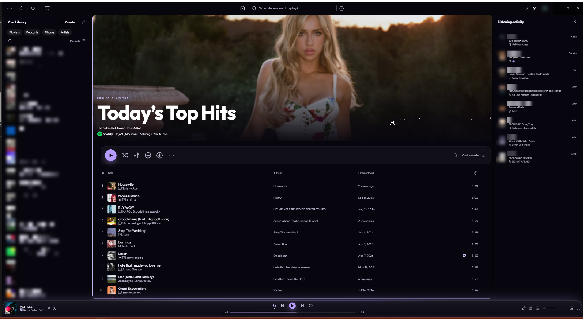
</p>
<table>
  <tr>
    <td width="50%">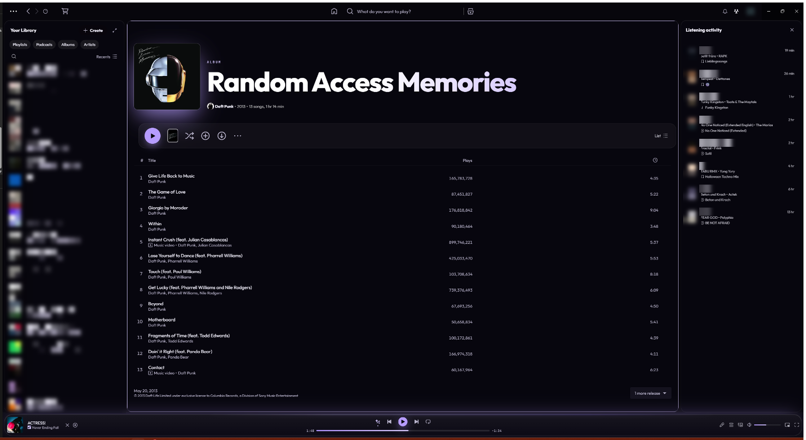</td>
    <td width="50%">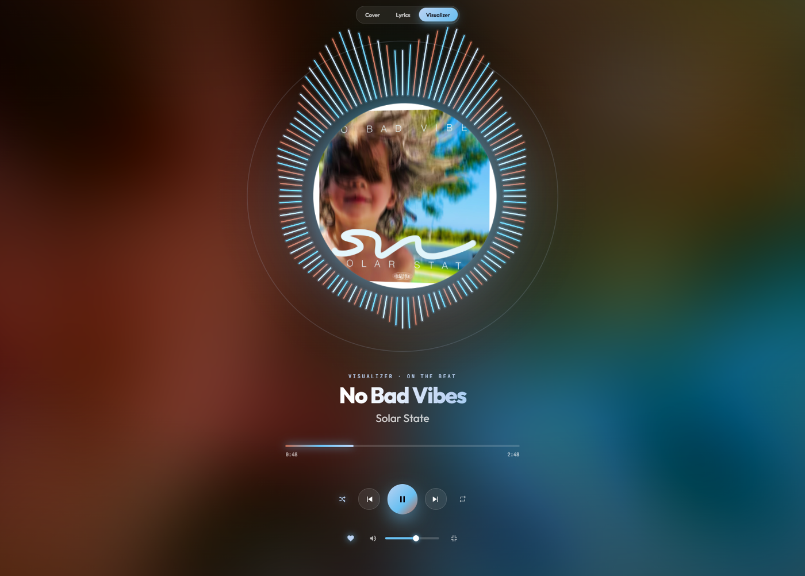</td>
  </tr>
  <tr>
    <td align="center"><sub>Album page – the header melts into the glass</sub></td>
    <td align="center"><sub>Immersive visualizer, coloured live from the cover</sub></td>
  </tr>
</table>
<sub>Real Spotify install. Personal library and friends' names are pixelated.</sub>

## ⬇ Install

**Marketplace (easiest):** open **Marketplace → Themes**, search **Mirage**, install. Done.

**Windows, by script:**

```powershell
git clone https://github.com/Passimoritz/spicetify-mirage
cd spicetify-mirage
powershell -ExecutionPolicy Bypass -File install.ps1            # theme only
powershell -ExecutionPolicy Bypass -File install.ps1 -Overlay   # theme + overlay app
```

Add `-Scheme Obsidian` (or `Sakura`, `Abyss`, `Ember`) for a fixed colour scheme.

<details>
<summary><b>macOS / Linux / by hand</b></summary>

```bash
cp -r Mirage "$(dirname "$(spicetify -c)")/Themes/"
spicetify config current_theme Mirage color_scheme Mirage inject_css 1 replace_colors 1 inject_theme_js 1
spicetify apply
```
</details>

<details>
<summary><b>Uninstall</b></summary>

```bash
spicetify config current_theme marketplace
spicetify apply
```
</details>

Everything is set up in **Profile menu → Mirage settings**. Every effect described below can be switched off there.

## ✦ What it does

<table>
  <tr>
    <td width="33%" valign="top">
      <h3>🎨 Colours from the cover</h3>
      Accent, buttons, progress bar and selection take on the song's palette – tuned so text stays readable on dark glass.
    </td>
    <td width="33%" valign="top">
      <h3>🌫️ Living background</h3>
      The album art drifts behind the interface as slow haze, with aurora bands, light dust and film grain on top.
    </td>
    <td width="33%" valign="top">
      <h3>🥁 On the beat</h3>
      With Spotify's beat data the background and light dust pulse in time. Without it Mirage estimates the tempo itself.
    </td>
  </tr>
  <tr>
    <td valign="top">
      <h3>🃏 3D cards</h3>
      Cards tilt towards the pointer, with a light cone and a glowing edge that follow the mouse.
    </td>
    <td valign="top">
      <h3>✨ Page motion</h3>
      Pages blur in, grids cascade, track rows glide in one after another; the playing row glows.
    </td>
    <td valign="top">
      <h3>💿 Small things</h3>
      The player cover spins like a record, the play button gets a halo, a like sets off a heart burst.
    </td>
  </tr>
</table>

**Colour schemes:** `Mirage` follows the cover live; `Obsidian`, `Sakura`, `Abyss` and `Ember` are fixed palettes for a calmer look, and the settings have a builder for your own.

<p align="center">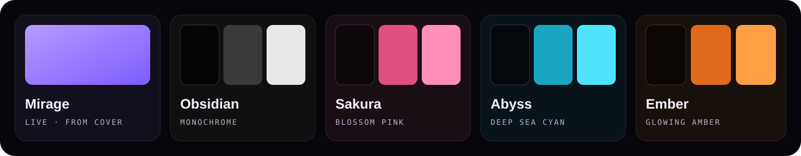</p>

## ◐ Immersive mode

<kbd>Ctrl</kbd>+<kbd>Shift</kbd>+<kbd>M</kbd> or the circle button in the top bar. Five views morph into each other (keys <kbd>1</kbd>–<kbd>5</kbd>):

<table>
  <tr>
    <td width="50%">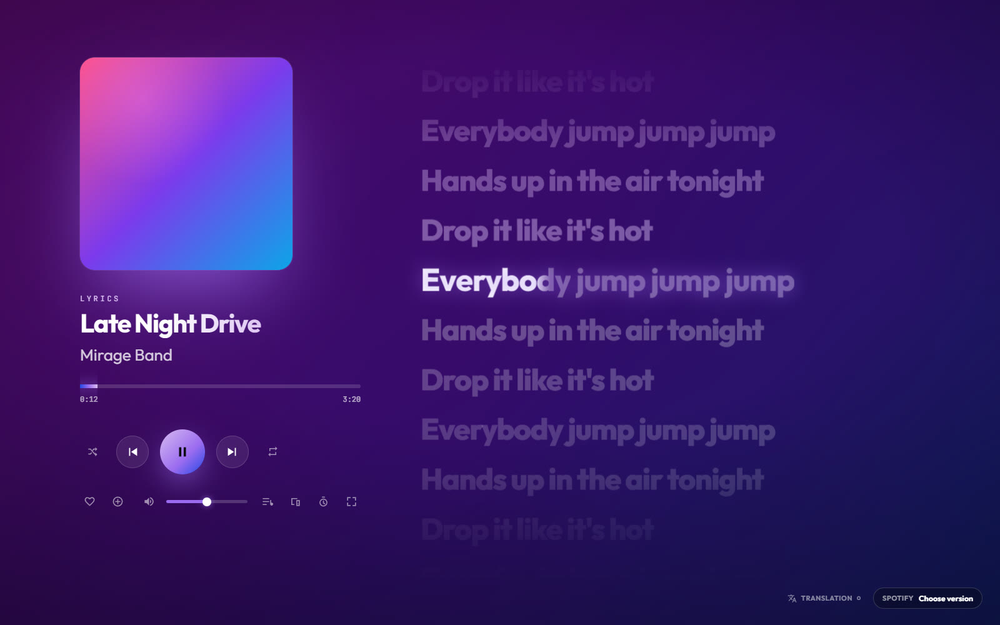</td>
    <td width="50%">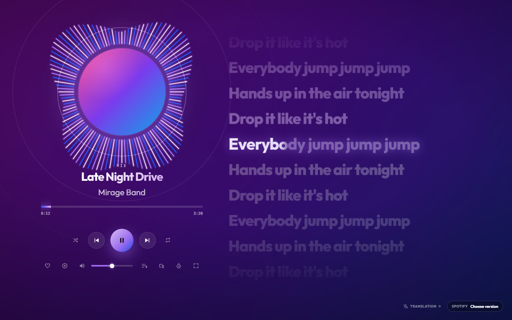</td>
  </tr>
  <tr>
    <td align="center"><sub>Lyrics – karaoke word by word</sub></td>
    <td align="center"><sub>Mix – cover, visualizer ring and lyrics</sub></td>
  </tr>
</table>

| View | What you get |
|---|---|
| **Cover** | Huge cover that tilts with the mouse, title in a colour gradient, full controls |
| **Lyrics** | Synced lyrics with karaoke word by word, click a line to jump there, optional translation |
| **Visualizer** | Radial spectrum around the cover with beat rings |
| **Mix** | Cover, visualizer ring and lyrics at once – the pulse follows the real kick drum |
| **Party** | A light show built for the song – [see below](#-party-mode) |

**No lyrics at Spotify?** Mirage looks on [LRCLIB](https://lrclib.net), NetEase and lyrics.ovh; *Choose version* picks another match. **No beat data?** Mirage borrows tempo and energy from Spotify's audio features or Deezer and estimates the beat from the lyric timing – the kicker then shows *≈ 128 BPM*.

Full screen with the button, <kbd>F</kbd> or <kbd>F11</kbd>. When the mouse rests, the controls fade out.

## 🎉 Party mode

<p align="center">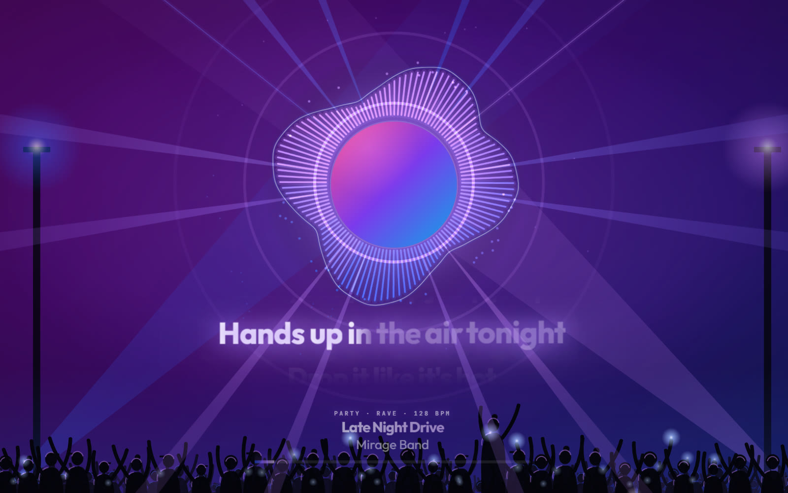</p>
<table>
  <tr>
    <td width="50%">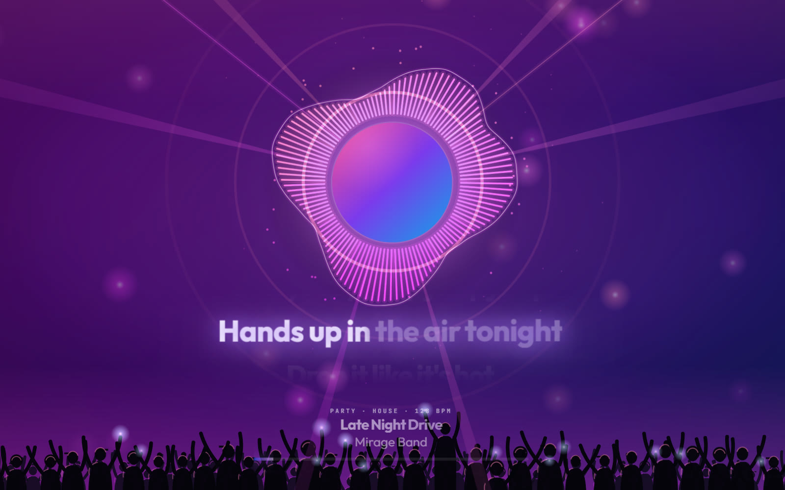</td>
    <td width="50%"></td>
  </tr>
  <tr>
    <td align="center"><sub>House in the club – disco ball, crowd on the beat</sub></td>
    <td align="center"><sub>Visualizer view</sub></td>
  </tr>
</table>

Party mode reads the whole song before it plays: energy curve, build-ups, drops (placed on their beat), breaks, major or minor, and where kick, snare and hi-hats hit. The light is directed from that map, so it reacts to what is coming, not just to what is loud.

**Twenty genres, each with its own light language.** Rave gets crossing beams, techno soft scanner bands, house a disco ball, trance aurora ribbons, drum & bass a tunnel of light rings, hip-hop light from the floor, rock hard spots from above, metal red-hot ones, latin warm sweeps, pop springy colour, chill slow breathing light – plus disco, K-pop, reggae, classical, punk, hardstyle, afro, jazz and country. The genre comes from Apple's iTunes search, Spotify's artist genres and the sound itself.

**It follows the instruments.** The kick drives the pulse and floor light, the snare the spots and flashes, the hi-hats the sparkle; two thin *melody lasers* follow the pitch of the tune.

**It directs moments.**
- **Light director** – calm before the storm: the light holds back before the drop, goes dark on the last beat, then everything hits at once. The final chorus gets the most.
- **Slow motion** – sparks, rings and the crowd freeze for half a second right before the drop.
- **DJ transitions** – on a song change the old colours hold until the first beat, then blend over four beats.

**A crowd and a venue.** Silhouettes in front of the stage move with the genre – they jump and land on the beat, nod, headbang, clap on 2 and 4, sway – start a wave every now and then, lift someone onto their shoulders and fire camera flashes on the drop. The venue follows the genre – club, warehouse, festival, stadium, beach or living room – or is fixed in the settings.

**Stage effects where they belong.** CO2 jets shoot up on the drop in electronic music, pyro flames burn for rock, metal and punk, fireworks go up in the final chorus at the stadium and the festival, and hard techno, hardstyle and rave drops get a strobe (from *Extreme* on, never faster than one flash per beat).

**Five intensity levels** from *Soft* to *Insane*. On top, each switchable: hype lines for choruses and crowd calls, 3D depth, camera rides, lyrics bursting into light on the drop, Jam colours for everyone in a Spotify Jam, and auto-hiding controls.

**Take it further:**

| | |
|---|---|
| 📱 **Live link** | Phones on the same Wi-Fi scan a QR code and flash along as extra lights (needs the overlay app) |
| 🖥️ **Second screen** | Puts party mode full screen on a TV or another monitor |
| 🌈 **Edge light** | The overlay app makes the edges of your desktop glow with the beat |
| 📊 **Party recap** | A shareable card of the night: songs, genre mix, tempo range, the biggest drop |

## ◎ Mirage Overlay

A small companion app that shows song changes **outside of Spotify** – above every window, on the screen you choose. The theme talks to it locally (`127.0.0.1:47321`).

<p align="center">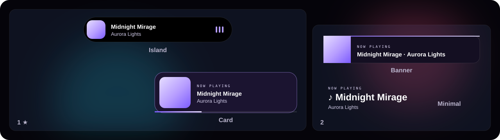</p>

| Windows | macOS | Linux |
|:-:|:-:|:-:|
| [**⬇ Mirage-Overlay-Setup.exe**](https://github.com/Passimoritz/spicetify-mirage/releases/latest/download/Mirage-Overlay-Setup.exe) | [**⬇ Mirage-Overlay.dmg**](https://github.com/Passimoritz/spicetify-mirage/releases/latest/download/Mirage-Overlay.dmg) | [**⬇ AppImage**](https://github.com/Passimoritz/spicetify-mirage/releases/latest/download/Mirage-Overlay.AppImage) · [**⬇ .deb**](https://github.com/Passimoritz/spicetify-mirage/releases/latest/download/Mirage-Overlay.deb) |
| Double-click – it starts and lives in the tray | Drag it into *Applications* | Make the AppImage executable, or `sudo apt install ./Mirage-Overlay.deb` |

Or in Spotify: **Mirage settings → Overlay → Download the Overlay app** (picks the right file and shows whether it is connected).

- **When:** on every song change, permanently as a mini player, or off · on play/pause · quiet hours
- **Where:** main screen, the screen with the mouse, or any screen on a map of your displays · 9 positions · fine offset
- **How:** Island, Card, Banner or Minimal · springy, slide or fade · glow, roundness, size, opacity · controls on hover
- **Extras:** volume bar · stays quiet while a game or video runs full screen · your own look via `custom.css` · OBS browser source (`http://127.0.0.1:47322/`) · edge light and live link for party mode · updates itself (Windows, AppImage)

> **First start:** the installers aren't code-signed yet. Windows: *More info → Run anyway*. macOS: right-click → *Open* → *Open*. When you turn on the live link, Windows asks once whether the app may be reached on your private network.

## 🛠 Fix after a Spotify update

Spotify updates itself every few weeks and overwrites what Spicetify patched. Symptoms: Spotify looks like normal Spotify again, `spicetify apply` complains about a *backup version mismatch* or *Cannot find xpui.spa*, or the window stays black. Nothing is broken – Spicetify just has to re-patch.

**One click (Windows):** <a href="https://github.com/Passimoritz/spicetify-mirage/releases/latest/download/fix-spicetify.cmd"><b>⬇ fix-spicetify.cmd</b></a> · <sub><a href="tools/fix-spicetify.cmd">read the source</a></sub> – closes Spotify, updates Spicetify, makes a fresh backup, re-applies Mirage and your extensions and starts Spotify again. Settings and Marketplace items are kept. (Windows may warn: *More info → Run anyway* – it's a plain text script.)

**By hand (all systems):**

```bash
spicetify upgrade
spicetify restore backup apply
```

Still broken? `spicetify clear` and then `spicetify backup apply`. Right after a big Spotify release Spicetify sometimes needs a few days – wait for the next [Spicetify release](https://github.com/spicetify/cli/releases) and run the fix again. If Mirage itself looks off, use the [bug form for Spotify updates](https://github.com/Passimoritz/spicetify-mirage/issues/new/choose).

## ⌨ Shortcuts

| Where | Key | Action |
|---|---|---|
| anywhere | <kbd>Ctrl</kbd>+<kbd>Shift</kbd>+<kbd>M</kbd> | open / close immersive mode |
| immersive | <kbd>1</kbd> … <kbd>5</kbd> | cover · lyrics · visualizer · mix · party |
| immersive | <kbd>Space</kbd> | play / pause |
| immersive | <kbd>←</kbd> <kbd>→</kbd> · <kbd>↑</kbd> <kbd>↓</kbd> | seek 5 s · volume |
| immersive | <kbd>N</kbd> <kbd>P</kbd> | next · previous |
| immersive | <kbd>L</kbd> <kbd>S</kbd> <kbd>R</kbd> <kbd>Q</kbd> | like · shuffle · repeat · queue |
| immersive | <kbd>F</kbd> / <kbd>F11</kbd> | full screen |
| immersive | <kbd>?</kbd> · <kbd>Esc</kbd> | all shortcuts · close |

## ⚡ Performance

Mirage is built to look alive without eating your CPU.

- **Presets:** *Full*, *Balanced*, *Light* and *Calm* in the settings. *Balanced* draws immersive mode at up to 60 fps (half the work on 120/144 Hz screens) with slightly fewer pixels, *Light* at 30 fps with about 40 % fewer pixels and less detail. If the first seconds run below ~45 fps, Mirage steps down by itself.
- **Party mode adapts:** the stage and crowd are drawn in a background thread that never builds up a backlog, a quality governor fades out back rows before frames drop, and quiet intros and breaks run at 30 fps.
- **Energy saving:** on battery (or always, if you like) everything runs at 30 fps with lighter detail.
- **Pauses when hidden**, and starts in calm mode when your system asks for reduced motion.

## 🔒 Privacy

No own server, no tracking, no account. Lyrics, beat data and audio features come from Spotify. Only when Spotify has nothing: title, artist, album and length go to LRCLIB, NetEase and lyrics.ovh for lyrics, and title and artist to Deezer for tempo and to Apple's iTunes search for the party genre – each can be turned off. The overlay listens only on your own computer; the live link (off by default) opens a page on your local network, protected by a random key in its address, that only receives light colours and the song title. Fonts load from Google Fonts.

## ❓ FAQ

<details>
<summary><b>Mirage is gone after Spotify updated.</b></summary>

Run the [fix](#-fix-after-a-spotify-update) – that's Spicetify, not Mirage.
</details>

<details>
<summary><b>Party mode shows the wrong genre.</b></summary>

Pick the style by hand in **Mirage settings → Party mode**, or keep *Auto* and turn on online genre lookup for better guesses.
</details>

<details>
<summary><b>The phone page does not open.</b></summary>

Phone and PC must be on the same Wi-Fi (not a guest network), the overlay app (1.10 or newer) must be running, and Windows must let *Mirage Overlay* through its firewall – for public networks too, if your network is set to public. If an old copy of the overlay is still running (for example from an old download folder), close it; newer versions take over from older ones by themselves. Turn the live link off and on in the settings to get a fresh QR code.
</details>

<details>
<summary><b>It's too much / my laptop gets warm.</b></summary>

Choose the *Light* or *Calm* preset, set energy saving to *Always*, or lower the party intensity. Every effect has its own switch.
</details>

## ⚙ Under the hood

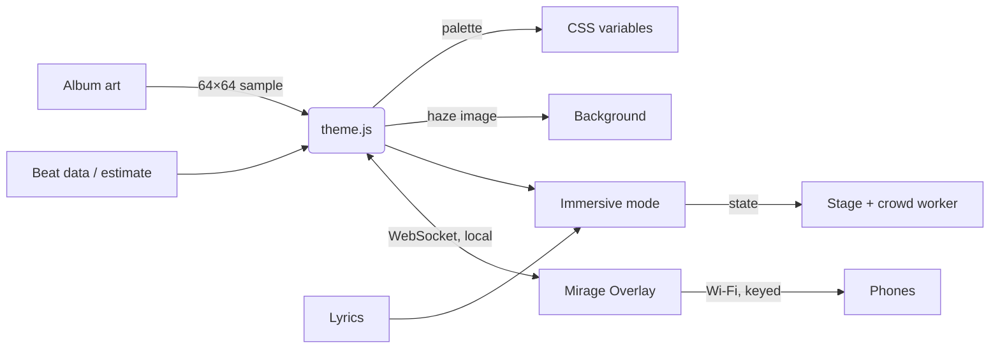

- Colours change in one style update; the background haze is a pre-shrunk image blurred once and only rotated.
- Built against the real Spotify DOM and matched by computed style rather than class names that change every release.
- With the overlay running, the theme can write a layout report (sizes, classes, colours – no content) to `%APPDATA%\Mirage Overlay\dom-report.json` for bug reports.
- 14 languages: English, Deutsch, Français, Español, Italiano, Português, Nederlands, Polski, Türkçe, Русский, Українська, 日本語, 한국어, 中文.

Want to help? See [CONTRIBUTING.md](CONTRIBUTING.md) and the [changelog](CHANGELOG.md). Questions and ideas go to [Discussions](https://github.com/Passimoritz/spicetify-mirage/discussions).

## License

MIT © Passimoritz
